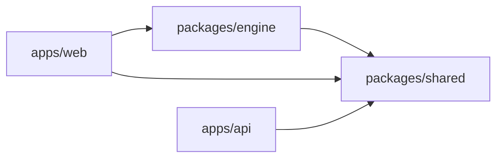
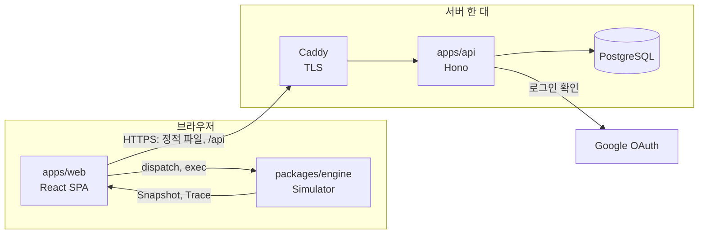
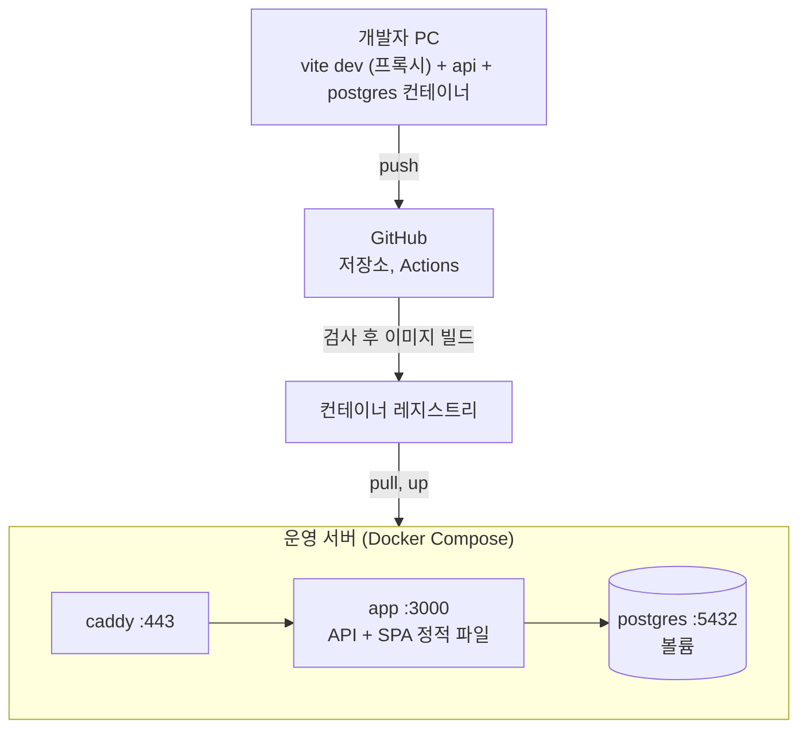
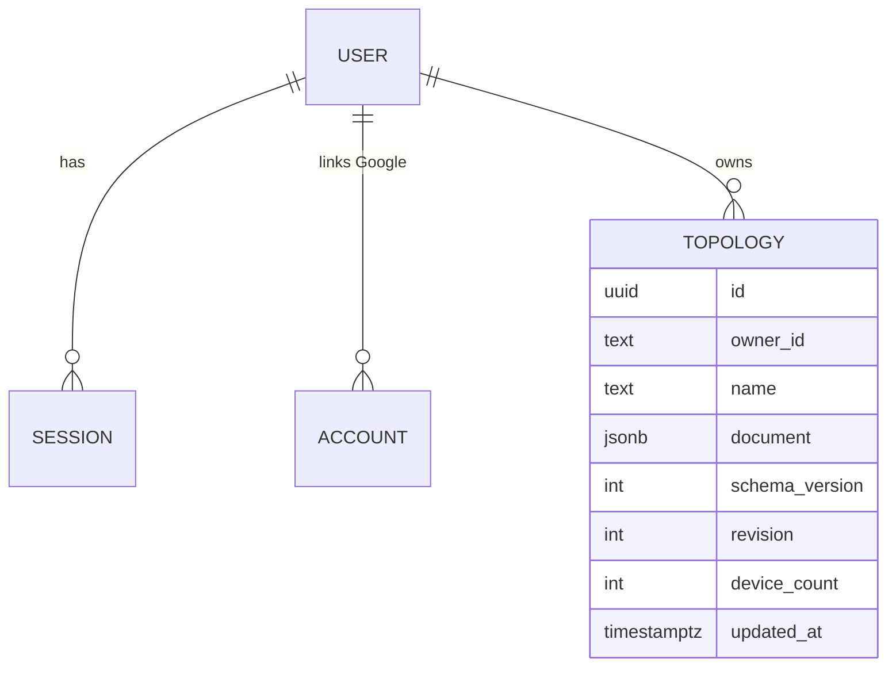

# Architecture Spine — PacketTracer WEB (작업명)

## Design Paradigm

**Functional core / imperative shell.**

| 층 | 위치 | 성격 |
| --- | --- | --- |
| Functional core | `packages/engine` | 순수 TypeScript. 입출력·시계·난수 없음. `(상태, Command) → (상태, 이벤트)` |
| 공유 계약 | `packages/shared` | 스키마, 타입, 코드 열거형, 값 검증 함수, 한도 상수, 계약 확인용 예시 자료 |
| Imperative shell (브라우저) | `apps/web` | React 화면, 저장 요청, 재생 타이머. core를 호출만 함 |
| Imperative shell (서버) | `apps/api` | 인증, 토폴로지 문서 저장. 시뮬레이션을 모름 |

네트워크 동작은 브라우저의 core 안에서만 계산한다. 서버는 문서 저장소다.

## Invariants & Rules



화살표는 "의존해도 된다"는 뜻이다. 그림에 없는 방향은 금지다.

### AD-1 — 시뮬레이션은 브라우저의 engine 안에서만 실행한다 [ADOPTED]

- **Binds:** all
- **Prevents:** 서버에 시뮬레이션 로직이나 장비 실행 환경이 생기는 것
- **Rule:** `packages/engine`은 DOM, React, Node API, 네트워크 입출력을 import하지 않는다. `apps/api`는 `packages/engine`을 import하지 않는다.

### AD-2 — 의존 방향은 위 그림으로 고정한다

- **Binds:** all
- **Prevents:** 패키지 간 순환 의존, engine이 화면 코드에 묶이는 것
- **Rule:** `shared`는 아무것도 의존하지 않는다. `engine`은 `shared`만, `api`는 `shared`만, `web`은 `engine`과 `shared`를 의존한다. 각 패키지의 `package.json`에는 허용된 workspace 패키지만 적고, ESLint의 import 제한 규칙으로 한 번 더 막는다.

### AD-3 — Document를 바꾸는 경로는 `Simulator.dispatch(Command)` 하나다

- **Binds:** FR-9..FR-18, FR-22, FR-25..FR-27, FR-31..FR-35
- **Prevents:** 캔버스, 설정 패널, CLI가 구성을 서로 다른 경로로 바꿔 값이 어긋나는 것, 같은 실수에 다른 오류가 나오는 것
- **Rule:**
  - `Command`는 Document를 바꾸는 요청만 뜻한다. `ping`, `arp -d`, `show`처럼 Runtime만 건드리거나 읽는 동작은 `ConsolePort.exec`로 한다 (AD-8).
  - 화면 컴포넌트와 CLI 핸들러는 `Command`를 만들어 `dispatch`할 뿐 Document를 직접 고치지 않는다. 같은 변경은 출처가 어디든 같은 `Command` 타입을 쓴다.
  - `dispatch`의 결과는 `{ ok: true, notices: Notice[] } | { ok: false, error: { code, params } }`다. 경고성 알림(중복 IP, 자동으로 만들어진 VLAN)은 `notices`로 전달한다.
  - 값 하나의 형식 검증(IPv4, 마스크, VLAN 번호, 포트 이름, 장비 이름)은 `shared`의 값 검증 함수 하나를 CLI 해석기와 reducer가 함께 쓴다. 토폴로지 전체에 걸친 검증(겹치는 네트워크, 중복 이름, 한도)은 reducer에서만 한다.
  - 장비의 기본 이름(`PC1`, `SW1`, `R1`)은 reducer가 종류별로 비어 있는 가장 작은 번호로 붙인다.

### AD-4 — 상태는 네 종류이고 소유자가 하나씩이다

- **Binds:** FR-5, FR-6, FR-10, FR-19, FR-28, FR-29, FR-40, FR-41, FR-44
- **Prevents:** 동적 상태가 저장 문서에 섞이는 것, 화면이 엔진 상태를 직접 고치는 것, 같은 값을 두 곳이 들고 있는 것
- **Rule:**

| 상태 | 내용 | 소유자 | 저장 |
| --- | --- | --- | --- |
| Document | 장비, 위치, 링크, 구성 | engine reducer | 서버에 저장 |
| Runtime | MAC 주소 테이블, ARP 테이블, 가상 시계, 장비별 CLI 세션(모드, 대상) | engine kernel | 저장 안 함 |
| Trace 목록 | 최근 Trace 20개 | engine | 저장 안 함 |
| UI | 선택, 열린 콘솔 탭, 콘솔 화면 기록과 입력 이력, 재생 위치, 패널 상태 | web store | 저장 안 함 |

  - web은 Document, Runtime, Trace를 읽기만 한다.
  - Document를 여는 순간 Runtime과 Trace 목록은 빈 상태로 새로 만든다.
  - 장비 위치의 원본은 Document다. 끄는 동안의 위치는 캔버스의 임시 상태이고, 놓는 순간 `device/move`를 한 번 낸다.
  - Document가 바뀌면 reducer가 영향받는 Runtime 항목을 정리한다 (`DeviceModel.onConfigChanged`).
  - 테이블 패널은 항상 현재 Runtime을 보여 준다. 재생 위치에 따라 테이블을 되돌리지 않는다.
  - web은 스냅샷이 바뀔 때 UI 상태가 가리키는 ID가 사라졌으면 그 UI 상태를 비운다.

### AD-5 — engine은 결정적이다

- **Binds:** NFR-11, FR-28..FR-30, FR-38, FR-41
- **Prevents:** 같은 입력에서 다른 추적이 나와 테스트와 재생이 흔들리는 것
- **Rule:**
  - engine 안에서 `Date.now`, `Math.random`, `crypto.randomUUID`, `setTimeout`, `setInterval`을 쓰지 않는다.
  - 시간은 정수 마이크로초 단위의 가상 시계다. kernel이 소유하고, Document를 열 때 0으로 시작해 Trace를 넘어 계속 증가한다. 사건은 `(가상 시각, 순번)` 순으로 처리한다.
  - 장비와 링크의 ID는 web이 `crypto.randomUUID()`로 만들어 `Command`에 담아 넘긴다.
  - MAC 주소는 저장하지 않는다. engine의 함수 하나가 장비 ID와 포트 순번에서 계산한다.

### AD-6 — Trace는 완성된 기록이고 재생은 읽기 전용이다

- **Binds:** FR-39..FR-42, FR-47
- **Prevents:** 캔버스 애니메이션, 이벤트 목록, 프레임 보기가 따로 계산되어 어긋나는 것, 재생이 장비 상태를 바꾸는 것
- **Rule:**
  - 통신 1회의 계산이 끝나면 완성된 `Trace`가 나온다: `{ id, docVersion, events, result: { status, primaryDropSeq? } }`. `id`는 engine의 증가 번호다.
  - 이벤트 하나는 **프레임 하나가 한 곳에 있는 순간**이다: `{ seq, time, frameId, parentSeq?, deviceId, inPort?, outPort?, linkId?, action, reason: { code, params }, frame, dropReason? }`. `time`은 Trace 시작부터의 가상 시간이다.
  - flooding으로 N개 포트에 나가면 이벤트도 N개다.
  - 재생의 한 단계는 **같은 `time`을 가진 이벤트의 묶음**이다. 이벤트 목록은 이벤트를 하나씩 나열한다.
  - 정상적인 폐기(`NOT_FOR_ME`)와 실패 원인을 구분하기 위해, 실패한 Trace는 원인 이벤트의 `seq`를 `primaryDropSeq`에 담는다.
  - 재생 화면은 `(Trace, 단계 번호, 현재 Document의 위치)`만으로 그리고 engine을 호출하지 않는다. Trace가 가리키는 장비나 링크가 현재 Document에 없으면 그 Trace를 "토폴로지가 바뀜"으로 표시하고 캔버스 재생을 막는다.
  - 이벤트 스키마, `action` 열거형, 폐기 사유 열거형은 `shared`에 하나만 둔다.

### AD-7 — 장비는 `DeviceModel` 인터페이스 뒤에 있고, 화면에 보일 값은 engine이 계산한다

- **Binds:** FR-15..FR-18, FR-28..FR-37, FR-43, FR-44
- **Prevents:** 장비 종류별 동작이 kernel과 화면에 퍼지는 것, 포트 상태를 화면과 엔진이 다르게 판정하는 것
- **Rule:**
  - kernel은 장비 종류로 분기하지 않고 `DeviceModel`(프레임 수신, 타이머, 구성 변경 알림, 표시용 값 조회)만 호출한다.
  - web은 **표현**(아이콘, 입력 양식, 표의 열)에 한해서만 `kind`로 분기한다. 표시할 값은 모두 `DeviceModel.view()`가 돌려주는 `DeviceView`에서 가져온다. `DeviceView`는 `kind`로 구분되는 타입이고 `shared`에 정의한다.
  - 포트 상태는 `up | admin-down | no-link | peer-down` 네 가지이고 engine만 계산한다.

### AD-8 — CLI는 선언적 명령 트리 하나에서 나오고, 콘솔 경계의 형태는 고정이다

- **Binds:** FR-19..FR-24, FR-38, FR-46
- **Prevents:** 도움말·자동 완성과 실제 해석기가 어긋나는 것, `show running-config` 출력을 다시 입력했을 때 다른 구성이 되는 것, web이 명령어 일치 로직을 다시 만드는 것
- **Rule:**
  - 명령어는 `{모드, 단어 열, 매개변수 타입, 설명, 핸들러, 직렬화}` 정의의 목록으로만 추가한다. 해석, 축약 판정, Tab 완성, `?` 도움말, `show running-config` 출력은 모두 이 목록에서 계산한다.
  - 콘솔 경계는 `ConsolePort = { prompt(), exec(line): Promise<ConsoleResult>, complete(line), help(line) }`다.
  - `ConsoleResult = { lines: ConsoleLine[], prompt }`이고, `ConsoleLine`은 `text | error { code, params, position? } | notice { code, params } | trace { traceId }` 중 하나다.
  - 장비 하나에 CLI 세션은 하나다. 모드와 프롬프트는 engine이, 화면 기록과 입력 이력은 web이 소유한다 (AD-4).
  - 구성을 바꾸는 명령어의 핸들러는 `Command`를 만들어 `dispatch`하고, 그 결과의 오류와 알림을 `ConsoleLine`으로 옮긴다. 콘솔이 더하는 것은 `position`뿐이다.

### AD-9 — Document의 형태와 유효성은 `shared`의 한 곳에서 정의한다

- **Binds:** FR-5..FR-8, NFR-6
- **Prevents:** web, api, engine이 서로 다른 문서를 유효하다고 보는 것, 스키마는 통과하지만 열면 깨지는 파일, 옛 파일을 못 여는 것
- **Rule:**
  - `shared`의 `validateDocument()`가 유일한 검증 함수다. 스키마에 더해 참조와 유일성(링크 끝의 장비와 포트가 실제로 있음, 포트 하나에 링크 하나, 이름 중복 없음, 한도)을 확인한다. web의 가져오기, api의 저장, engine의 불러오기가 모두 이 함수를 쓴다.
  - reducer가 만든 Document는 항상 `validateDocument()`를 통과해야 하며, 속성 기반 테스트로 확인한다.
  - `schemaVersion`의 원본은 Document 안의 값이다. 데이터베이스의 열은 api가 문서에서 옮겨 적은 사본이다.
  - 형태를 바꾸면 `schemaVersion`을 올리고 변환 함수 `migrateDocument()`를 `shared`에 넣는다. 변환은 web이 열거나 가져올 때 `Simulator.load` 전에 한다. api는 현재 버전의 문서만 받는다.
  - 포트 참조는 `{ deviceId, port }`이고 `port`는 전체 이름이다. 링크는 `{ id, ends: [PortRef, PortRef] }`이며 방향이 없다.
  - 토폴로지 이름은 Document 밖(행)에 있다. 내보낸 파일은 `{ kind: "topology-export", name, document }` 형태다.
  - `shared`에 예시 Document와 그에 대한 기대 Trace를 두고, engine 테스트와 web 테스트가 같은 자료를 쓴다.

### AD-10 — 서버는 Document를 통째로 저장하고 `revision`으로 충돌을 막는다

- **Binds:** FR-2, FR-5, FR-6, NFR-5, NFR-7
- **Prevents:** 두 탭이 서로의 변경을 소리 없이 덮어쓰는 것, 저장 요청이 자기 자신과 충돌하는 것, 부분 수정 API가 늘어나는 것
- **Rule:**
  - 토폴로지 하나는 JSONB 문서 하나다. 서버는 내용을 해석하거나 병합하지 않고 `validateDocument()`만 한다.
  - `revision`은 행에만 있고 Document 안에는 없다. 1에서 시작하고, 서버만 올리며, 모든 쓰기 응답에 담아 돌려준다. 저장 요청은 읽어 온 `revision`을 함께 보내고, 서버의 값과 다르면 서버는 409를 돌려주고 저장하지 않는다.
  - web의 저장 관리는 한 번에 요청 하나만 보낸다. 요청 중에 생긴 변경은 응답을 받은 뒤 새 `revision`으로 보낸다.
  - 409를 받으면 자동 저장을 멈추고 사용자에게 고르게 한다: 서버의 것을 다시 불러오기, 또는 내 것을 사본으로 저장하기. 덮어쓰기는 제공하지 않는다.
  - 401을 받으면 `{ userId, topologyId, baseRevision, document }`를 IndexedDB에 보관하고, 다시 로그인한 뒤 이어서 저장한다. 현재 사용자의 초안만 이어 저장하고, 로그아웃하면 지운다.

### AD-11 — 소유자 확인은 저장소 계층에서 강제한다

- **Binds:** FR-3, FR-4, NFR-8
- **Prevents:** 엔드포인트 하나에서 소유자 확인을 빠뜨려 남의 토폴로지가 열리는 것
- **Rule:** 토폴로지를 읽고 쓰는 쿼리는 저장소 모듈 한 곳에만 있고, 모든 함수가 `ownerId`를 필수 인자로 받아 조건에 넣는다. 라우트 핸들러는 데이터베이스에 직접 접근하지 않는다. 남의 토폴로지 요청에는 404를 돌려준다.

### AD-12 — 같은 출처로 배포하고 세션은 서버 측 쿠키 세션이다

- **Binds:** FR-1, FR-2, NFR-8
- **Prevents:** 화면과 API의 출처가 달라 생기는 CORS·쿠키 설정 분기, 토큰을 브라우저 저장소에 두는 것, 라이브러리 기본값에 기댄 쿠키 설정
- **Rule:**
  - 하나의 출처에서 SPA 정적 파일과 `/api`를 함께 제공한다. 로컬 개발에서도 개발 서버의 프록시로 같은 출처를 유지한다. 다른 출처의 요청을 허용하지 않는다.
  - 세션 식별자는 쿠키에만 있다. 운영 환경의 쿠키 속성 `HttpOnly`, `Secure`, `SameSite=Lax`는 인증 라이브러리의 기본값에 기대지 않고 설정에 명시하며, 응답 헤더를 확인하는 테스트를 둔다.
  - 인증 라이브러리의 기준 주소는 환경 변수 `APP_URL`에서 온다.
  - 브라우저의 저장소에 인증 정보를 두지 않는다.

### AD-13 — MVP에는 실시간 채널이 없다

- **Binds:** all
- **Prevents:** 필요 없는 WebSocket 인프라, 서버를 거치는 콘솔
- **Rule:** 브라우저와 서버 사이는 HTTPS 요청·응답만 쓴다. WebSocket이나 SSE는 서버에서 실행되는 장비를 도입할 때 새 AD로 추가한다.

### AD-14 — 오류와 설명은 `{ code, params }` 하나의 형태로 전달하고 문구는 web이 만든다

- **Binds:** FR-45..FR-47
- **Prevents:** 한국어 문구가 engine과 api에 흩어지는 것, 오류 형식이 출처마다 다른 것, 매개변수 이름이 어긋나는 것
- **Rule:**
  - engine의 오류·알림·이벤트 설명(`reason`), api의 오류는 모두 `{ code, params }`다. api의 HTTP 응답 본문은 `{ "error": { "code", "params" } }`다.
  - `shared`가 코드마다 `params`의 타입을 정의한다. web의 메시지 카탈로그는 모든 코드를 빠짐없이 다루는 `Record<Code, (params) => string>`이다.
  - 장비를 가리키는 `params`에는 ID와 그 시점의 이름을 함께 담는다.
  - engine과 api의 코드에는 사용자에게 보일 문장을 쓰지 않는다. CLI의 영어 출력(`show` 결과, `ping` 결과)은 예외이며 engine이 만든다.

### AD-15 — 서버 로그는 구조적이고 민감한 값을 담지 않는다

- **Binds:** NFR-8, NFR-9
- **Prevents:** 로그에 개인정보와 인증 정보가 남는 것, 요청을 추적할 수 없는 것
- **Rule:** api는 요청마다 요청 ID를 붙여 JSON 한 줄 로그를 표준 출력에 쓴다. Document 본문, 세션 쿠키, OAuth 토큰, 이메일은 로그에 쓰지 않는다. 사용자는 내부 사용자 ID로만 기록한다.

### AD-16 — web과 engine의 경계는 동기식 `Simulator` 하나이고, 오가는 값은 변경 불가능한 단순 자료다

- **Binds:** all (web과 engine이 만나는 모든 곳)
- **Prevents:** 엔진은 제자리에서 고치는데 화면은 새 참조를 기대하는 것, 두 사람이 경계의 형태를 각자 추측하는 것
- **Rule:**
  - web은 engine에서 `Simulator`만 import한다: `load(document)`, `dispatch(command)`, `console(deviceId)`, `getSnapshot()`, `getTrace(traceId)`, `subscribe(listener)`.
  - `getSnapshot()`은 `{ document, docVersion, runtimeVersion, views, traces }`를 돌려준다. 값은 변경 불가능한 단순 JSON 자료다(클래스 인스턴스, 함수, `Map` 없음).
  - `Command`가 받아들여졌을 때만 `document`의 참조가 바뀌고 `docVersion`이 1 오른다. Runtime이나 Trace 목록이 바뀌면 `runtimeVersion`이 오른다.
  - `dispatch`와 읽기는 동기식이다. engine은 화면과 같은 스레드에서 실행한다. 비동기인 것은 `ConsolePort.exec`뿐이다.
  - engine은 사용자 입력 때문에 예외를 던지지 않는다. 잘못된 입력은 결과 값으로 돌려준다.
  - NFR-2(장비 30대에서 ping 1회 계산 100ms 이내)를 CI의 성능 테스트로 확인한다.

## Consistency Conventions

| Concern | Convention |
| --- | --- |
| 이름: 파일 | kebab-case (`mac-table.ts`). 테스트는 같은 폴더의 `*.test.ts` |
| 이름: 타입과 함수 | 타입 PascalCase, 함수와 변수 camelCase. 식별자는 영어 |
| 이름: Command | `영역/동작` 문자열 (`device/add`, `link/remove`, `interface/set-ip`, `vlan/create`) |
| 이름: 이벤트 동작 | `shared`의 열거형: `create`, `receive`, `learn`, `forward`, `reply`, `drop` |
| 이름: 포트 | PC `Ethernet0`, Switch `FastEthernet0/1`~`0/8`, Router `GigabitEthernet0/0`~`0/3`. Document와 `PortRef`에는 항상 전체 이름 |
| 이름: 장비 | 영문자, 숫자, `-`, `_`. 1~32자. 토폴로지 안에서 중복 없음 |
| ID | 장비와 링크는 web이 `crypto.randomUUID()`로 만듦. 토폴로지 ID는 서버가 UUID로 만듦. Trace ID는 engine의 증가 번호 |
| 날짜 | API와 데이터베이스는 UTC, API 응답은 ISO 8601 문자열 |
| 가상 시간 | 정수 마이크로초. 링크 한 구간 지연 1,000 |
| JSON | API와 Document는 camelCase. 데이터베이스 열은 snake_case |
| IP 주소 | Document에는 점으로 구분한 문자열(`192.168.1.10`). 계산은 engine 안에서 숫자로 변환 |
| MAC 주소 | 저장하지 않음. 표시는 `02:00:00:00:00:01` 형태의 소문자 |
| 화면 문구 | 한국어, web의 메시지 카탈로그 한 곳. CLI 명령어와 출력은 영어 |
| 설정 | api는 환경 변수만 읽고, 시작할 때 스키마로 검증해 빠진 값이 있으면 실행하지 않음 |
| 인증 확인 | `/api/auth/*`와 `/api/health`를 제외한 모든 `/api` 경로는 세션 미들웨어를 거침 |
| 데이터베이스 변경 순서 | 인증 라이브러리의 스키마 생성 → Drizzle Kit 마이그레이션 생성 → 적용 |

## Stack

2026-11-05에 npm registry와 각 프로젝트의 배포 목록에서 **버전 번호와 패키지 간 요구 범위**를 확인했다. 함께 실행해 본 것은 아니다.

| Name | Version |
| --- | --- |
| Node.js | 24.22.2 |
| TypeScript | 6.0.3 |
| pnpm (workspace) | 12.16.1 |
| ESLint | 10.14.0 |
| typescript-eslint | 8.72.1 |
| React, React DOM | 19.3.1 |
| Vite | 8.3.5 |
| @vitejs/plugin-react | 6.2.1 |
| @xyflow/react | 12.12.1 |
| @xterm/xterm | 6.0.0 |
| @xterm/addon-fit | 0.11.0 |
| Zustand | 5.0.16 |
| React Router | 8.5.1 |
| Tailwind CSS, @tailwindcss/vite | 4.3.4 |
| Zod | 4.6.7 |
| Hono | 4.13.16 |
| @hono/node-server | 2.1.6 |
| better-auth, @better-auth/drizzle-adapter | 1.7.17 |
| Drizzle ORM | 0.45.4 |
| Drizzle Kit | 0.31.11 |
| pg | 8.23.1 |
| PostgreSQL | 18.6 |
| pino | 10.4.0 |
| Vitest | 5.1.0 |
| fast-check | 4.10.2 |
| Playwright Test | 1.64.1 |
| Caddy | 2.11.9 |
| Docker Compose | 5.7.0 |

## Structural Seed

### 구성 요소



### 배포와 환경



환경은 로컬과 운영 두 개다. `postgres`는 호스트 밖으로 포트를 열지 않는다.

### 저장 데이터



`USER`, `SESSION`, `ACCOUNT`, `VERIFICATION` 테이블과 그 열은 인증 라이브러리가 정한다. `owner_id`의 타입은 그 라이브러리가 만든 `user.id`의 타입을 따른다.

### 소스 트리

```text
/
  apps/
    web/          # React SPA: 화면, web store, 저장 관리, 메시지 카탈로그, API 클라이언트
    api/          # Hono: 인증, 토폴로지 저장소, 미들웨어
  packages/
    shared/       # Document 스키마와 validateDocument, 값 검증 함수, Command·이벤트·코드 타입, 한도, 예시 자료
    engine/       # Simulator, reducer, kernel, DeviceModel(pc, switch, router), 프로토콜 모듈, CLI 명령 트리
  deploy/         # Dockerfile, compose 파일, Caddyfile
  docs/           # 프로젝트 계획서
```

## Capability → Architecture Map

| Capability / Area | Lives in | Governed by |
| --- | --- | --- |
| 계정 (FR-1, FR-2) | `apps/api` 인증, `apps/web` 로그인 화면 | AD-12, AD-15 |
| 토폴로지 관리 (FR-3..FR-8) | `apps/api` 토폴로지 저장소, `apps/web` 목록 화면, `shared` 스키마 | AD-9, AD-10, AD-11 |
| 편집기 (FR-9..FR-14) | `apps/web` 캔버스, `engine` reducer | AD-3, AD-4, AD-16 |
| 장비 (FR-15..FR-18) | `engine` DeviceModel 구현 | AD-7 |
| 콘솔과 CLI (FR-19..FR-24) | `engine` CLI 명령 트리, `apps/web` 콘솔 화면 | AD-8, AD-14 |
| IP 설정 (FR-25..FR-27) | `engine` reducer, `shared` 값 검증, `apps/web` 설정 패널 | AD-3 |
| Switching, ARP, 루프 보호 (FR-28..FR-30) | `engine` 프로토콜 모듈, kernel | AD-5, AD-7 |
| VLAN (FR-31..FR-33) | `engine` 프로토콜 모듈 | AD-7, AD-8 |
| Routing, ICMP (FR-34..FR-37) | `engine` 프로토콜 모듈 | AD-5, AD-7 |
| ping (FR-38) | `engine` DeviceModel, CLI 명령 트리 | AD-5, AD-8 |
| 추적과 재생 (FR-39..FR-42) | `engine` Trace 생성, `apps/web` 재생 화면 | AD-6 |
| 상태 표시 (FR-43, FR-44) | `engine`의 `DeviceView`, `apps/web` | AD-4, AD-7 |
| 오류 피드백 (FR-45..FR-47) | `shared` 코드, `apps/web` 메시지 카탈로그 | AD-14 |
| 저장 유실 방지 (FR-2, FR-5) | `apps/web` 저장 관리 | AD-10 |

## Deferred

| 미룬 결정 | 미뤄도 되는 이유 |
| --- | --- |
| engine을 Web Worker로 옮길지 | AD-16을 바꾸는 결정이며 web의 호출부 수정이 따른다. CI의 성능 테스트가 기준을 넘길 때 다시 다룬다. 경계를 오가는 값이 단순 자료이므로(AD-16) 옮길 수는 있다 |
| 편집 되돌리기·다시 실행 | AD-3의 Command 기록 위에 얹을 수 있다. MVP 범위 밖 |
| 서버에서 실행되는 장비와 실시간 채널 | 콘솔 경계가 비동기라는 점(AD-8)만 지금 고정한다. 프레임 단위 연동은 미검증이며 3차에 새 AD로 다룬다 |
| 화면 구성과 디자인 체계 | 화면 간 계약은 AD-3, AD-4, AD-6, AD-16으로 충분하다. 세부는 구현하면서 정한다 |
| 준비 환경(staging) | 3인·4주 규모에서는 로컬 확인으로 대신한다 |
| 지표 수집, 화면 오류 수집 | MVP는 서버 로그(AD-15)만 쓴다 |
| 백업의 외부 보관 위치와 암호화 키 보관자 | 암호화한 사본을 서버 밖에 두는 것 자체는 출시 조건이다. 위치와 키 보관자만 팀이 출시 전에 정한다 |
| 요청 빈도 제한의 수치 | 미들웨어 자리만 두고 수치는 운영하며 조정한다 |
| 계정 삭제 화면 | MVP는 운영자가 수동으로 처리한다 (NFR-9) |
| 도메인 이름과 TLS 발급 경로 | 미결정. 배포 위치와 함께 1주차에 정한다 |
