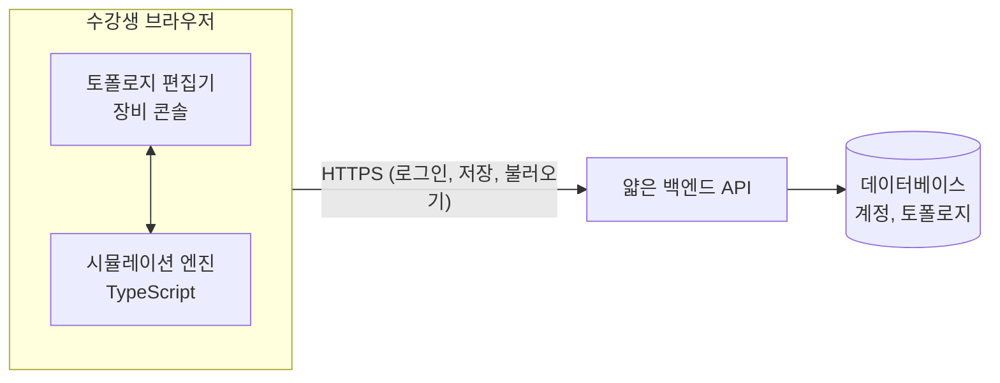
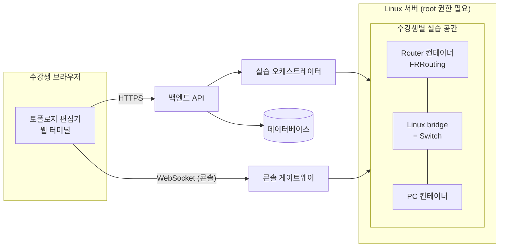
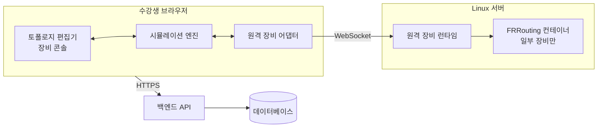

# 1. 기술 검증 (Technical Validation)

- 작성 기준일: 2026-11-05
- 상위 문서: [README.md](README.md) · 이전 문서: [00-current-state.md](00-current-state.md)
- 사용한 워크플로: BMad `bmad-deep-recon` (technical, 후보 중 선택 형태)
- 조사 원자료: `_bmad-output/planning-artifacts/research/technical-web-network-simulator-engine-2026-11-05/` (출처별 요약 `digests/`, 조사 보고서 `research.md`)

> **이 문서의 검증 범위**
> 공개 문서와 저장소를 웹으로 조사해 확인한 내용입니다. 이번 단계는 문서만 작성하므로 **컨테이너를 실제로 띄워 보거나 메모리를 측정하는 실행 검증은 하지 않았습니다.** 실행해야만 알 수 있는 항목은 ⚠️ 미검증으로 표시하고 [1.9절](#19-검증되지-않은-사항과-후속-확인)에 모았습니다.
> 본문의 `[n]`은 문서 끝 [출처](#출처) 번호입니다. 신뢰도가 "높음"이 아닌 주장에는 신뢰도를 함께 적었습니다.

## 1.1 결론 요약

**추천: MVP는 브라우저 중심 시뮬레이션(자체 엔진)으로 만들고, 실행 엔진의 경계를 분리해 두어 나중에 서버 에뮬레이션 장비를 추가할 수 있게 합니다.**

추천을 결정한 근거는 세 가지입니다.

1. **서버 에뮬레이션은 3인이 4주 안에 안전하게 만들기 어렵습니다.** 수강생이 조작하는 컨테이너에 `NET_ADMIN` 권한을 줘야 하고 [34], 실습별 네트워크 분리·외부 차단·자원 제한·콘솔 인증을 모두 직접 만들어야 합니다 [35][40][41]. 기존 실습 플랫폼(containerlab, GNS3)은 신뢰할 수 있는 운영자를 전제로 하므로 그대로 얹을 수도 없습니다 [10][11][12]. 무료로 쓸 수 있는 서버(Oracle Cloud Always Free, 메모리 12GB)가 있어 비용만으로 탈락하지는 않습니다 [47].
2. **화이트보드의 VyOS 1.3.5는 쓸 수 없습니다.** 1.3.x 계열은 지원이 끝났습니다 [23]. 지원되는 1.4 이상은 문서상 최소 사양이 인스턴스당 RAM 4GB입니다 [24][44].
3. **참고 대상인 Cisco Packet Tracer도 같은 방식입니다.** Cisco의 도움말은 Packet Tracer가 단순화한 프로토콜 모델을 쓰고 실제 장비 기능의 일부만 지원한다고 설명합니다 [1]. 브라우저 전용 교육용 시뮬레이터의 공개 선례(GEduNet, MIT 라이선스)도 있습니다 [2].

단서는 두 가지입니다.

- **프로토콜을 전부 직접 구현해야 합니다.** Dynamic Routing, NAT, VPN은 기능마다 구현 비용이 들고, 실제 장비와 동작이 다를 수 있습니다.
- **4주는 빠듯합니다.** 선례인 GEduNet은 4명이 약 9.5개월 동안 ARP, MAC 학습, Static Routing, ICMP, TCP를 구현했고 VLAN은 넣지 못했습니다 [2][54]. MVP 범위를 좁게 잡고 1주차에 구현 속도를 확인해야 합니다.

함께 추천하는 두 가지입니다.

- **CLI 문법**: 업계에서 널리 쓰이는 계층형 명령어 형식(`enable` → `configure terminal` → `interface ...`)의 부분집합을 자체 구현합니다. Cisco의 도움말·출력 문구를 그대로 베끼지 않고, "IOS"라는 단어를 제품 표기에 쓰지 않습니다. 근거는 [1.5절](#15-라이선스와-상표)에 있습니다.
- **제품 이름**: "PacketTracer"는 내부 작업명으로만 쓰고, 공개되는 이름·도메인·저장소 이름에는 쓰지 않는 것을 권합니다. 근거는 [1.5절](#15-라이선스와-상표)에 있습니다.

## 1.2 Simulation과 Emulation의 차이

| 구분 | Simulation (시뮬레이션) | Emulation (에뮬레이션) |
|---|---|---|
| 정의 | 장비와 프로토콜의 **동작을 흉내 내는 모델**을 직접 작성해 실행 | **실제 네트워크 소프트웨어**(라우팅 데몬, 운영체제)를 가상 환경에서 그대로 실행 |
| 실행되는 것 | 우리가 작성한 코드 (예: ARP 테이블, 라우팅 테이블 조회 로직) | FRRouting, VyOS, Linux 커널 네트워크 스택 등 |
| 패킷 | 프로그램 안의 데이터 객체 | 가상 인터페이스를 실제로 오가는 프레임 |
| 동작 충실도 | 구현한 만큼만. 구현하지 않은 기능은 없음 | 실제 소프트웨어와 동일 |
| 자원 소비 | 낮음. 브라우저 한 탭에서 실행 가능 | 장비 한 대마다 프로세스·컨테이너·VM이 필요 |
| 구현 부담 | 프로토콜마다 직접 구현 | 프로토콜은 그대로 얻지만, 실행 환경 구성·격리·연결을 구현 |
| 시각화 | 패킷 이동을 단계별로 멈추고 보여 주기 쉬움 | 실제 트래픽을 캡처해서 해석해야 함 |
| 대표 도구 | Cisco Packet Tracer [1], GEduNet [2], Filius | GNS3 [12][13], containerlab [8], EVE-NG [17], Kathará |

화이트보드의 분류는 조사 결과와 일치합니다. Packet Tracer는 Simulator 쪽이고 [1], GNS3는 QEMU·Dynamips·Docker 같은 에뮬레이터를 구동하는 Emulator 쪽입니다 [13].

## 1.3 세 가지 구조 비교

### A. 브라우저 중심 시뮬레이션

- 네트워크 동작 계산이 모두 수강생의 브라우저에서 일어납니다. 서버는 계정과 토폴로지 저장만 담당합니다.
- 동시 사용자가 늘어도 서버 부하가 거의 늘지 않습니다.

### B. 서버 기반 에뮬레이션

- 장비마다 컨테이너(또는 네트워크 네임스페이스)를 만들고 veth와 bridge로 연결합니다.
- 실제 FRRouting이 동작하므로 OSPF·BGP 같은 프로토콜을 구현하지 않아도 됩니다 [21].
- 수강생 수 × 장비 수만큼 서버 자원이 필요하고, 수강생 간 격리를 직접 만들어야 합니다.

### C. 하이브리드

- 기본 장비는 브라우저에서 시뮬레이션하고, 일부 장비(예: Dynamic Routing을 쓰는 Router)만 서버의 실제 소프트웨어로 처리합니다.
- 시뮬레이션된 패킷과 실제 프레임을 서로 변환하는 경계가 필요합니다. ⚠️ 이 경계를 구현한 공개 사례는 이번 조사에서 찾지 못했습니다.

### 구조별 장단점

| 항목 | A. 브라우저 시뮬레이션 | B. 서버 에뮬레이션 | C. 하이브리드 |
|---|---|---|---|
| 서버 요구 | 정적 호스팅 + 소형 API | root 권한이 있는 Linux VM | B와 같음 |
| 수강생 수십 명 동시 사용 | 서버 부하 거의 없음 | 장비 수에 비례해 메모리 증가 | 서버 장비 수에 비례 |
| 프로토콜 구현 | 전부 직접 구현 | 구현 불필요 | 일부만 직접 구현 |
| 실제 장비와의 일치도 | 구현한 범위에서만. 차이가 날 수 있음 | 실제 소프트웨어와 동일 | 장비 종류에 따라 다름 |
| 격리·보안 구축 | 거의 불필요 (계산이 각자 브라우저에서 일어남) | 필수. 범위가 큼 | 필수 |
| 패킷 흐름 시각화 | 쉬움 | 캡처·해석 계층이 필요 | 두 방식을 모두 처리 |
| 콘솔 응답 | 네트워크 지연 없음 | 입력마다 서버 왕복 | 혼합 |
| 4주 MVP 적합성 | 범위를 좁히면 가능 | 어려움 | 가장 어려움 |

## 1.4 후보 기술 검증 결과

| 기술 | 확인된 사실 | 제한 사항 | 판단 |
|---|---|---|---|
| **VyOS** | 1.3.x 계열 전체가 지원 종료. 마지막 릴리스는 1.3.8 (2024-06) [23]. 문서상 최소 사양은 1.3이 RAM 512MiB·저장소 2GiB [45], 1.4 이상이 RAM 4GB·저장소 10GB [24][44]. 안정판(LTS) 이미지는 구독자·기여자·비영리·학술기관 등에만 제공되고, 개발판(rolling)과 Stream은 누구나 받을 수 있음 [24]. 컨테이너 실행 방법이 공식 문서에 있으나 ISO에서 직접 이미지를 만들어야 하고 `--privileged`로 실행 [25]. 1.4부터 방화벽이 nftables 기반으로 바뀜 (신뢰도: 중, 검색 요약) [26] | 화이트보드의 1.3.5는 지원 종료 버전이라 보안 수정이 없음. 지원되는 버전은 장비 한 대에 4GB. 최소 사양은 독립 출처로 교차 확인되지 않았고, 제3자 안내서는 2GB라고 적음 (신뢰도: 낮음) [46]. "VyOS" 이름으로 이미지를 배포하는 것은 상표 정책상 제한 [32] | **배제** |
| **FRRouting (FRR)** | 현행 안정판 10.7.1 (2026-08-31) [19]. 공식 컨테이너 이미지 `quay.io/frrouting/frr` [19]. 지원 프로토콜: OSPFv2/v3, BGP, RIPv2, IS-IS, EIGRP, VRRP 등, Static route 포함 [21]. 컴파일된 결과물은 GPLv2 이상으로 배포 가능하다는 것이 프로젝트의 설명 [20] | 인스턴스당 메모리 사용량의 공식 수치 없음 [21]. 컨테이너에 `NET_ADMIN`과 `SYS_ADMIN`을 주는 구성이 안내됨 (Docker사의 이미지 문서 기준, 신뢰도: 중) [22] | **3차 이후 후보** (서버 에뮬레이션 장비 확장 시) |
| **Linux Network Namespace, veth, bridge** | 네임스페이스 생성에는 해당 사용자 네임스페이스 안의 `CAP_SYS_ADMIN`이 필요 [18]. 비특권 사용자도 사용자 네임스페이스를 만들면 그 안에서 권한을 가짐 [18]. 인터페이스 구성과 라우팅 테이블 변경은 `CAP_NET_ADMIN`의 범위 [36]. Docker 기본 컨테이너에서는 인터페이스 생성이 거부되고 `NET_ADMIN`을 추가해야 성공 [34] | root 없이 구성하면 호스트 인터페이스에 연결할 수 없음 (신뢰도: 중, 문서 규칙에서 추론) [18]. Google Cloud Run은 특권 컨테이너와 권한 추가를 지원하지 않음 [48]. 직접 관리하는 VM이 필요 | **3차 이후 후보** |
| **containerlab** | BSD-3-Clause, 최신 v0.82.0 (2026-10-23, 신뢰도: 중상) [8]. FRR·일반 Linux·Linux bridge를 컨테이너로 지원, VyOS는 VM 형태로 지원 [9]. 실행에 `sudo` 권한 필요, 권한 그룹 구성원은 사실상 root와 동등 [10]. 별도 REST API 서버가 있음 [11] | API 서버는 root로 실행되고, 사용자마다 Linux 계정이 필요 [11]. 불특정 웹 사용자를 받는 다중 사용자 서비스의 백엔드로 쓴 사례는 찾지 못함 | **배제** (운영자용 도구) |
| **GNS3** | GPL-3.0 [13]. controller·compute·에뮬레이터 구조, REST API 제공 [12]. Dynamips·QEMU·Docker·VPCS를 구동 [13]. 안정판 표시는 2.2.61, 3.1.0은 알파 단계 (신뢰도: 중상) [14] | 사용자별 프로젝트 격리가 3.1.0 알파에서 추가되는 중 [14]. 2.x 설계 문서는 기본 인증과 VPN 사용만 안내 [12]. Cisco 이미지는 제공하지 않음 [27] | **배제** |
| **EVE-NG, Kathará** (참고) | EVE-NG는 Intel VT-x/EPT가 필요 (신뢰도: 중, 검색 요약) [17]. Kathará는 장비마다 컨테이너를 실행 (신뢰도: 중, 검색 요약) | 둘 다 운영자가 직접 쓰는 실습 도구 | **배제** |
| **브라우저 안에서 실제 Linux 실행** (v86, container2wasm) | v86은 한 페이지 안의 가상 머신끼리 이더넷을 연결하는 기능이 있음 [4]. container2wasm은 스스로 실험적 소프트웨어라고 밝힘 [5] | 메모리·성능 수치가 문서에 없음 [4]. container2wasm의 브라우저 네트워킹은 외부 접속용만 문서화 [5]. 라우팅 데몬을 이 방식으로 돌린 사례를 찾지 못함 (신뢰도: 낮음, 검색 1회) | **배제** |
| **GEduNet** (참고 구현) | 브라우저 전용 TypeScript 시뮬레이터, MIT 라이선스. ARP, Switch MAC 학습, Static Routing, ICMP echo, TCP, HTTP를 구현 [2]. 기여자 4명, 커밋 185개, 2024-09-23 생성, 마지막 푸시 2025-07-06 [54] | VLAN, 서브넷·게이트웨이, Dynamic Routing이 없음 [2]. 약 16개월간 갱신 없음 [54] | **설계 참고** |
| **React Flow (xyflow)** | MIT 라이선스 [6]. 표시 배지(attribution)는 React Flow Pro 구독자만 제거할 수 있다고 문서에 명시 (신뢰도: 중) [52] | 배지를 그대로 두어야 함. 현행 주 버전은 확인하지 못함 | **채택 후보** (토폴로지 편집기) |
| **Cytoscape.js** (대안) | 3.34.4, MIT [53] | 그래프 분석 중심 라이브러리. 편집기 적합성은 비교하지 않음 | 대안 후보 |
| **xterm.js** | 최신 6.0.0. 패키지가 `@xterm/*`로 이전됨 [7]. 저장소 LICENSE는 MIT 형식의 허가 문구 [51] | — | **채택 후보** (장비 콘솔) |

### 화이트보드의 다른 항목

| 항목 | 검증 결과 |
|---|---|
| "Firewall = iptables" | 서버 에뮬레이션을 전제로 한 메모입니다. 시뮬레이션 방식에서는 실제 iptables를 쓰지 않고 패킷 필터 규칙 모델을 직접 구현합니다. VyOS도 1.4부터 nftables로 옮겼습니다 (신뢰도: 중) [26] |
| "Switch = Cisco L2, 8 Port" | 포트 수와 L2 동작은 시뮬레이션 모델로 구현할 수 있습니다. GEduNet도 스위치 포트 8개 고정으로 구현했습니다 [2]. Cisco의 실제 스위치 이미지는 쓰지 않습니다 |
| "VMware" | 화이트보드에서 이미 배제된 항목이며, 조사 대상에 넣지 않았습니다 |

## 1.5 라이선스와 상표

법률 자문이 아닙니다. 각 권리자의 문서에 적힌 내용을 확인한 것이며, 공개 서비스로 내놓기 전에는 전문가 확인이 필요합니다.

| 주제 | 확인된 내용 | 미확인 | 계획에 주는 영향 |
|---|---|---|---|
| **Cisco IOS 이미지** | GNS3는 법적 이유로 Cisco 이미지를 제공하지 않으며, Cisco 서비스 계약·유료 제품·보유 장비에서 얻으라고 안내 [27] | ⚠️ 제3자가 수강생용으로 이미지를 호스팅해도 되는지. Cisco 약관 원문을 읽지 못함 | **사용하지 않습니다.** 허용 근거를 확인하지 못했으므로 불가로 봅니다 |
| **Cisco Packet Tracer 프로그램** | Cisco 약관(2025-09-10 개정): Networking Academy와 관련된 용도로만 사용 가능. Networking Academy와 무관한 수업, 교재·영상 제작 등은 서면 승인 없이 불가 [28] | ⚠️ 독자 구현물이 Packet Tracer의 파일 형식(.pkt)·아이콘·화면 구성을 따라 써도 되는지 | Cisco의 코드·아이콘·파일 형식·예제 활동을 쓰지 않습니다. 장비 아이콘은 직접 그리거나 자유 라이선스 아이콘을 씁니다 |
| **"Packet Tracer" 상표** | Cisco의 공개 상표 목록에는 없음. 다만 목록은 전부를 담은 것이 아니라고 스스로 밝힘 [29][30]. Cisco는 제품을 일관되게 "Cisco Packet Tracer"로 표기 [28]. 미국에 한 단어 "PACKETTRACER" 출원(2003년)이 있었으나 2008년 포기 상태이며 출원인은 확인하지 못함 (신뢰도: 중, 검색 요약) [50] | ⚠️ **등록 여부 미확인.** 미국 특허청, WIPO, EUIPO, KIPRIS 등록부는 조사 도구로 읽을 수 없었음. "등록되지 않았다"는 뜻이 아님 | 아래 "제품 이름" 참조 |
| **Cisco 상표 정책** | Cisco의 상표나 이름을 타사 제품·서비스 이름의 일부로 쓰지 말 것, 혼동될 만큼 비슷한 표기를 쓰지 말 것, Cisco 상표가 들어간 도메인을 등록하지 말 것, Cisco 자료의 외형·전체적 인상을 모방하지 말 것 [30]. 제품을 가리키기 위한 설명적 언급은 허용 [30] | 2009년 문서. 더 최신 정책이 있는지 확인하지 못함 (신뢰도: 중) | "Cisco Packet Tracer와 비슷한 학습 도구"라고 **설명**하는 것은 가능, 이름에 넣는 것은 피합니다 |
| **"IOS" 상표** | "IOS", "Cisco IOS"는 Cisco의 등록 상표로 목록에 있음 [29] | — | CLI를 "IOS"라고 부르지 않습니다 |
| **CLI 명령어 문법** | Cisco 대 Arista 소송(미국): 배심은 필수 장면(scènes à faire) 항변을 근거로 Arista에 저작권 책임이 없다고 평결 [43]. 2018년 8월 합의(Arista가 4억 달러 지급) [31]. 연방항소법원은 본안 판결 없이 사건을 돌려보냈고, 1심 법원이 2018-10-01 판결을 취소 [43] | ⚠️ 평결이 판결로 남아 있지 않으므로 선례로 기댈 수 없음. 한국 법에서의 판단, 도움말·출력 문구의 보호 범위는 확인하지 못함 | 명령어 **형식**은 따르되 Cisco의 도움말·출력 문구를 그대로 복제하지 않습니다 |
| **VyOS** | "VyOS"는 등록 상표이며, VyOS 이름으로 이미지를 배포하는 것을 원하지 않는다는 것이 회사의 입장 [32]. LTS 이미지는 제한 제공 [24][32] | ⚠️ 소스 라이선스 파일과 EULA 원문을 읽지 못함 | 사용하지 않습니다 |
| **FRRouting** | GPLv2 이상 [20]. 자유소프트웨어재단의 해설: 수정본을 서버에서 실행만 하고 배포하지 않으면 소스 공개 의무가 없음. 실행 파일을 배포하면 소스도 제공해야 함 [33] | — | 서버에서만 실행하면 의무 없음. 이미지·실행 파일을 수강생에게 나눠 주면 의무 발생 |

### 제품 이름

현재 작업명 "PacketTracer WEB"은 Cisco 제품명을 포함합니다. Cisco의 상표 정책은 이런 사용을 허용하지 않는다고 밝히고 있으며 [30], 등록 여부와 무관하게 Cisco가 자사 제품명으로 계속 써 온 표기입니다 [28].

- **권장**: 공개되는 이름, 도메인, 저장소 이름, 화면 표기에는 다른 이름을 씁니다. "PacketTracer WEB"은 팀 내부 작업명으로만 둡니다.
- 수업 안에서만 쓰는 과제물이라면 실제 분쟁 가능성은 낮다고 보지만, 포트폴리오로 공개하거나 배포할 계획이 있다면 지금 이름을 바꾸는 편이 나중에 바꾸는 것보다 쌉니다. 이 판단은 조사 근거가 아니라 작성자의 의견입니다.
- 등록 여부는 팀이 [KIPRIS](https://www.kipris.or.kr)에서 "PACKET TRACER"를 직접 검색하면 몇 분 안에 확인할 수 있습니다.

### CLI 문법 추천

| 선택지 | 장점 | 단점 | 판단 |
|---|---|---|---|
| 계층형 명령어 형식의 부분집합을 자체 구현 | 수강생이 교재·자격증 학습에서 익힌 형식과 같음 | 명령어 해석기를 직접 작성. 문구 복제를 피해야 함 | **추천** |
| VyOS·Linux 문법 | 서버 에뮬레이션과 자연스럽게 맞음 | 시뮬레이션에서는 이점이 없고, 수강생에게 낯섦 | 비추천 |
| 자체 단순화 문법 | 구현이 가장 쉬움 | 배운 내용을 실제 장비에 옮기기 어려움 | 비추천 |

PC 장비는 화이트보드대로 `ipconfig`, `ping` 같은 일반 명령어를 제공합니다.

⚠️ 미검증: FRRouting의 관리 셸(vtysh)도 같은 계층형 명령어 형식을 쓰는 것으로 알고 있으나, 이번 조사에서 출처로 확인하지 않았습니다. 사실이라면 나중에 FRRouting 장비를 붙일 때 명령어 체계가 이어집니다.

## 1.6 멀티테넌트 격리, 서버 자원, 보안 위험

### 서버 에뮬레이션을 택할 때 생기는 위험과 필요한 대책

| 위험 | 근거 | 필요한 대책 | 구현 부담 |
|---|---|---|---|
| 권한 상승. 실습 컨테이너에 `NET_ADMIN`이 필요하고, FRR 구성에는 `SYS_ADMIN`도 안내됨 | Docker는 필요한 권한 외 모두 제거를 권고 [35]. `SYS_ADMIN`은 man page가 "새로운 root"라고 부를 만큼 범위가 넓음 [36]. Kubernetes 보안 기준 Baseline·Restricted는 `NET_ADMIN`을 허용하지 않음 [37] | 커널을 분리하는 실행 환경(gVisor, Kata, Firecracker) | 큼. Firecracker는 `/dev/kvm` 필요 [39]. gVisor의 veth·bridge·원시 소켓 지원은 공식 문서로 확인 안 됨 [38] |
| 공유 커널 취약점 | Docker: 기본 격리는 커널 취약점과 결합하면 불완전할 수 있음 [35]. 2026년에 veth 생성 권한 검사 누락 취약점이 보고됨 (신뢰도: 중, 검색 요약) [42] | 커널 최신 유지, 수강생에게 셸 대신 제한된 CLI만 제공 | 중간 |
| 외부로 나가는 트래픽 악용 | Docker bridge 네트워크는 기본으로 외부 접속을 허용 [40] | 실습 네트워크의 외부 경로 차단, 호스트 방화벽 | 중간 |
| 수강생 간 간섭 | 같은 bridge의 컨테이너는 서로 모든 포트가 열림 [40] | 실습마다 별도 네트워크, 기본 bridge 사용 금지 | 중간 |
| 자원 고갈 (메모리, CPU, 프로세스 수) | cgroup 제한이 서비스 거부를 막는 수단 [35]. `--memory`, `--cpus` 제공 [34] | 컨테이너별 자원 한도, 사용자별 장비 수 한도 | 작음 |
| 브로드캐스트 폭주, 루프 토폴로지 | `NET_ADMIN`과 `NET_RAW`로 임의 프레임 생성과 루프 구성이 가능 [36] | ⚠️ 문서화된 완화책을 찾지 못함 | 불명 |
| 웹 콘솔 탈취 | OWASP: WebSocket 연결마다 Origin 검증, 인증 후 데이터 제공, 동작마다 권한 확인, `wss://` 사용 [41] | 콘솔 접속 시 장비 소유자 확인, 세션 만료 시 연결 종료 | 중간 |

브라우저 시뮬레이션에서는 위 표의 위험 중 **웹 API 보안과 계정 관리만 남습니다.** 수강생이 만든 네트워크 구성이 아무리 악의적이어도 그 수강생의 브라우저 탭 안에서만 실행됩니다. 남는 위험은 5단계 문서(보안·테스트)에서 다룹니다.

### 서버 자원 추정

아래는 근거가 약한 수치로 계산한 **추정**입니다. 실제 값은 측정해야 합니다.

가정: 수강생 30명이 동시에 화이트보드의 예시 토폴로지(Router 2대, Switch 2대, PC 2대)를 실행합니다. Router는 모두 60대입니다.

| 방식 | 장비당 메모리 | 필요 메모리 | 근거의 신뢰도 |
|---|---|---|---|
| A. 브라우저 시뮬레이션 | 서버 메모리 사용 없음 | API 서버와 데이터베이스만 | — |
| B. FRR 컨테이너 | Router 약 30MB (유휴 상태, 표본 2개) [15] | 약 1.8GB + PC 컨테이너 60개 + 호스트 기본 약 1GB [16] | 낮음. ⚠️ 측정 필요 |
| B. VyOS 1.4 이상 | 4GB (문서상 최소 사양) [24][44] | 240GB | 수치는 높음. 운영 불가 |
| B. VyOS 1.3 (지원 종료) | 512MiB (문서상 최소 사양) [45] | 약 30GB | 수치는 높음. 운영 불가 |
| B. QEMU 기반 (GNS3·EVE-NG식) | 스위치 이미지 512MB, 라우터 이미지 수 GB (신뢰도: 낮음) | 수십 GB 이상 | 낮음 |

Switch는 컨테이너 없이 Linux bridge로 대체할 수 있어 메모리 계산에서 뺐습니다.

FRR 컨테이너 방식은 12GB 서버에서 이론상 가능해 보이지만, 유휴 상태 표본 2개에서 나온 수치이므로 판단 근거로 쓰기에는 부족합니다.

### 호스팅

| 선택지 | 확인된 내용 | 쓸 수 있는 방식 |
|---|---|---|
| Oracle Cloud Always Free (VM) | Arm 인스턴스 합계 2 OCPU·메모리 12GB (1대 또는 2대로 분할), AMD 소형 인스턴스(메모리 1GB) 2대, 블록 저장소 합계 200GB [47]. 7일간 CPU·네트워크 사용률이 낮으면 유휴 인스턴스로 분류하는 규칙이 있음 [47] | A의 API 서버, B1의 실습 서버 |
| Google Cloud Run | 특권 컨테이너와 Linux 권한 추가를 지원하지 않음 [48] | A의 API 서버만 |
| Railway | `NET_ADMIN`을 부여할 수 없다는 직원 답변 (신뢰도: 낮음, 포럼) [49] | A의 API 서버만 |
| Render, Fly.io, Koyeb | 권한 관련 공식 문서를 확인하지 못함 | 미확인 |
| 정적 호스팅 (GitHub Pages 등) | GEduNet이 GitHub Pages로 서비스 중 [2]. 무료 한도는 조사하지 못함 | A의 프론트엔드 |

⚠️ 미확인: Oracle 유휴 인스턴스가 실제로 회수되는지, Arm 인스턴스를 바로 할당받을 수 있는지, FRRouting 공식 이미지가 Arm을 지원하는지는 확인하지 못했습니다.

A 방식은 정적 호스팅과 소형 API 서버만 있으면 되므로 위 선택지 어느 것으로도 운영할 수 있습니다. 구체적인 배포 위치는 3단계 문서에서 정합니다.

## 1.7 선택 매트릭스

### 요구 조건

| 구분 | 조건 | 출처 |
|---|---|---|
| 필수 | 3인이 4주 안에 MVP를 완성할 수 있을 것 | D1, D2, D3 |
| 필수 | 예산이 거의 없는 상태로 수강생 수십 명이 동시에 쓸 수 있을 것 | D4, D5 |
| 필수 | 라이선스·상표를 위반하지 않을 것 | 요청 사항 |
| 필수 | 수강생 간, 수강생과 서버 간 격리가 지켜질 것 | D4 |
| 선호 | 실제 프로토콜 동작과 일치할 것 | 학습 목적 |
| 선호 | Dynamic Routing, NAT, VPN으로 확장하기 쉬울 것 | 화이트보드 |
| 선호 | 패킷 흐름을 눈으로 보여 주기 쉬울 것 | 요청 사항 |

D 번호는 [00-current-state.md](00-current-state.md)의 확정된 결정입니다.

### 1차 선별

| 후보 | 결과 | 사유 |
|---|---|---|
| A. 브라우저 시뮬레이션 (자체 엔진) | 통과 | — |
| B1. 서버 에뮬레이션: FRR 컨테이너 + netns·veth·bridge 직접 구성 | 통과 (조건부) | 4주·격리 조건에서 약점 |
| B2. 서버 에뮬레이션: VyOS | 탈락 | 1.3.x 지원 종료 [23], 1.4 이상은 인스턴스당 4GB [24][44] |
| B3. 서버 에뮬레이션: GNS3 또는 containerlab 위에 구축 | 탈락 | 운영자 전제 도구. 사용자 격리가 알파 단계이거나 Linux 계정 기반 [11][14] |
| C. 하이브리드 | 통과 (조건부) | A와 B1을 모두 만들어야 함 |
| D. 브라우저 안에서 실제 Linux 실행 | 탈락 | 성능 근거와 사례 없음 [4][5] |

### 점수 (5점 만점, 가중치 합 100)

| 기준 | 가중치 | A. 브라우저 시뮬레이션 | B1. FRR 컨테이너 | C. 하이브리드 |
|---|---|---|---|---|
| 4주 안에 구현 가능 | 30 | 3 | 2 | 1 |
| 운영 비용과 서버 자원 | 20 | 5 | 3 | 3 |
| 격리·보안 부담 | 20 | 5 | 1 | 2 |
| 프로토콜 충실도 | 15 | 2 | 5 | 4 |
| 기능 확장 용이성 | 10 | 2 | 5 | 4 |
| 패킷 흐름 시각화 | 5 | 5 | 2 | 3 |
| **가중 합계 (500점 만점)** | 100 | **365** | **275** | **245** |

점수는 조사 근거를 바탕으로 한 작성자의 판단입니다. 점수를 매긴 이유는 다음과 같습니다.

- **4주 안에 구현 가능**: A는 선례가 4명·9.5개월 규모여서 [54] 범위를 좁혀야만 가능하다고 보아 3점입니다. B1은 실습 오케스트레이션, 격리, 웹 콘솔, 외부 차단을 모두 만들어야 해 2점입니다.
- **운영 비용**: B1과 C는 무료 VM이 있어 [47] 3점입니다. 다만 메모리 수치가 미검증입니다.
- **격리·보안 부담**: [1.6절](#16-멀티테넌트-격리-서버-자원-보안-위험)의 표가 근거입니다.

가중치를 바꿔 다시 계산할 수 있습니다. 예를 들어 가중치를 구현 가능 10, 운영 비용 15, 격리·보안 15, 프로토콜 충실도 30, 기능 확장 25, 시각화 5로 바꾸면 순위가 뒤집힙니다 (A 315, B1 365). 즉 이 추천은 "4주"와 "수강생 격리"라는 조건에 기대고 있습니다.

## 1.8 추천안과 조건

### 추천: A. 브라우저 중심 시뮬레이션

MVP에서 직접 구현할 동작 모델의 범위는 다음과 같이 제안합니다. 상세 범위는 2단계와 4단계 문서에서 확정합니다.

| 단계 | 직접 구현할 모델 |
|---|---|
| MVP (4주) | Ethernet 프레임 전달, Switch MAC 학습, ARP, IPv4 전달, Static Routing, ICMP echo (ping), 장비 CLI, VLAN (access·trunk) |
| 2차 | Dynamic Routing (RIP부터), NAT, DHCP |
| 3차 | Firewall (패킷 필터), VPN, L3 Switch, 서버 에뮬레이션 장비 연동 검토 |

VLAN은 MVP 목표에 넣되, **1주차 구현 속도가 예상보다 느리면 2차로 미루는 첫 번째 항목**으로 둡니다. 선례인 GEduNet도 VLAN과 서브넷 개념은 넣지 못했습니다 [2].

### 대안이 이기는 조건

차점은 **B1. FRR 컨테이너 방식**입니다. 다음이 모두 성립하면 B1이 낫습니다.

- OSPF 같은 Dynamic Routing이 MVP에 반드시 들어가야 한다.
- 사용자가 신원이 확인된 사람으로 한정되고, 운영자(개발팀)가 서버 운영 위험을 받아들인다.
- 개발 기간이 4주보다 길다.
- FRR 컨테이너의 실제 메모리 사용량을 측정해 서버 한 대에 들어간다는 것을 확인했다.

### 추천안에 대한 가장 강한 반론

"시뮬레이션은 구현한 만큼만 동작하므로, 화이트보드의 Dynamic Routing·NAT·VPN을 모두 넣으려면 기능마다 프로토콜을 다시 만들어야 한다. 서버 에뮬레이션이면 FRRouting 하나로 대부분 얻고, 무료 서버도 있다."

타당한 지적입니다. 그래서 추천안은 4주 MVP에 한정하며, 3차에서 서버 에뮬레이션 장비를 붙일 수 있도록 아래 장치를 둡니다.

### 되돌릴 수 있게 하는 장치

1. **실행 엔진 경계 분리**: 토폴로지 편집기와 콘솔은 "장비에 명령을 보내고 출력을 받는다", "장비의 포트로 프레임을 넣고 받는다"는 인터페이스만 알고, 그 뒤가 시뮬레이션 모델인지 서버의 실제 소프트웨어인지 모르게 설계합니다. 3단계 문서에서 구체화합니다.
2. **1주차 기술 확인 (스파이크)**: 개발 첫 주에 PC 2대와 Switch 1대로 ARP와 ping이 되는 최소 엔진을 만들어 구현 속도를 확인합니다. 예상보다 크게 느리면 범위를 다시 조정합니다.

## 1.9 검증되지 않은 사항과 후속 확인

### 핵심 주장의 교차 확인 결과

추천의 근거가 되는 주장 6개를 독립된 출처로 다시 확인했습니다.

| 주장 | 결과 | 설명 |
|---|---|---|
| VyOS 최소 사양 4GB | 부분 확인 | 1.4 문서와 rolling 문서가 같은 수치 [24][44]. 1.3 문서는 512MiB [45]. 독립 출처는 2GB라고 적어 일치하지 않음 [46] |
| VyOS 1.3.x 지원 종료 | 미확인 (1차 출처만) | VyOS 회사의 공지 [23] 외에 독립 출처로 확인하지 못함. 공급사 본인의 공지이므로 신뢰도는 높게 둠 |
| Packet Tracer는 단순화한 모델 사용 | 미확인 (1차 출처만) | Cisco의 도움말 [1] 외에 독립 출처를 열지 못함. 권리자 본인의 설명이므로 신뢰도는 높게 둠 |
| Cisco 대 Arista 소송 결과 | 확인, 내용 수정 | 평결은 필수 장면 항변에 따른 면책이며, 합의 후 판결이 취소됨 [43]. 초안의 "항소심 본안 판결 없이 종료"에 "판결 취소"를 추가 |
| 인터페이스·라우팅 변경에 `NET_ADMIN` 필요 | 확인 | Linux man page로 확인 [36]. Docker가 기본으로 주지 않는다는 점은 Docker 문서만 근거 [34] |
| GEduNet의 구현 범위 | 확인 | 저장소를 직접 확인. 기여자 수와 기간을 추가로 확인 [54] |

### 후속 확인 목록

| # | 항목 | 왜 중요한가 | 확인 방법 | 시점 |
|---|---|---|---|---|
| V1 | ⚠️ "Packet Tracer" 상표 등록 여부 | 제품 이름 결정 | KIPRIS, 미국 특허청에서 직접 검색 | 1단계 검토 시 |
| V2 | ⚠️ 브라우저 한 탭에서 시뮬레이션할 수 있는 장비 수 | A 방식의 성능 한계 | 1주차 스파이크에서 측정 | MVP 1주차 |
| V3 | ⚠️ 팀이 1주에 구현할 수 있는 프로토콜 모델의 양 | MVP 범위의 현실성 | 1주차 스파이크 결과로 판단 | MVP 1주차 |
| V4 | ⚠️ FRR 컨테이너의 실제 메모리 사용량 | B1·C 방식의 서버 규모 | zebra·staticd·ospfd만 켠 컨테이너를 여러 개 띄워 `docker stats`로 측정 | 3차 착수 전 |
| V5 | ⚠️ FRR 컨테이너가 `SYS_ADMIN` 없이 동작하는지 | 격리 수준 | 권한을 하나씩 빼며 실행 | 3차 착수 전 |
| V6 | ⚠️ gVisor에서 veth·bridge·라우팅 데몬이 동작하는지 | KVM 없이 쓸 수 있는 커널 분리 후보 | 직접 실행 | 3차 착수 전 |
| V7 | ⚠️ 시뮬레이션 패킷과 실제 프레임을 잇는 하이브리드 경계의 구현 가능성 | C 방식의 전제 | 설계 검토와 시제품 | 3차 착수 전 |
| V8 | ⚠️ FRRouting vtysh의 명령어 형식이 추천 CLI 형식과 맞는지 | CLI 설계의 연속성 | FRR 문서 확인 | 3단계 문서 작성 시 |
| V9 | ⚠️ 한국 법에서 CLI 명령어 형식과 유사 UI의 보호 범위 | 공개 서비스 전환 시 위험 | 전문가 문의 | 공개 전 |
| V10 | ⚠️ Cisco 약관 원문의 역설계·파생물 조항 | 파일 형식·화면 모방 가능 여부 | 원문 확인 | 필요 시 |
| V11 | ⚠️ 정적 호스팅과 API 호스팅의 무료 한도 | 배포 위치 결정 | 각 서비스의 가격 문서 확인 | 3단계 문서 작성 시 |

## 1.10 검토 요청 사항

다음 단계(상세 요구사항)로 넘어가기 전에 아래를 정해 주세요.

- [ ] **엔진 방식**: A. 브라우저 시뮬레이션으로 확정할지
- [ ] **CLI 문법**: 계층형 명령어 부분집합을 자체 구현하는 안으로 확정할지
- [ ] **제품 이름**: "PacketTracer WEB"을 내부 작업명으로만 쓰고 공개용 이름을 따로 정할지
- [ ] **VyOS**: 계획에서 빼는 데 동의하는지
- [ ] **MVP 범위의 큰 틀**: [1.8절](#18-추천안과-조건)의 MVP·2차·3차 구분에 동의하는지. Dynamic Routing과 NAT가 2차로 밀립니다
- [ ] **"L3" 해석**: 화이트보드의 동그라미 친 L3가 L3 Switch를 뜻하는지

## 출처

접근일은 모두 2026-11-05입니다. "검색 요약"은 검색 결과 요약만 보고 본문을 열지 않은 출처입니다.

| # | 출처 | 발행처 | 발행일 | 비고 |
|---|---|---|---|---|
| 1 | [Packet Tracer FAQ](https://tutorials.ptnetacad.net/help/default/faqTroubleShoot.htm) | Cisco Networking Academy | 날짜 없음 | |
| 2 | [GEduNet README](https://github.com/MegaRedHand/network-simulator) | GitHub 프로젝트 | 날짜 없음 | |
| 3 | [NetSim Community Edition README](https://github.com/netsim-labs/netsim) | GitHub 프로젝트 | 날짜 없음 | 본문에서 인용하지 않음. 조사 보고서 참조 |
| 4 | [v86 networking 문서](https://github.com/copy/v86/blob/master/docs/networking.md) | v86 프로젝트 | 날짜 없음 | |
| 5 | [container2wasm README](https://github.com/container2wasm/container2wasm) | container2wasm 프로젝트 | 날짜 없음 | |
| 6 | [xyflow README](https://github.com/xyflow/xyflow) | xyflow | 날짜 없음 | |
| 7 | [xterm.js releases](https://github.com/xtermjs/xterm.js/releases) | xterm.js 프로젝트 | 연도 표시 없음 | |
| 8 | [containerlab 저장소](https://github.com/srl-labs/containerlab), [releases](https://github.com/srl-labs/containerlab/releases) | srl-labs (Nokia) | 2026-10-23 | 연도는 추정 |
| 9 | [containerlab kinds](https://containerlab.dev/manual/kinds/) | containerlab 공식 문서 | 날짜 없음 | |
| 10 | [containerlab install](https://containerlab.dev/install/) | containerlab 공식 문서 | 날짜 없음 | |
| 11 | [clab-api-server](https://github.com/srl-labs/clab-api-server) | srl-labs | 날짜 없음 | |
| 12 | [GNS3 architecture](https://docs.gns3.com/docs/using-gns3/design/architecture) | GNS3 Technologies | 날짜 없음 | 2.x 설계 기준으로 보임 |
| 13 | [gns3-server README](https://github.com/GNS3/gns3-server) | GNS3 | 날짜 없음 | |
| 14 | [gns3-server releases](https://github.com/GNS3/gns3-server/releases) | GNS3 | 2026-10-21 | 연도는 추정 |
| 15 | [containerlab 소개 글](https://codilime.com/blog/latest-addition-to-network-testing-and-simulation-containerlab/) | CodiLime (업체 블로그) | 날짜 미확인 | 검색 요약, 신뢰도 낮음 |
| 16 | [Learn routing protocols with FRR](https://blog.ipspace.net/2023/06/learn-routing-protocols-frr/) | ipSpace.net | 2023-06 | 검색 요약 |
| 17 | [EVE-NG system requirement](https://www.eve-ng.net/index.php/documentation/installation/system-requirement/) | EVE-NG Ltd | 날짜 없음 | 검색 요약 |
| 18 | [user_namespaces(7)](https://man7.org/linux/man-pages/man7/user_namespaces.7.html) | Linux man-pages 6.19 | 2026-02-08 | |
| 19 | [FRR releases](https://github.com/FRRouting/frr/releases) | FRRouting 프로젝트 | 2026-08-31 | |
| 20 | [FRR COPYING](https://github.com/FRRouting/frr/blob/master/COPYING) | FRRouting 프로젝트 | 날짜 없음 | |
| 21 | [FRR About](https://docs.frrouting.org/en/latest/about.html) | FRRouting 문서 | 날짜 없음 | |
| 22 | [Docker Hardened Image: FRR guide](https://hub.docker.com/hardened-images/catalog/dhi/frr/guides) | Docker, Inc. | 날짜 없음 | FRR 프로젝트의 문서가 아님 |
| 23 | [VyOS 1.3 has reached End of Life](https://blog.vyos.io/vyos-1.3-has-reached-end-of-life) | VyOS Networks | 2025-03-18 | |
| 24 | [VyOS Installation (rolling)](https://docs.vyos.io/en/latest/installation/install.html) | VyOS 문서 | 날짜 없음 | |
| 25 | [VyOS: Running on Docker](https://docs.vyos.io/en/latest/installation/virtual/docker.html) | VyOS 문서 (rolling) | 날짜 없음 | |
| 26 | [VyOS 1.4.0 GA release](https://blog.vyos.io/vyos-1.4.0-ga-release) | VyOS Networks | 날짜 미확인 | 검색 요약 |
| 27 | [Where do I get IOS images?](https://docs.gns3.com/docs/troubleshooting-faq/where-do-i-get-ios-images) | GNS3 Technologies | 날짜 없음 | |
| 28 | [Offer Description: Cisco Packet Tracer Software](https://www.cisco.com/c/dam/en_us/about/doing_business/legal/seula/cisco-packet-tracer-software.pdf) | Cisco Systems | 2025-09-10 | |
| 29 | [Cisco Trademarks](https://www.cisco.com/c/en/us/about/legal/trademarks.html) | Cisco Systems | 날짜 없음 | |
| 30 | [Cisco Policy on Trademarks](https://www.cisco.com/c/dam/en_us/about/ac50/ac47/downloads/logo/trademark.pdf) | Cisco Systems | 2009-05 | 최신 정책 여부 미확인 |
| 31 | [Arista, Cisco agreement](https://www.theregister.com/2018/08/06/arista_cisco_agreement/) | The Register | 2018-08-07 | |
| 32 | [Community, contributors, userbase and LTS builds](https://blog.vyos.io/community-contributors-userbase-and-lts-builds) | VyOS Networks | 2024-04-25 | |
| 33 | [GPL FAQ](https://www.gnu.org/licenses/gpl-faq.html) | Free Software Foundation | 날짜 없음 | |
| 34 | [Running containers](https://docs.docker.com/engine/containers/run/) | Docker Docs | 날짜 없음 | |
| 35 | [Docker Engine security](https://docs.docker.com/engine/security/) | Docker Docs | 날짜 없음 | |
| 36 | [capabilities(7)](https://man7.org/linux/man-pages/man7/capabilities.7.html) | Linux man-pages 6.19 | 2026-02-08 | |
| 37 | [Pod Security Standards](https://kubernetes.io/docs/concepts/security/pod-security-standards/) | Kubernetes | 2026-10-16 | |
| 38 | [gVisor Networking](https://gvisor.dev/docs/user_guide/networking/) | gVisor | 날짜 없음 | |
| 39 | [Firecracker FAQ](https://github.com/firecracker-microvm/firecracker/blob/main/FAQ.md) | Firecracker 프로젝트 | 날짜 없음 | 수치는 자체 발표 |
| 40 | [Docker bridge network driver](https://docs.docker.com/engine/network/drivers/bridge/) | Docker Docs | 날짜 없음 | |
| 41 | [WebSocket Security Cheat Sheet](https://cheatsheetseries.owasp.org/cheatsheets/WebSocket_Security_Cheat_Sheet.html) | OWASP | 날짜 없음 | |
| 42 | [CVE-2026-31692](https://nvd.nist.gov/vuln/detail/CVE-2026-31692) | NVD (NIST) | 2026 | 검색 요약 |
| 43 | [Cisco Systems v. Arista Networks](https://www.eff.org/cases/cisco-systems-v-arista-networks) | Electronic Frontier Foundation | 날짜 없음 (마지막 기록 2018-10) | |
| 44 | [VyOS Installation (1.4)](https://docs.vyos.io/en/1.4/installation/install.html) | VyOS 문서 | 날짜 없음 | |
| 45 | [VyOS Installation (1.3)](https://docs.vyos.io/en/1.3/installation/install.html) | VyOS 문서 | 날짜 없음 | |
| 46 | [VyOS installation guide](https://8labs.id/guides/vyos/installation/) | 8Labs (제3자) | 2026-11-02 | 근거 미제시, 신뢰도 낮음 |
| 47 | [Always Free Resources](https://docs.oracle.com/en-us/iaas/Content/FreeTier/resourceref.htm) | Oracle | 날짜 없음 | |
| 48 | [Cloud Run container contract](https://docs.cloud.google.com/run/docs/container-contract) | Google Cloud | 날짜 없음 | |
| 49 | [Railway help station](https://station.railway.com/questions/access-to-tun-request-to-host-an-open-vpn-224464bb) | Railway (포럼) | 날짜 없음 | 검색 요약, 신뢰도 낮음 |
| 50 | [PACKETTRACER, serial 78346123](https://trademarks.justia.com/783/46/packettracer-78346123.html) | Justia Trademarks | 날짜 없음 | 검색 요약 |
| 51 | [xterm.js LICENSE](https://raw.githubusercontent.com/xtermjs/xterm.js/master/LICENSE) | xterm.js 프로젝트 | 날짜 없음 | |
| 52 | [Remove Attribution](https://reactflow.dev/learn/troubleshooting/remove-attribution) | xyflow (React Flow 문서) | 날짜 없음 | |
| 53 | [cytoscape (npm)](https://registry.npmjs.org/cytoscape/latest) | npm registry | 날짜 없음 | |
| 54 | [GEduNet 저장소 정보](https://api.github.com/repos/MegaRedHand/network-simulator) | GitHub API | 마지막 푸시 2025-07-06 | |
