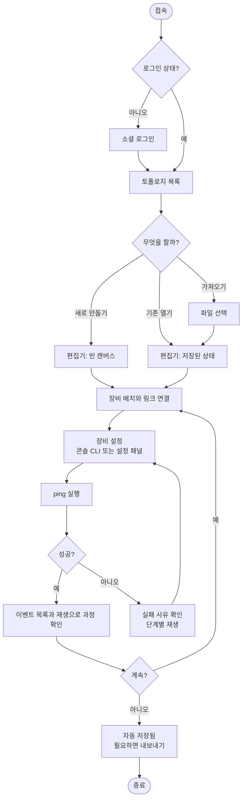
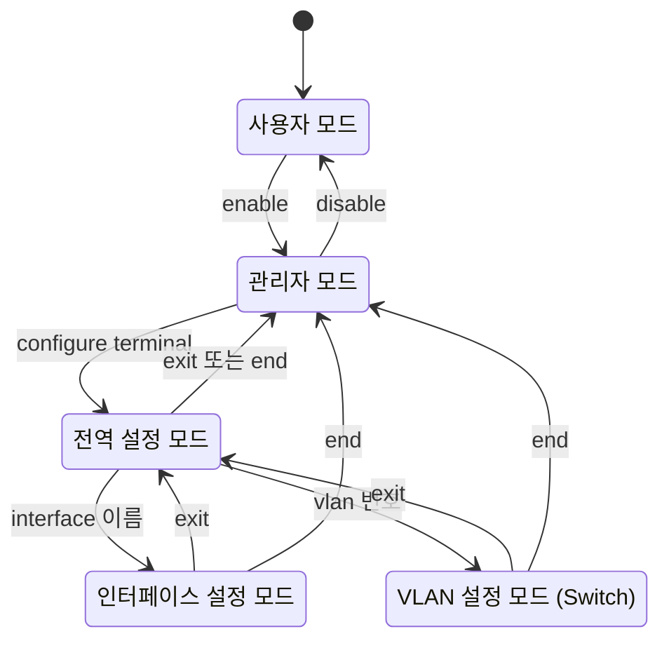
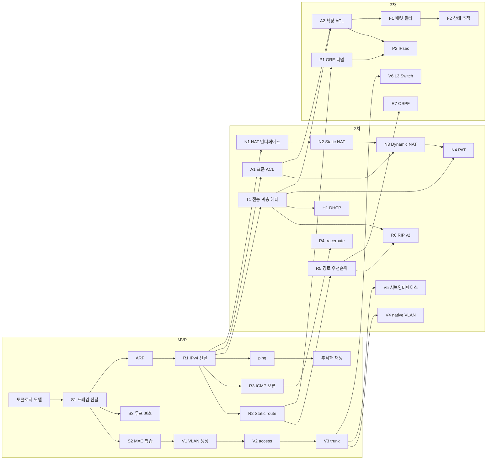

# 2. 상세 요구사항 (Requirements, PRD)

- 작성 기준일: 2026-11-05
- 상위 문서: [README.md](README.md) · 이전 문서: [01-technical-validation.md](01-technical-validation.md)
- 사용한 워크플로: BMad `bmad-product-brief` → `bmad-prd` (빠른 경로)
- 입력: [제품 브리프](../../_bmad-output/planning-artifacts/briefs/brief-PacketTracer-WEB-2026-11-05/brief.md), 1단계 기술 검증 결과, 2026-11-05 질의응답

## 2.0 문서 목적과 읽는 법

이 문서는 MVP에서 **무엇을** 만드는지 정합니다. **어떻게** 만드는지(기술 선택, 구조)는 3단계 문서에서 다룹니다.

- 기능은 묶음별로 설명하고, 그 아래에 기능 요구사항(FR)을 둡니다. FR 번호는 문서 전체에서 하나로 이어지며, 이후 문서(설계, 작업 분해, 테스트)가 이 번호를 참조합니다.
- 사용자 시나리오는 UJ 번호로, 성공 지표는 SM 번호로 부릅니다.
- [2.3절](#23-용어)의 용어를 문서 전체에서 같은 뜻으로 씁니다.
- 🟡 가정은 확인 없이 둔 전제입니다. [2.11절](#211-가정-목록)에 모았습니다. ❓ 미결정은 [2.10절](#210-미결정-사항)에 모았습니다.

### 이 단계에서 확정된 결정

| # | 항목 | 결정 |
|---|---|---|
| D9 | 실행 엔진 | ✅ 브라우저 중심 시뮬레이션 (자체 엔진) |
| D10 | 역할 | ✅ 역할 구분 없음. 모든 사용자가 같은 기능을 씀. 강사·수업·과제 기능은 이후 단계를 포함해 만들지 않음 |
| D11 | 패킷 흐름 표시 | ✅ 이동 표시, 이벤트 목록, 단계별 재생까지 MVP에 포함 |
| D12 | 로그인 | ✅ 소셜 로그인. 비밀번호를 저장하지 않음 |

D1~D8은 [00-current-state.md](00-current-state.md)에 있습니다.

## 2.1 비전

설치 없이 브라우저 주소만 열면 네트워크 장비를 배치하고 연결해 실습할 수 있는 학습 도구입니다. 수강생은 교재에서 배운 명령어로 장비를 설정하고, 패킷이 장비를 하나씩 지나는 과정을 멈춰 가며 봅니다. 통신이 안 되면 어느 장비에서 왜 막혔는지를 도구가 알려 줍니다.

네트워크 동작은 각자의 브라우저 안에서 계산하므로, 수강생 수십 명이 동시에 써도 서버 비용이 거의 들지 않습니다.

## 2.2 사용자

### 사용자 유형

역할 구분이 없습니다. 로그인한 사람은 모두 같은 기능을 씁니다 (D10).

| 유형 | 설명 |
|---|---|
| 사용자 | 로그인해 자기 토폴로지를 만들고 실습하는 사람. 제품 안의 유일한 유형 |
| 운영자 | 서비스를 배포하고 관리하는 개발팀 3인. 제품 화면에 별도 기능은 없고 배포·로그 확인만 수행 |

### 해결하려는 일

- 교재의 실습 예제를 설치 없이 바로 따라 해 보고 싶다.
- 설정한 대로 통신이 되는지 확인하고, 안 되면 어디가 틀렸는지 알고 싶다.
- 패킷이 스위치와 라우터에서 어떻게 처리되는지 눈으로 보고 이해하고 싶다.
- 하던 실습을 저장해 두고 다른 날, 다른 기기에서 이어서 하고 싶다.

### 대상이 아닌 사용자 (MVP)

- 실제 장비와 동일한 동작이 필요한 현업 엔지니어, 자격증 실기 시험 대비용 정밀 실습
- 모바일 기기 사용자
- 여러 사람이 한 토폴로지를 동시에 편집하려는 팀

### 사용자 시나리오

🟡 시나리오의 인물과 상황은 작성자가 가정한 것입니다. 실제 수강생의 사용 모습과 다르면 고쳐야 합니다.

**UJ-1. 서연이 처음 접속해 PC 두 대를 연결하고 ping에 성공한다.**
네트워크를 배우기 시작한 서연은 스터디에서 공유받은 주소를 엽니다. Google 계정으로 로그인하면 빈 토폴로지 목록이 보입니다. "새 토폴로지"를 눌러 캔버스에 들어가, 장비 목록에서 Switch 1대와 PC 2대를 끌어다 놓고 PC의 포트와 Switch의 포트를 차례로 눌러 연결합니다. PC를 눌러 IP 주소와 서브넷 마스크를 입력합니다. PC1의 콘솔에서 `ping 192.168.1.20`을 입력하자 패킷이 링크를 따라 움직이고 콘솔에 응답 4개가 찍힙니다. 서연은 이벤트 목록에서 ARP 요청이 먼저 나간 것을 봅니다.
*예외*: 한쪽 PC에 IP를 넣지 않고 ping하면, 콘솔에 실패가 표시되고 "PC2에 IP 주소가 없습니다"라는 사유가 보입니다.

**UJ-2. 서연이 VLAN으로 네트워크를 나눈다.**
교재의 VLAN 실습을 따라 합니다. Switch 콘솔에서 `enable`, `configure terminal`로 들어가 `vlan 10`, `vlan 20`을 만들고, 포트마다 `switchport access vlan`으로 VLAN을 지정합니다. 같은 VLAN의 PC끼리는 ping이 되고 다른 VLAN의 PC로는 실패합니다. 실패한 ping의 이벤트 목록에 "VLAN 10의 프레임을 VLAN 20 포트로 내보내지 않음"이 표시됩니다. Switch 2대를 trunk로 연결한 뒤 같은 VLAN끼리 스위치를 건너 통신되는 것을 확인합니다.

**UJ-3. 도윤이 Router 2대로 두 네트워크를 연결한다.**
도윤은 화이트보드의 예시 토폴로지(Router 2대, 각 Router 아래 Switch 1대와 PC 1대)를 만듭니다. Router 인터페이스에 IP를 넣고 `no shutdown`으로 켭니다. 이 상태에서 양 끝 PC 사이의 ping은 실패하고, 사유로 "R1의 라우팅 테이블에 10.0.2.0/24로 가는 경로가 없습니다"가 표시됩니다. 두 Router에 `ip route`로 상대 네트워크 경로를 넣자 ping이 성공합니다. `show ip route`로 추가된 경로를 확인합니다.

**UJ-4. 도윤이 단계별 재생으로 ping 실패 원인을 찾는다.**
ping이 실패합니다. 도윤은 재생 막대에서 "처음으로"를 누르고 "다음 단계"를 눌러 가며 패킷을 따라갑니다. 요청은 상대 PC에 도착했는데 응답이 R2에서 멈춥니다. R2 단계의 프레임을 열어 보니 목적지가 10.0.1.10이고, 이벤트 설명에 "일치하는 경로 없음"이 적혀 있습니다. R2에 돌아오는 경로를 빠뜨린 것을 알아채고 추가합니다.

**UJ-5. 서연이 집에서 이어서 한다.**
낮에 만들던 토폴로지는 자동으로 저장되어 있습니다. 집 노트북에서 같은 계정으로 로그인하니 목록에 그 토폴로지가 있고, 열면 장비 위치와 장비별 설정이 그대로입니다. 스터디원에게 보여 주려고 "내보내기"를 눌러 파일로 받습니다.

### 사용 흐름

역할이 하나이므로 흐름도 하나입니다.

## 2.3 용어

| 용어 | 정의 |
|---|---|
| 사용자 | 로그인해 자기 토폴로지로 실습하는 사용자 |
| 토폴로지 (Topology) | 장비, 링크, 장비별 구성을 묶은 저장 단위. 사용자 한 명이 여러 개를 가짐 |
| 장비 (Device) | 토폴로지에 놓이는 네트워크 기기. MVP의 종류는 PC, Switch, Router |
| 포트 (Port) | 장비에서 링크를 꽂는 자리. Router와 PC에서는 인터페이스(Interface)와 같은 뜻으로 씀 |
| 링크 (Link) | 두 포트를 잇는 연결. 포트 하나에는 링크가 하나만 연결됨 |
| 캔버스 | 장비와 링크를 배치하는 편집 화면 영역 |
| 콘솔 (Console) | 장비에 명령어를 입력하고 출력을 보는 창 |
| CLI 모드 | 콘솔에서 입력할 수 있는 명령어 범위를 정하는 상태. 사용자 모드, 관리자 모드, 전역 설정 모드, 인터페이스 설정 모드, VLAN 설정 모드 |
| 구성 (Configuration) | 장비에 설정된 값의 모음. 호스트 이름, 인터페이스 IP, VLAN, 경로 등. 토폴로지와 함께 저장됨 |
| 동적 상태 | 실행 중에 생기는 값. MAC 주소 테이블, ARP 테이블. 저장하지 않음 |
| 시뮬레이션 엔진 | 장비의 동작 모델을 실행해 프레임 전달 결과를 계산하는 부분 |
| 프레임 (Frame) | 링크를 지나는 전달 단위. Ethernet 헤더와 그 안의 ARP 또는 IPv4 패킷을 포함 |
| 추적 (Trace) | 한 번의 통신(예: ping 1회)에서 생긴 이벤트의 순서 있는 기록 |
| 이벤트 (Event) | 추적의 한 단계. 어느 장비가 프레임을 받았는지, 무엇을 판단했는지, 어디로 보냈거나 왜 버렸는지를 담음 |
| 재생 (Replay) | 추적의 이벤트를 순서대로 캔버스에 보여 주는 것. 멈춤, 다음 단계, 이전 단계를 지원 |
| 폐기 사유 (Drop reason) | 프레임이 목적지에 닿지 못하고 버려진 이유를 나타내는 분류값 |

## 2.4 기능 명세 (MVP)

각 FR의 "검증"은 테스트로 확인할 수 있는 조건입니다. 괄호 안의 UJ는 그 FR이 실현하는 시나리오입니다.

### 2.4.1 계정

사용자는 소셜 계정으로 로그인합니다. 서비스는 비밀번호를 받거나 저장하지 않습니다.

**FR-1 소셜 로그인** — 사용자는 소셜 계정으로 로그인할 수 있다. (UJ-1, UJ-5)
- 검증: 로그인하지 않은 상태로 토폴로지 목록이나 편집기 주소를 열면 로그인 화면으로 이동한다.
- 검증: 처음 로그인하면 계정이 만들어지고 빈 토폴로지 목록이 보인다.
- 검증: 같은 소셜 계정으로 다른 기기에서 로그인하면 같은 토폴로지 목록이 보인다.
- 검증: 서비스가 저장하는 개인정보는 소셜 계정 식별자, 이메일, 표시 이름뿐이다.

**FR-2 로그아웃과 세션 만료** — 사용자는 로그아웃할 수 있고, 세션이 만료되면 다시 로그인해야 한다.
- 검증: 로그아웃 뒤에는 토폴로지 API가 인증 오류를 돌려준다.
- 검증: 편집 중 세션이 만료되면 저장하지 못한 변경을 브라우저에 보관하고, 다시 로그인하면 이어서 저장한다.

소셜 로그인 제공자는 Google입니다 ([03 문서](03-system-design.md)의 D14).

### 2.4.2 토폴로지 관리

**FR-3 토폴로지 목록** — 사용자는 자기 토폴로지의 목록을 볼 수 있다. (UJ-5)
- 검증: 목록에 이름, 마지막 수정 시각, 장비 수가 보이고 최근 수정 순으로 정렬된다.
- 검증: 다른 사용자의 토폴로지는 목록에 보이지 않고, 주소를 직접 입력해도 열리지 않는다.

**FR-4 토폴로지 생성·이름 변경·복제·삭제** — 사용자는 토폴로지를 만들고, 이름을 바꾸고, 복제하고, 삭제할 수 있다.
- 검증: 삭제는 확인을 거친 뒤 실행되고 목록에서 사라진다.
- 검증: 복제본을 고쳐도 원본은 바뀌지 않는다.
- 검증: 계정당 토폴로지 수가 한도(🟡 50개)에 닿으면 생성이 거부되고 사유가 표시된다.

**FR-5 저장** — 편집 내용은 자동으로 저장되고, 사용자는 직접 저장할 수도 있다. (UJ-5)
- 검증: 장비·링크·구성을 바꾸고 일정 시간(🟡 3초) 입력이 없으면 저장되고, 화면에 "저장됨"과 시각이 표시된다.
- 검증: 저장에 실패하면 "저장 실패"가 표시되고 자동으로 다시 시도한다. 변경은 브라우저에 남아 있다.
- 검증: 저장되는 것은 장비, 위치, 링크, 구성이다. 동적 상태와 추적은 저장되지 않는다.

**FR-6 불러오기** — 사용자는 저장된 토폴로지를 열어 이어서 편집할 수 있다. (UJ-5)
- 검증: 열었을 때 장비 위치, 링크, 장비별 구성이 저장 시점과 같다.
- 검증: 열린 직후 동적 상태(MAC 주소 테이블, ARP 테이블)는 비어 있다.

**FR-7 내보내기와 가져오기** — 사용자는 토폴로지를 파일로 내보내고, 내보낸 파일을 가져올 수 있다. (UJ-5)
- 검증: 내보낸 파일을 가져오면 같은 장비·링크·구성을 가진 새 토폴로지가 만들어진다.
- 검증: 형식이 맞지 않거나 한도를 넘는 파일은 거부되고 사유가 표시된다.
- 검증: 파일에는 형식 버전 번호가 들어 있다.

**FR-8 예제 토폴로지** — 사용자는 준비된 예제에서 시작할 수 있다.
- 검증: 예제 3종(Switch 1대 LAN, VLAN 2개, Router 2대 Static Routing)을 골라 자기 토폴로지로 복사할 수 있다.

### 2.4.3 토폴로지 편집기

**FR-9 장비 추가** — 사용자는 장비 목록에서 장비를 캔버스에 끌어다 놓을 수 있다. (UJ-1)
- 검증: 놓은 위치에 장비가 생기고 종류별 기본 이름(PC1, SW1, R1 …)이 중복 없이 붙는다.
- 검증: 토폴로지당 장비 수가 한도(🟡 50대)에 닿으면 추가가 거부되고 사유가 표시된다.

**FR-10 장비 이동과 이름 변경** — 사용자는 장비를 끌어 옮기고 이름을 바꿀 수 있다.
- 검증: 장비를 옮기면 연결된 링크가 따라 움직인다.
- 검증: 캔버스에서 바꾼 이름과 CLI의 `hostname`으로 바꾼 이름은 서로 반영된다.
- 검증: 같은 토폴로지 안에서 중복된 이름은 거부된다.

**FR-11 장비 삭제** — 사용자는 장비를 삭제할 수 있다.
- 검증: 장비를 삭제하면 그 장비에 연결된 링크도 함께 삭제된다.
- 검증: 링크가 연결된 장비를 삭제할 때는 확인을 거친다.

**FR-12 링크 연결** — 사용자는 두 장비의 포트를 골라 링크로 연결할 수 있다. (UJ-1)
- 검증: 연결할 때 각 장비의 비어 있는 포트 목록에서 포트를 고른다.
- 검증: 이미 링크가 있는 포트, 같은 장비의 두 포트는 연결할 수 없고 사유가 표시된다.
- 검증: 링크 양 끝에 포트 이름이 표시된다.

**FR-13 링크 삭제** — 사용자는 링크를 삭제할 수 있다.
- 검증: 링크를 삭제하면 양쪽 포트가 비어 있는 상태가 되고, 그 포트로 학습된 MAC 주소 항목이 지워진다.

**FR-14 캔버스 조작** — 사용자는 캔버스를 확대·축소하고 이동할 수 있다.
- 검증: 확대·축소와 이동 뒤에도 장비 선택, 링크 연결, 재생 표시가 올바른 위치에서 동작한다.

### 2.4.4 장비

| 장비 | 포트 | 포트 이름 (🟡) | 기본 상태 | 주요 구성 |
|---|---|---|---|---|
| PC | 1개 | `Ethernet0` | 켜짐 | IP 주소, 서브넷 마스크, 기본 게이트웨이 |
| Switch | 8개 | `FastEthernet0/1` ~ `0/8` | 모든 포트 켜짐, VLAN 1, access | VLAN 목록, 포트별 모드와 VLAN |
| Router | 4개 | `GigabitEthernet0/0` ~ `0/3` | 모든 인터페이스 꺼짐 | 인터페이스 IP, Static route |

**FR-15 PC** — PC는 포트 1개와 IP 구성을 가지며 ping을 보낼 수 있다. (UJ-1)
- 검증: PC는 자기 IP로 온 ICMP echo 요청에 응답한다.
- 검증: 목적지가 자기 네트워크 밖이면 기본 게이트웨이로 보낸다.

**FR-16 Switch** — Switch는 포트 8개를 가지며 프레임을 전달한다. (UJ-1, UJ-2)
- 검증: 구성 없이 연결만 해도 같은 VLAN의 장비끼리 통신된다.

**FR-17 Router** — Router는 인터페이스 4개를 가지며 네트워크 사이에서 패킷을 전달한다. (UJ-3)
- 검증: 인터페이스는 처음에 꺼져 있고, `no shutdown`을 입력해야 켜진다. 🟡 교재의 실습 순서와 맞추기 위한 기본값입니다.

**FR-18 인터페이스 켜기와 끄기** — 사용자는 Switch 포트와 Router 인터페이스를 켜고 끌 수 있다.
- 검증: 꺼진 포트는 프레임을 보내지도 받지도 않는다.
- 검증: 포트 상태는 "동작 중", "사용자가 끔", "링크 없음", "상대 쪽이 꺼짐" 네 가지로 구분되어 `show` 출력과 캔버스에 같은 값으로 표시된다.

### 2.4.5 콘솔과 CLI

장비를 누르면 그 장비의 콘솔이 열립니다. Switch와 Router는 계층형 명령어를, PC는 일반 명령어를 씁니다. 명령어와 출력은 영어이고, 오류에는 한국어 설명이 붙습니다. Cisco의 도움말과 출력 문구를 그대로 복제하지 않습니다 ([01 문서 1.5절](01-technical-validation.md#15-라이선스와-상표)).

**CLI 모드 (Switch, Router)**

| 모드 | 프롬프트 |
|---|---|
| 사용자 모드 | `R1>` |
| 관리자 모드 | `R1#` |
| 전역 설정 모드 | `R1(config)#` |
| 인터페이스 설정 모드 | `R1(config-if)#` |
| VLAN 설정 모드 | `SW1(config-vlan)#` |

**MVP 명령어 목록**

| 장비 | 모드 | 명령어 | 동작 |
|---|---|---|---|
| Switch, Router | 사용자 | `enable` | 관리자 모드로 이동 |
| Switch, Router | 관리자 | `disable`, `configure terminal` | 모드 이동 |
| Switch, Router | 설정 모드 전체 | `exit`, `end` | 한 단계 위로, 관리자 모드로 |
| Switch, Router | 전역 설정 | `hostname <이름>` | 장비 이름 변경 |
| Switch, Router | 전역 설정 | `interface <이름>` | 인터페이스 설정 모드로 이동 |
| Switch, Router | 인터페이스 설정 | `shutdown`, `no shutdown` | 포트 끄기, 켜기 |
| Router | 인터페이스 설정 | `ip address <IP> <마스크>`, `no ip address` | IP 설정, 제거 |
| Router | 전역 설정 | `ip route <네트워크> <마스크> <다음 홉 IP>`, `no ip route …` | Static route 추가, 제거 |
| Switch | 전역 설정 | `vlan <번호>`, `no vlan <번호>` | VLAN 생성, 삭제 |
| Switch | VLAN 설정 | `name <이름>` | VLAN 이름 지정 |
| Switch | 인터페이스 설정 | `switchport mode access`, `switchport mode trunk` | 포트 모드 지정 |
| Switch | 인터페이스 설정 | `switchport access vlan <번호>` | access 포트의 VLAN 지정 |
| Switch | 인터페이스 설정 | `switchport trunk allowed vlan <목록>` | trunk에서 허용할 VLAN 지정 |
| Switch, Router | 관리자 | `show running-config` | 현재 구성 전체 출력 |
| Switch, Router | 관리자 | `show ip interface brief` | 인터페이스별 IP와 상태 |
| Router | 관리자 | `show ip route` | 라우팅 테이블 |
| Router | 관리자 | `show arp` | ARP 테이블 |
| Switch | 관리자 | `show mac address-table` | MAC 주소 테이블 |
| Switch | 관리자 | `show vlan brief` | VLAN과 소속 포트 |
| Switch | 관리자 | `show interfaces trunk` | trunk 포트와 허용 VLAN |
| Router | 사용자, 관리자 | `ping <IP>` | ICMP echo 4회 |
| PC | — | `ipconfig`, `ipconfig /all` | IP 구성 출력 |
| PC | — | `ipconfig <IP> <마스크> [게이트웨이]` | IP 구성 설정 |
| PC | — | `ping <IP>` | ICMP echo 4회 |
| PC | — | `arp -a`, `arp -d` | ARP 테이블 출력, 비우기 |
| 전체 | 전체 | `?`, `help` | 현재 모드에서 쓸 수 있는 명령어 |

**FR-19 콘솔 열기** — 사용자는 장비의 콘솔을 열 수 있다. (UJ-1)
- 검증: 여러 장비의 콘솔을 동시에 열어 두고 전환할 수 있다.
- 검증: 콘솔을 닫았다 열어도 그 장비의 CLI 모드와 이전 출력이 유지된다 (같은 편집 세션 안에서).

**FR-20 CLI 모드 전환** — 사용자는 위 상태도대로 CLI 모드를 오갈 수 있다. (UJ-2, UJ-3)
- 검증: 프롬프트가 현재 모드와 장비 이름을 반영한다.
- 검증: 현재 모드에서 쓸 수 없는 명령어는 실행되지 않고 오류가 표시된다.

**FR-21 입력 편의** — 사용자는 명령어를 축약하고, 자동 완성하고, 도움말을 볼 수 있다.
- 검증: 다른 명령어와 구별되는 앞부분만 입력해도 실행된다 (예: `conf t`, `sh ip ro`).
- 검증: Tab을 누르면 유일하게 일치하는 명령어로 완성된다.
- 검증: `?`를 입력하면 그 자리에서 입력할 수 있는 다음 단어 목록과 설명이 표시된다.
- 검증: 위·아래 화살표로 이전에 입력한 명령어를 불러온다.

**FR-22 설정 취소** — 사용자는 `no`를 붙여 설정을 되돌릴 수 있다.
- 검증: 명령어 목록에 `no` 형식이 있는 설정은 `no`로 제거되고 `show running-config`에서 사라진다.

**FR-23 구성과 상태 조회** — 사용자는 `show` 명령어로 구성과 상태를 볼 수 있다. (UJ-3)
- 검증: `show running-config` 출력을 그대로 다시 입력하면 같은 구성이 만들어진다.
- 검증: 각 `show` 명령어의 출력이 그 시점의 구성·동적 상태와 일치한다.

**FR-24 PC 명령어** — 사용자는 PC 콘솔에서 위 표의 PC 명령어를 쓸 수 있다. (UJ-1)
- 검증: `ipconfig`가 IP 주소, 서브넷 마스크, 기본 게이트웨이, MAC 주소를 보여 준다.

### 2.4.6 IP 설정

**FR-25 PC의 IP 설정** — 사용자는 PC의 IP 주소, 서브넷 마스크, 기본 게이트웨이를 설정 패널과 명령어 양쪽에서 설정할 수 있다. (UJ-1)
- 검증: 설정 패널에서 바꾼 값이 `ipconfig` 출력에 반영되고, 그 반대도 같다.

**FR-26 Router 인터페이스의 IP 설정** — 사용자는 Router 인터페이스에 IP 주소와 서브넷 마스크를 설정할 수 있다. (UJ-3)
- 검증: 인터페이스에 IP가 있고 동작 중이면 그 네트워크가 라우팅 테이블에 직접 연결 경로로 나타난다.

**FR-27 IP 입력 검증** — 잘못된 IP 입력은 거부되고 사유가 표시된다.
- 검증: 형식이 틀린 주소, 연속되지 않은 마스크, 네트워크 주소·브로드캐스트 주소를 장비 주소로 넣으면 거부된다.
- 검증: 한 Router의 두 인터페이스에 겹치는 네트워크를 넣으면 거부된다.
- 검증: 같은 토폴로지 안에서 같은 IP를 두 장비에 넣으면 설정은 되지만 중복 경고가 표시된다.

### 2.4.7 Switching과 ARP

**FR-28 프레임 전달과 MAC 학습** — Switch는 받은 프레임의 출발지 MAC 주소를 학습하고, 목적지에 따라 전달한다. (UJ-1)
- 검증: 프레임을 받으면 출발지 MAC 주소, 받은 포트, VLAN을 MAC 주소 테이블에 기록한다.
- 검증: 목적지 MAC 주소가 테이블에 있으면 그 포트로만 보내고, 없거나 브로드캐스트이면 받은 포트를 제외한 같은 VLAN의 모든 포트로 보낸다.
- 검증: 목적지 포트가 받은 포트와 같으면 프레임을 버린다.
- 검증: 일정 시간(🟡 가상 시간 300초) 쓰이지 않은 항목은 테이블에서 지워진다.

**FR-29 ARP** — PC와 Router는 IP 주소에 해당하는 MAC 주소를 ARP로 알아낸다. (UJ-1)
- 검증: 다음 홉의 MAC 주소를 모르면 ARP 요청을 브로드캐스트로 보내고, 응답을 받으면 ARP 테이블에 기록한 뒤 대기 중이던 패킷을 보낸다.
- 검증: 자기 IP에 대한 ARP 요청에만 응답한다.
- 검증: 일정 시간(🟡 가상 시간 2초) 안에 응답이 없으면 대기 중이던 패킷을 버리고 폐기 사유를 남긴다.

**FR-30 루프 보호** — 링크가 고리 모양으로 연결되어도 시뮬레이션이 멈추지 않는다.
- 검증: 한 번의 통신에서 생긴 이벤트 수가 한도(🟡 2,000개)를 넘으면 계산을 중단하고 "루프가 의심됩니다"라는 경고와 관련 장비를 표시한다.
- 검증: 중단 뒤에도 편집기와 콘솔은 계속 동작한다.

### 2.4.8 VLAN

**FR-31 VLAN 생성과 삭제** — 사용자는 Switch에 VLAN을 만들고 지울 수 있다. (UJ-2)
- 검증: VLAN 번호는 1~4094이며, VLAN 1은 처음부터 있고 지울 수 없다.
- 검증: 포트가 속한 VLAN을 지우면 그 포트는 통신되지 않고, `show vlan brief`에서 확인할 수 있다.

**FR-32 access 포트** — 사용자는 포트를 access 모드로 두고 VLAN 하나를 지정할 수 있다. (UJ-2)
- 검증: access 포트로 들어온 프레임은 그 포트의 VLAN에 속한 것으로 처리된다.
- 검증: 서로 다른 VLAN의 access 포트 사이에는 프레임이 전달되지 않는다.
- 검증: 없는 VLAN을 지정하면 그 VLAN이 자동으로 만들어지고 알림이 표시된다.

**FR-33 trunk 포트** — 사용자는 포트를 trunk 모드로 두고 여러 VLAN의 프레임을 실어 보낼 수 있다. (UJ-2)
- 검증: trunk로 나가는 프레임에는 VLAN 번호 태그(802.1Q)가 붙고, 받는 쪽은 태그의 VLAN으로 처리한다.
- 검증: 허용 목록에 없는 VLAN의 프레임은 trunk로 나가지 않는다.
- 검증: Switch 2대를 trunk로 연결하면 같은 VLAN의 PC끼리 Switch를 건너 통신된다.

MVP에서 빼는 것: native VLAN 지정, Router의 서브인터페이스(하나의 링크로 VLAN 간 라우팅). VLAN 간 통신은 Router 인터페이스를 VLAN마다 하나씩 연결하면 됩니다.

### 2.4.9 IPv4 전달과 Static Routing

**FR-34 직접 연결 경로** — Router는 동작 중인 인터페이스의 네트워크를 라우팅 테이블에 올린다. (UJ-3)
- 검증: 인터페이스가 꺼지거나 링크가 끊기면 그 경로가 테이블에서 사라진다.

**FR-35 Static route** — 사용자는 Router에 Static route와 기본 경로(0.0.0.0/0)를 넣을 수 있다. (UJ-3)
- 검증: 다음 홉 IP가 직접 연결된 네트워크에 없으면 경로는 구성에 남지만 라우팅 테이블에는 올라가지 않는다.
- 검증: `show ip route`에 경로의 종류(직접 연결, Static)가 구분되어 표시된다.

**FR-36 패킷 전달 규칙** — Router는 목적지 IP와 가장 길게 일치하는 경로로 패킷을 보낸다. (UJ-3)
- 검증: 일치하는 경로가 여럿이면 접두사가 가장 긴 경로를 고른다.
- 검증: 전달할 때 TTL을 1 줄이고, 출발지·목적지 MAC 주소를 다음 구간에 맞게 바꾼다.
- 검증: Router는 자기 인터페이스 IP로 온 ICMP echo 요청에 응답한다.

**FR-37 ICMP 오류 응답** — Router는 패킷을 전달할 수 없을 때 출발지에 알린다. (UJ-3, UJ-4)
- 검증: 일치하는 경로가 없으면 패킷을 버리고 "목적지 도달 불가"를 출발지로 보낸다.
- 검증: TTL이 0이 되면 패킷을 버리고 "시간 초과"를 출발지로 보낸다.

### 2.4.10 ping

**FR-38 ping 실행과 결과** — 사용자는 PC나 Router의 콘솔에서 ping을 실행하고 결과를 볼 수 있다. (UJ-1, UJ-3)
- 검증: echo 요청을 4회 보내고, 회차마다 응답 수신 또는 실패 사유를 한 줄씩 출력한다.
- 검증: 끝나면 보낸 수, 받은 수, 손실률을 출력한다.
- 검증: 실패한 회차의 출력에서 그 회차의 추적을 열 수 있다.
- 검증: ARP 테이블이 비어 있을 때 첫 회차가 ARP 때문에 실패할 수 있고, 이 경우 사유에 ARP 대기가 표시된다. 🟡 실제 장비의 동작을 따른 것입니다.

### 2.4.11 패킷 추적과 재생

ping 한 회차마다 추적 하나가 만들어집니다. 추적은 이벤트의 목록이며, 캔버스 재생과 이벤트 목록이 같은 추적을 보여 줍니다.

**이벤트가 담는 내용**

| 항목 | 예 |
|---|---|
| 순번, 가상 시각 | 7번째, 0.004초 |
| 장비, 포트 | SW1, FastEthernet0/2로 수신 |
| 계층 | L2 (Ethernet), L3 (IPv4), ARP, ICMP |
| 동작 | 생성, 수신, 학습, 전달, 응답, 폐기 |
| 설명 | "목적지 MAC 주소가 테이블에 없어 VLAN 10의 모든 포트로 보냄" |
| 프레임 내용 | Ethernet 출발지·목적지 MAC, VLAN 태그, ARP 필드 또는 IPv4 출발지·목적지·TTL, ICMP 종류 |
| 폐기 사유 | 폐기일 때만. [2.4.13절](#2413-오류-피드백)의 분류값 |

**FR-39 패킷 이동 표시** — 통신이 일어나면 프레임이 링크를 따라 이동하는 모습이 캔버스에 표시된다. (UJ-1)
- 검증: 프레임 종류(ARP, ICMP 요청, ICMP 응답)가 색이나 모양으로 구분된다.
- 검증: 폐기된 지점에 폐기 표시가 나타난다.

**FR-40 이벤트 목록** — 사용자는 추적의 이벤트를 순서대로 볼 수 있다. (UJ-1, UJ-4)
- 검증: 이벤트를 누르면 해당 장비와 링크가 캔버스에서 강조된다.
- 검증: 한 토폴로지에서 최근 추적(🟡 20개)을 골라 다시 볼 수 있다.

**FR-41 단계별 재생** — 사용자는 추적을 멈추고, 한 단계씩 앞뒤로 이동하고, 처음부터 다시 볼 수 있다. (UJ-4)
- 검증: 재생, 멈춤, 다음 단계, 이전 단계, 처음으로 버튼이 있다.
- 검증: 한 단계는 같은 가상 시각에 일어난 이벤트의 묶음이다. Switch가 여러 포트로 내보낸 프레임은 한 단계에서 함께 움직인다.
- 검증: 추적을 만든 뒤 관련 장비나 링크를 지웠으면 그 추적은 "토폴로지가 바뀜"으로 표시되고 캔버스 재생이 막힌다. 이벤트 목록은 볼 수 있다.
- 검증: 재생 속도를 바꿀 수 있다 (🟡 0.5배, 1배, 2배).
- 검증: 어느 단계에 있든 캔버스의 프레임 위치와 이벤트 목록의 선택 항목이 일치한다.
- 검증: 재생은 이미 계산된 추적을 보여 주는 것이며, 재생 중에 장비 구성이 바뀌지 않는다.

**FR-42 프레임 내용 열람** — 사용자는 각 단계의 프레임 내용을 계층별로 볼 수 있다. (UJ-4)
- 검증: Ethernet, VLAN 태그, ARP 또는 IPv4, ICMP의 필드가 계층별로 나뉘어 표시된다.
- 검증: 이전 단계와 달라진 필드(예: Router를 지난 뒤의 MAC 주소, TTL)가 강조된다.

### 2.4.12 상태 표시

**FR-43 링크와 포트 상태 표시** — 캔버스에서 링크와 포트의 상태를 볼 수 있다.
- 검증: 링크 양 끝에 포트 상태가 색과 모양으로 표시된다 (동작 중, 사용자가 끔, 상대 쪽이 꺼짐). 링크가 없는 포트는 캔버스에 그려지지 않는다.
- 검증: 장비에 마우스를 올리면 인터페이스별 IP 주소와 상태가 표시된다.

**FR-44 장비 테이블 보기** — 사용자는 콘솔 명령어 없이도 장비의 테이블을 패널로 볼 수 있다.
- 검증: Switch는 MAC 주소 테이블과 VLAN 목록, Router는 라우팅 테이블과 ARP 테이블, PC는 ARP 테이블을 보여 준다.
- 검증: 패널의 내용은 통신이 일어날 때마다 갱신된다.

### 2.4.13 오류 피드백

오류는 세 종류로 나눕니다. 모든 오류 문구는 "무엇이 문제인지"와 "어떻게 고치는지"를 함께 담습니다.

**FR-45 편집 오류 안내** — 편집기에서 할 수 없는 동작을 하면 사유가 표시된다.
- 검증: 이미 사용 중인 포트 연결, 한도 초과, 중복 이름, 잘못된 가져오기 파일에 각각 구별되는 문구가 표시된다.
- 검증: 저장 실패와 세션 만료는 화면 상단에 계속 보이는 알림으로 표시된다.

**FR-46 CLI 오류 안내** — 잘못된 명령어를 입력하면 틀린 위치와 사유가 표시된다.
- 검증: 알 수 없는 명령어, 인자 부족, 형식이 틀린 값, 현재 모드에서 쓸 수 없는 명령어, 여러 명령어와 일치하는 축약이 서로 다른 문구로 구분된다.
- 검증: 틀린 단어의 위치가 표시되고 한국어 설명이 한 줄 붙는다.

**FR-47 통신 실패 사유 안내** — 통신이 실패하면 어느 장비에서 왜 폐기되었는지 표시된다. (UJ-3, UJ-4)
- 검증: 아래 폐기 사유마다 장비 이름과 구체적인 값이 들어간 문구가 표시된다.
- 검증: 사유 문구를 누르면 해당 이벤트로 이동한다.

| 폐기 사유 | 상황 | 표시 문구의 예 |
|---|---|---|
| `NO_LINK` | 보내려는 포트에 링크가 없음 | "PC1의 Ethernet0에 연결된 링크가 없습니다" |
| `IF_DOWN` | 포트나 인터페이스가 꺼져 있음 | "R1의 GigabitEthernet0/1이 꺼져 있습니다. `no shutdown`으로 켜세요" |
| `NO_IP` | 출발 장비에 IP가 없음 | "PC2에 IP 주소가 없습니다" |
| `NO_GATEWAY` | 다른 네트워크로 보내는데 기본 게이트웨이가 없음 | "10.0.2.10은 PC1과 다른 네트워크인데 기본 게이트웨이가 없습니다" |
| `ARP_TIMEOUT` | ARP 응답이 없음 | "192.168.1.1의 MAC 주소를 알아내지 못했습니다" |
| `VLAN_BLOCKED` | VLAN이 달라 전달하지 않음 | "SW1이 VLAN 10의 프레임을 VLAN 20 포트로 내보내지 않았습니다" |
| `TRUNK_NOT_ALLOWED` | trunk 허용 목록에 없는 VLAN | "SW1의 FastEthernet0/8 trunk가 VLAN 20을 허용하지 않습니다" |
| `NO_ROUTE` | 일치하는 경로가 없음 | "R1의 라우팅 테이블에 10.0.2.0/24로 가는 경로가 없습니다" |
| `TTL_EXPIRED` | TTL이 0이 됨 | "R2에서 TTL이 0이 되었습니다. 경로가 순환하는지 확인하세요" |
| `NOT_FOR_ME` | 받은 장비가 목적지가 아님 | "PC3은 목적지가 아니어서 프레임을 버렸습니다" (정상 동작, 회색으로 표시) |
| `LOOP_GUARD` | 이벤트 수 한도 초과 | "루프가 의심됩니다. SW1과 SW2 사이의 연결을 확인하세요" |

## 2.5 네트워크 기능 세분화와 의존성

화이트보드의 기능을 세부 기능으로 나누고, 단계와 의존 관계를 정리합니다. 2차와 3차 기능의 FR 번호는 그 단계를 시작할 때 붙입니다.

### Switching

| # | 세부 기능 | 단계 | 구현에 필요한 선행 지식 | 의존 |
|---|---|---|---|---|
| S1 | 프레임 전달과 flooding | MVP | Ethernet 프레임 구조, 브로드캐스트 | 토폴로지 모델 |
| S2 | MAC 주소 학습과 항목 만료 | MVP | MAC 주소 테이블 | S1 |
| S3 | 루프 보호 (이벤트 수 한도) | MVP | — | S1 |
| S4 | Spanning Tree Protocol (STP) | 3차 이후 | BPDU, 포트 역할과 상태 | S1, S2 |

### VLAN

| # | 세부 기능 | 단계 | 구현에 필요한 선행 지식 | 의존 |
|---|---|---|---|---|
| V1 | VLAN 생성·삭제 | MVP | VLAN 번호 체계 | S1 |
| V2 | access 포트 | MVP | 포트별 VLAN 소속 | V1, S2 |
| V3 | trunk 포트, 802.1Q 태그, 허용 목록 | MVP | 802.1Q 태그 구조 | V2 |
| V4 | native VLAN | 2차 | 태그 없는 프레임 처리 | V3 |
| V5 | Router 서브인터페이스로 VLAN 간 라우팅 | 2차 | 서브인터페이스, 태그 종단 | V3, R1 |
| V6 | L3 Switch (VLAN 인터페이스로 라우팅) | 3차 | SVI | V3, R1, R2 |

### Routing

| # | 세부 기능 | 단계 | 구현에 필요한 선행 지식 | 의존 |
|---|---|---|---|---|
| R1 | 직접 연결 경로, IPv4 전달, TTL | MVP | IPv4 헤더, 서브넷 계산 | ARP, S1 |
| R2 | Static route, 기본 경로, 가장 긴 접두사 일치 | MVP | 라우팅 테이블 조회 | R1 |
| R3 | ICMP 오류 (도달 불가, 시간 초과) | MVP | ICMP 종류와 코드 | R1 |
| R4 | traceroute | 2차 | TTL을 이용한 경로 추적 | R3 |
| R5 | 경로 우선순위 (administrative distance, metric) | 2차 | 여러 출처의 경로 비교 | R2 |
| R6 | RIP v2 | 2차 | 거리 벡터, 주기적 갱신, UDP | R5, T1, 가상 시간 타이머 |
| R7 | OSPF (단일 영역) | 3차 | 링크 상태, 인접 관계, 최단 경로 계산 | R5, 가상 시간 타이머 |

### 공통 기반 (2차 이후 기능이 요구)

| # | 세부 기능 | 단계 | 구현에 필요한 선행 지식 | 의존 |
|---|---|---|---|---|
| T1 | 전송 계층 헤더 모델 (UDP·TCP 포트 번호) | 2차 | UDP·TCP 헤더 | R1 |
| A1 | 표준 ACL (출발지 IP로 허용·거부) | 2차 | 와일드카드 마스크, 순서대로 평가 | R1 |
| A2 | 확장 ACL (프로토콜, 포트) | 3차 | L4 조건 | A1, T1 |
| H1 | DHCP (Router가 서버, PC가 클라이언트) | 2차 | DHCP 4단계 교환, UDP 브로드캐스트 | T1, ARP |

### NAT

| # | 세부 기능 | 단계 | 구현에 필요한 선행 지식 | 의존 |
|---|---|---|---|---|
| N1 | 내부·외부 인터페이스 지정 | 2차 | NAT 용어 (inside, outside) | R1 |
| N2 | Static NAT (1:1) | 2차 | 주소 변환 테이블 | N1 |
| N3 | Dynamic NAT (주소 풀) | 2차 | 풀 할당과 반납 | N2, A1 |
| N4 | PAT (포트 번호로 여러 내부 주소 공유) | 2차 | 포트 변환, ICMP 식별자 변환 | N3, T1 |

### VPN과 Firewall

| # | 세부 기능 | 단계 | 구현에 필요한 선행 지식 | 의존 |
|---|---|---|---|---|
| P1 | 터널 인터페이스와 GRE 캡슐화 | 3차 | 패킷 캡슐화, 터널 출발지·목적지 | R2 |
| P2 | IPsec site-to-site (암호화는 추상화) | 3차 | 보호 대상 트래픽 선택, 터널 협상 개념 | P1, A2, NAT와의 순서 |
| F1 | Firewall 장비: 무상태 패킷 필터 | 3차 | 인터페이스 방향별 규칙 | A2 |
| F2 | Firewall 장비: 상태 추적 필터 | 3차 이후 | 연결 상태 테이블 | F1, T1 |

❓ VPN을 GRE까지만 할지 IPsec까지 할지, IPsec의 암호화를 어느 수준까지 흉내 낼지는 3차 착수 전에 정합니다.

### 의존 관계도

읽는 법: 화살표는 "왼쪽이 먼저 있어야 오른쪽을 만들 수 있다"는 뜻입니다. NAT의 PAT(N4)와 RIP(R6)는 전송 계층 헤더 모델(T1)이 먼저 필요하므로, 2차는 T1부터 시작해야 합니다.

## 2.6 공통 비기능 요구사항

수치는 모두 🟡 가정입니다. 1주차 측정 결과로 조정합니다.

| # | 분류 | 요구사항 |
|---|---|---|
| NFR-1 | 지원 환경 | 최신 버전의 Chrome, Edge, Firefox, Safari 데스크톱. 화면 너비 1280px 이상. 모바일은 지원하지 않음 |
| NFR-2 | 성능: 시뮬레이션 | 장비 30대 토폴로지에서 ping 1회의 추적 계산이 일반 노트북에서 100ms 안에 끝남 |
| NFR-3 | 성능: 화면 | 장비 50대 토폴로지에서 장비 이동과 재생이 끊김 없이 동작 |
| NFR-4 | 성능: 로딩 | 첫 화면이 3초 안에 뜨고, 토폴로지 열기가 1초 안에 끝남 |
| NFR-5 | 동시 사용 | 사용자 30명이 동시에 편집·저장해도 저장 요청이 실패하지 않음 |
| NFR-6 | 데이터 한도 | 토폴로지당 장비 50대·링크 100개, 문서 크기 512KB, 계정당 토폴로지 50개와 총 5MB. 상세는 [05 문서 5.5절](05-security-and-testing.md#55-자원-제한) |
| NFR-7 | 데이터 보존 | 저장이 완료되었다고 표시된 토폴로지는 서버 재시작 뒤에도 남아 있음 |
| NFR-8 | 보안 | 모든 통신은 HTTPS. 사용자는 자기 토폴로지에만 접근. 상세는 5단계 문서 |
| NFR-9 | 개인정보 | 소셜 계정 식별자, 이메일, 표시 이름만 저장. 사용자가 요청하면 계정과 토폴로지를 삭제 (MVP는 운영자가 스크립트로 처리). 서버 접근 로그에 접속 IP가 14일간 남음 |
| NFR-10 | 언어 | 화면은 한국어. CLI 명령어와 출력은 영어. 오류에는 한국어 설명 |
| NFR-11 | 결정성 | 같은 토폴로지와 같은 구성에서 같은 명령을 실행하면 같은 추적이 나옴. 테스트와 재생의 전제 |
| NFR-12 | 접근성 | 콘솔은 키보드만으로 쓸 수 있음. 상태를 색으로만 구분하지 않고 모양이나 글자를 함께 씀 |

## 2.7 비목표

- 실제 장비와 완전히 같은 동작을 재현하지 않습니다. 구현한 범위의 동작만 보장합니다.
- Cisco Packet Tracer의 파일(.pkt)을 읽거나 쓰지 않고, Cisco의 아이콘·화면·문구를 쓰지 않습니다.
- 실제 네트워크나 인터넷과 연결하지 않습니다. 모든 통신은 시뮬레이션 안에서만 일어납니다.
- 여러 사람이 한 토폴로지를 동시에 편집하는 기능을 만들지 않습니다.
- 강사 역할, 수업(반), 과제 배포·제출·채점 같은 역할별 기능을 만들지 않습니다. 모든 사용자가 같은 기능을 씁니다 (D10).
- 자격증 시험 채점이나 실기 평가 도구가 아닙니다.
- IPv6는 다루지 않습니다.

## 2.8 MVP 범위

### 포함

- [ ] 소셜 로그인, 로그아웃 (FR-1, FR-2)
- [ ] 토폴로지 목록·생성·복제·삭제·저장·불러오기·내보내기·가져오기·예제 (FR-3 ~ FR-8)
- [ ] 편집기: 장비 추가·이동·삭제, 링크 연결·삭제, 캔버스 조작 (FR-9 ~ FR-14)
- [ ] 장비: PC, Switch, Router, 인터페이스 켜기·끄기 (FR-15 ~ FR-18)
- [ ] 콘솔과 CLI (FR-19 ~ FR-24)
- [ ] IP 설정과 검증 (FR-25 ~ FR-27)
- [ ] Switching, ARP, 루프 보호 (FR-28 ~ FR-30)
- [ ] VLAN: 생성, access, trunk (FR-31 ~ FR-33)
- [ ] IPv4 전달, Static Routing, ICMP 오류 (FR-34 ~ FR-37)
- [ ] ping (FR-38)
- [ ] 추적, 이벤트 목록, 단계별 재생, 프레임 열람 (FR-39 ~ FR-42)
- [ ] 상태 표시 (FR-43, FR-44)
- [ ] 오류 피드백 (FR-45 ~ FR-47)

### MVP에서 제외

| 항목 | 단계 | 사유 |
|---|---|---|
| 편집 되돌리기·다시 실행 | 2차 | 편집기 작업량 |
| 계정 삭제 화면 | 2차 | MVP는 운영자가 수동 처리 |
| Dynamic Routing (RIP), NAT, DHCP, traceroute, ACL | 2차 | 전송 계층 헤더 모델이 먼저 필요 |
| native VLAN, Router 서브인터페이스 | 2차 | VLAN 기본 기능 이후 |
| Firewall, VPN, L3 Switch, OSPF | 3차 | D6 (후순위 표시) |
| 서버 에뮬레이션 장비 연동 | 3차 검토 | 실측 뒤 결정 |
| 구성의 시작 구성·실행 구성 구분 (`copy running-config startup-config`) | 미정 | 구성은 토폴로지와 함께 저장됨 |

### 일정이 밀릴 때 줄이는 순서

4주는 빠듯합니다 ([01 문서 1.1절](01-technical-validation.md#11-결론-요약)). 1주차 구현 속도가 계획보다 느리면 아래 순서로 범위를 줄입니다. 위에 있을수록 먼저 뺍니다.

1. 예제 토폴로지 (FR-8), 내보내기·가져오기 (FR-7)
2. 장비 테이블 보기 패널 (FR-44). 콘솔의 `show` 명령어로 대체
3. 재생의 이전 단계와 속도 조절 (FR-41의 일부). 다음 단계와 처음으로만 유지
4. trunk 포트 (FR-33). access 포트만 유지
5. VLAN 전체 (FR-31 ~ FR-33)

줄이지 않는 핵심: 편집기, PC·Switch·Router, CLI, Switching, ARP, Static Routing, ping, 이벤트 목록, 통신 실패 사유, 로그인과 저장.

## 2.9 성공 지표

🟡 목표 수치는 작성자의 제안입니다.

**주요 지표**

- **SM-1 첫 ping 성공까지의 시간**: 처음 쓰는 사용자가 로그인부터 PC 2대와 Switch 1대로 ping에 성공하기까지 걸린 시간. 목표 5분 이내. (FR-1, FR-9, FR-12, FR-25, FR-38)
- **SM-2 예시 토폴로지 완성 시간**: 화이트보드의 예시 토폴로지를 구성해 양 끝 PC 사이의 ping에 성공하기까지 걸린 시간. 목표 15분 이내. (FR-17, FR-26, FR-35, FR-38)
- **SM-3 실패 원인 식별률**: 일부러 틀리게 구성한 토폴로지 5종에서 사용자가 화면만 보고 원인 장비와 사유를 맞힌 비율. 목표 80% 이상. (FR-40, FR-41, FR-47)

**보조 지표**

- **SM-4 동시 사용**: 30명이 동시에 쓰는 수업 1회 동안 저장 실패 0건. (FR-5, NFR-5)
- **SM-5 일정**: 4주 안에 MVP를 배포하고 시연. (전체)

**반대 지표 (높이려고 하지 않는 것)**

- **SM-C1 지원 명령어 수**: 명령어 수를 늘리는 것이 목표가 아닙니다. 명령어를 늘리느라 SM-3(실패 원인 식별)이 떨어지면 안 됩니다. SM-5와 균형.
- **SM-C2 실제 장비와의 출력 일치도**: 출력 문구를 실제 장비와 똑같이 만드는 것은 목표가 아니며, 문구를 그대로 복제하면 안 됩니다. SM-2와 균형.

## 2.10 미결정 사항

| # | 항목 | 결정 시점 |
|---|---|---|
| Q1 | ✅ 해소: Google (D14) | 완료 |
| Q2 | ❓ 공개용 제품 이름 | 배포 전 |
| Q3 | ✅ 해소: 나중에 저장하려는 쪽이 충돌 알림을 받고, 서버의 것을 다시 불러오거나 내 것을 사본으로 저장한다. 덮어쓰지 않는다 ([03 문서 3.7절](03-system-design.md#37-실시간-통신)) | 완료 |
| Q4 | ❓ ping 이외에 추적을 만들 통신 (예: 장비를 켰을 때의 ARP) | 1주차 뒤 |
| Q5 | ❓ 장비 아이콘을 직접 그릴지, 자유 라이선스 아이콘을 쓸지 | 3단계 검토 |
| Q6 | ✅ 해소: 강사·과제 기능은 만들지 않음 (D10) | 완료 |
| Q7 | ❓ VPN의 종류와 암호화 표현 수준 | 3차 착수 전 |
| Q8 | ❓ 성공 지표를 누가 어떻게 측정할지 (수업에서 직접 관찰, 사용 기록 수집) | 4주차 |

## 2.11 가정 목록

| # | 가정 | 위치 | 틀리면 생기는 일 |
|---|---|---|---|
| A1 | 사용자는 네트워크 입문 단계이며 교재의 실습을 따라 한다 | 2.2 | 시나리오와 예제의 수준을 바꿔야 함 |
| A2 | 포트 이름은 `Ethernet0`, `FastEthernet0/n`, `GigabitEthernet0/n` | 2.4.4 | CLI 명령어 해석기와 예제 수정 |
| A3 | Router 인터페이스는 처음에 꺼져 있다 | FR-17 | 기본값 한 줄 변경 |
| A4 | 자동 저장 대기 3초, 계정당 토폴로지 50개, 토폴로지당 장비 50대 | FR-4, FR-5, FR-9 | 수치 조정 |
| A5 | MAC 항목 만료 300초, ARP 대기 2초 (가상 시간) | FR-28, FR-29 | 수치 조정 |
| A6 | 루프 보호 한도는 통신 1회당 이벤트 2,000개 | FR-30 | 수치 조정 |
| A7 | 첫 ping 회차가 ARP 때문에 실패할 수 있는 동작을 그대로 둔다 | FR-38 | ARP 완료 뒤 재전송하도록 변경 |
| A8 | 명령어와 출력은 영어, 오류 설명은 한국어 | 2.4.5 | 문구 전체 수정 |
| A9 | 성능·한도 수치 | 2.6 | 1주차 측정 뒤 조정 |
| A10 | 성공 지표의 목표 수치 | 2.9 | 팀이 다시 정함 |
| A11 | 화이트보드의 동그라미 친 "L3"는 L3 Switch | 2.5 | V6의 단계와 내용 변경 |
