# 3. 시스템 설계 (System Design)

- 작성 기준일: 2026-11-05
- 상위 문서: [README.md](README.md) · 이전 문서: [02-requirements.md](02-requirements.md)
- 사용한 워크플로: BMad `bmad-architecture` (빠른 경로)
- 짝 문서: [ARCHITECTURE-SPINE.md](../../_bmad-output/planning-artifacts/architecture/architecture-PacketTracer-WEB-2026-11-05/ARCHITECTURE-SPINE.md). 구현자가 지켜야 할 규칙(AD-1 ~ AD-16)만 짧게 적은 문서입니다. 이 문서는 그 규칙의 배경, 구조, 기술 선택의 이유를 설명합니다.

## 3.0 읽는 법

- `AD-n`은 짝 문서의 아키텍처 결정 번호입니다. `FR-n`, `NFR-n`은 [02 문서](02-requirements.md)의 요구사항 번호입니다.
- 버전은 2026-11-05에 npm registry와 각 프로젝트의 배포 목록에서 확인한 값입니다. 확인 기록은 조사 폴더의 `digests/stack-versions-r3-1.md`에 있습니다.
- ⚠️ 미검증과 ❓ 미결정은 [3.15절](#315-미검증과-미결정)에 모았습니다.

### 이 단계에서 확정된 결정

| # | 항목 | 결정 |
|---|---|---|
| D13 | 백엔드 방식 | ✅ 얇은 자체 API 서버 + PostgreSQL을 컨테이너로 운영 |
| D14 | 소셜 로그인 제공자 | ✅ Google |
| D15 | 배포 위치 | ✅ 정해진 곳 없음. 이 문서의 추천안(무료 VM 한 대)을 따르되 미검증 조건은 1주차에 확인 |
| D10 변경 | 역할 | ✅ 강사·과제 기능은 이후 단계를 포함해 만들지 않음. 모든 사용자가 같은 기능을 사용 |

## 3.1 설계 요약

**네트워크 동작은 전부 브라우저 안의 시뮬레이션 엔진이 계산하고, 서버는 로그인과 토폴로지 저장만 맡습니다.**

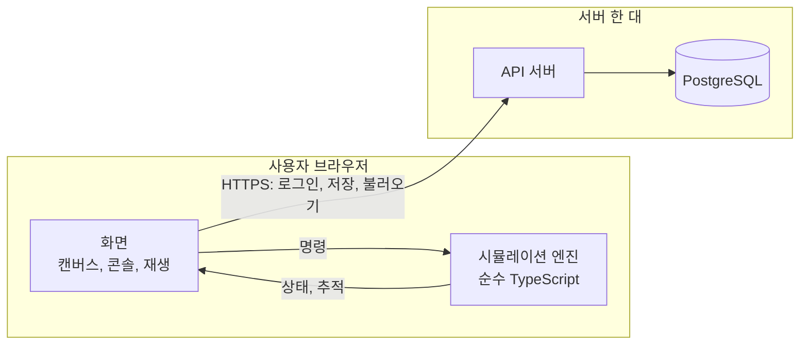

설계의 뼈대는 네 가지입니다.

| 원칙 | 내용 | 근거 |
|---|---|---|
| 엔진은 순수한 계산 모듈 | 화면·시계·난수·네트워크에 의존하지 않고, 같은 입력에 같은 결과를 냅니다 | AD-1, AD-5 |
| 변경 경로는 하나 | 캔버스, 설정 패널, CLI가 모두 같은 명령(Command)으로 토폴로지를 바꿉니다 | AD-3 |
| 상태는 셋으로 나눔 | 저장되는 문서, 실행 중 상태, 화면 상태를 섞지 않습니다 | AD-4 |
| 서버는 문서 저장소 | 서버는 토폴로지를 통째로 저장하고 내용을 해석하지 않습니다 | AD-10 |

이 구조에서 팀은 엔진, 화면, 서버로 나누어 병렬로 작업할 수 있습니다. 영역 사이의 계약은 `packages/shared`의 타입과 엔진의 공개 인터페이스입니다.

## 3.2 전체 구조

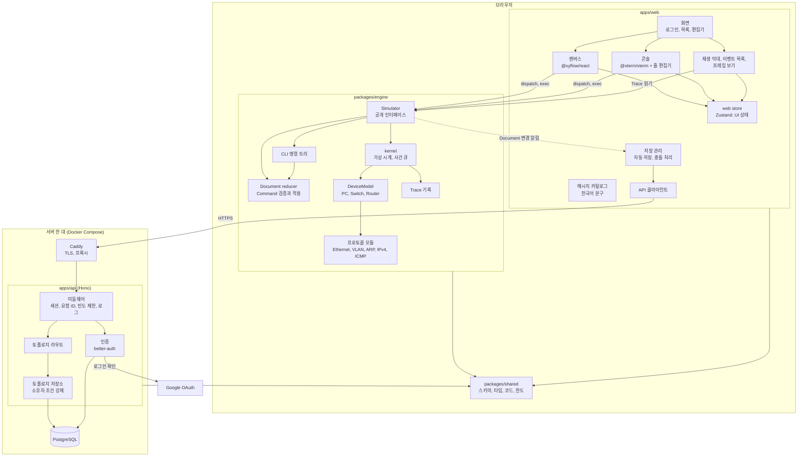

## 3.3 프론트엔드

### 화면

| 경로 | 화면 | 내용 |
|---|---|---|
| `/login` | 로그인 | "Google로 로그인" 버튼 하나 |
| `/topologies` | 토폴로지 목록 | 목록, 새로 만들기, 복제, 삭제, 가져오기, 예제에서 시작 |
| `/topologies/:id` | 편집기 | 캔버스, 콘솔, 재생 |

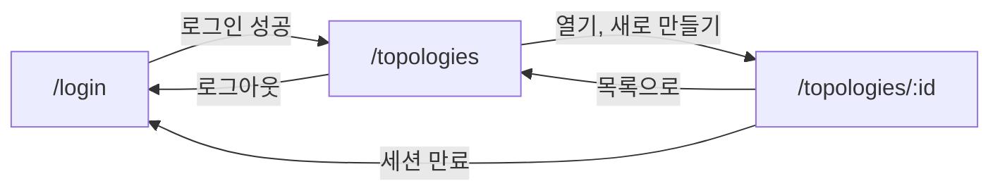

### 편집기 화면 구성

| 영역 | 위치 | 내용 | 요구사항 |
|---|---|---|---|
| 장비 목록 | 왼쪽 | PC, Switch, Router. 캔버스로 끌어다 놓음 | FR-9 |
| 캔버스 | 가운데 | 장비 노드, 링크, 포트 이름과 상태, 재생 중인 프레임 | FR-10 ~ FR-14, FR-39, FR-43 |
| 속성 패널 | 오른쪽 | 선택한 장비의 설정(PC의 IP), 테이블 보기 | FR-25, FR-44 |
| 하단 도크 | 아래 | 탭: 콘솔(장비별), 이벤트 목록, 프레임 보기. 재생 막대 | FR-19, FR-40 ~ FR-42 |
| 상단 막대 | 위 | 토폴로지 이름, 저장 상태, 내보내기, 알림 | FR-5, FR-7, FR-45 |

### 캔버스: 링크 연결 방식

장비 노드에는 연결점을 하나만 둡니다. 한 장비에서 다른 장비로 선을 끌면 **양쪽의 비어 있는 포트를 고르는 창**이 뜨고, 고르면 `link/add` 명령이 나갑니다. Switch의 포트 8개를 노드에 모두 그리면 화면이 복잡해지기 때문입니다. 연결된 뒤에는 링크 양 끝에 포트 이름과 상태가 표시됩니다.

캔버스의 노드와 선은 Document에서 계산한 값입니다. 캔버스가 자체 상태로 장비 목록을 들고 있지 않습니다 (AD-4). 장비를 끌어 옮기면 놓는 순간 `device/move` 명령이 한 번 나갑니다.

### 콘솔

`@xterm/xterm`은 글자를 그리는 터미널 화면이고 줄 편집 기능이 없습니다. 그래서 web에 작은 **줄 편집기**를 둡니다.

| 키 | 줄 편집기의 동작 | 엔진 호출 |
|---|---|---|
| 글자, Backspace, 좌우 화살표 | 현재 줄 편집 | 없음 |
| Enter | 줄을 실행하고 출력을 표시 | `ConsolePort.exec(line)` |
| Tab | 유일하게 일치하면 완성 | `ConsolePort.complete(line)` |
| `?` | 그 자리에서 쓸 수 있는 단어 목록 표시 | `ConsolePort.help(line)` |
| 위·아래 화살표 | 이전 명령어 | 없음 (web이 보관) |

프롬프트, CLI 모드, 명령어 해석은 모두 엔진에 있습니다. 줄 편집기는 입력만 다룹니다.

### 화면 상태

| 상태 | 보관 위치 | 예 |
|---|---|---|
| Document, Runtime | 엔진 (`Simulator`) | 장비, 링크, 구성, MAC 주소 테이블 |
| UI | web store (Zustand) | 선택한 장비, 열린 콘솔 탭, 재생 위치와 속도, 패널 열림 |
| 저장 상태 | 저장 관리 모듈 | 저장됨·저장 중·실패·충돌, 마지막 `revision` |
| 서버 데이터 | API 클라이언트 | 토폴로지 목록, 내 계정 |

화면은 엔진의 변경 알림을 구독해 다시 그립니다. `Simulator`는 편집기 화면이 열릴 때 하나 만들어지고 닫힐 때 버려집니다.

## 3.4 네트워크 실행 엔진

엔진은 이 제품의 핵심이며 `packages/engine`에 있습니다. 화면 없이 Node에서 그대로 실행되므로, 프로토콜 동작을 단위 테스트로 검증할 수 있습니다.

### 구성 요소

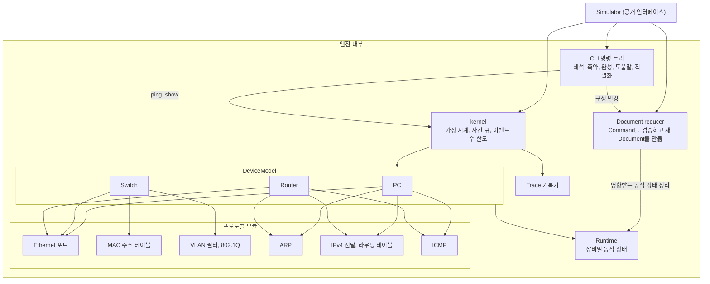

### 공개 인터페이스

web이 엔진에 대해 아는 것은 아래가 전부입니다. 두 사람이 각자 엔진과 화면을 만들 때의 계약이므로 **1주차 첫날에 `packages/shared`와 `packages/engine`의 타입으로 먼저 확정**합니다 (AD-16, AD-8).

```ts
interface Simulator {
  load(document: TopologyDocument): void;            // Runtime과 Trace 목록을 빈 상태로 새로 만듦
  dispatch(command: Command): DispatchResult;        // 동기식. Document 변경만
  console(deviceId: string): ConsolePort;
  getSnapshot(): Snapshot;                           // 변경 불가능한 단순 자료
  getTrace(traceId: number): Trace;
  subscribe(listener: () => void): () => void;
}

interface Snapshot {
  document: TopologyDocument;                        // Command가 받아들여졌을 때만 새 참조
  docVersion: number;                                // Document가 바뀔 때마다 1 증가
  runtimeVersion: number;                            // Runtime이나 Trace 목록이 바뀔 때마다 증가
  views: Record<string, DeviceView>;                 // 장비 ID별 표시용 값 (포트 상태, 테이블)
  traces: TraceSummary[];                            // 최근 20개
}

type DispatchResult =
  | { ok: true; notices: Notice[] }                  // 알림: 중복 IP 경고, VLAN 자동 생성 등
  | { ok: false; error: { code: ErrorCode; params: object } };

interface ConsolePort {
  prompt(): string;                                  // 예: "R1(config-if)#"
  exec(line: string): Promise<ConsoleResult>;
  complete(line: string): string | null;
  help(line: string): HelpEntry[];
}

interface ConsoleResult {
  lines: ConsoleLine[];
  prompt: string;                                    // 실행 뒤의 프롬프트
}

type ConsoleLine =
  | { kind: "text"; text: string }                   // show, ping 결과 등 영어 출력
  | { kind: "error"; code: ErrorCode; params: object; position?: number }
  | { kind: "notice"; code: NoticeCode; params: object }
  | { kind: "trace"; traceId: number };              // ping 회차의 추적 열기 링크
```

경계의 규칙은 다음과 같습니다.

- `Command`는 Document를 바꾸는 요청만 뜻합니다. `ping`, `arp -d`, `show`처럼 실행 중 상태만 다루는 동작은 `ConsolePort.exec`로 합니다 (AD-3).
- `dispatch`와 읽기는 동기식이고, 엔진은 화면과 같은 스레드에서 실행합니다. 비동기인 것은 `exec`뿐이며, 나중에 서버에서 실행되는 장비를 같은 인터페이스 뒤에 붙이기 위한 것입니다 (AD-16, AD-8).
- 엔진은 사용자 입력 때문에 예외를 던지지 않습니다. 잘못된 입력은 결과 값으로 돌려줍니다.
- 경계를 오가는 값은 클래스 인스턴스나 함수가 없는 단순 자료입니다.

### Document 형태

저장되는 문서의 예입니다. 정식 스키마는 `packages/shared`에 Zod로 정의합니다 (AD-9).

```json
{
  "schemaVersion": 1,
  "devices": [
    {
      "id": "d1", "kind": "router", "name": "R1", "position": { "x": 320, "y": 120 },
      "config": {
        "interfaces": {
          "GigabitEthernet0/0": { "adminUp": true, "ip": "10.0.1.1", "mask": "255.255.255.0" },
          "GigabitEthernet0/1": { "adminUp": true, "ip": "10.0.12.1", "mask": "255.255.255.252" }
        },
        "staticRoutes": [
          { "network": "10.0.2.0", "mask": "255.255.255.0", "nextHop": "10.0.12.2" }
        ]
      }
    },
    {
      "id": "d2", "kind": "switch", "name": "SW1", "position": { "x": 320, "y": 280 },
      "config": {
        "vlans": [ { "id": 1, "name": "default" }, { "id": 10, "name": "sales" } ],
        "ports": {
          "FastEthernet0/1": { "adminUp": true, "mode": "access", "accessVlan": 10 },
          "FastEthernet0/8": { "adminUp": true, "mode": "trunk", "allowedVlans": [[1, 1], [10, 10]] }
        }
      }
    },
    {
      "id": "d3", "kind": "pc", "name": "PC1", "position": { "x": 320, "y": 440 },
      "config": { "ip": "10.0.1.10", "mask": "255.255.255.0", "gateway": "10.0.1.1" }
    }
  ],
  "links": [
    { "id": "l1", "ends": [ { "deviceId": "d1", "port": "GigabitEthernet0/0" },
                            { "deviceId": "d2", "port": "FastEthernet0/1" } ] }
  ]
}
```

예시의 ID는 읽기 쉽게 줄인 것이고, 실제로는 web이 `crypto.randomUUID()`로 만듭니다.

- 장비 이름은 `name` 하나입니다. 캔버스에서 바꾸든 CLI의 `hostname`으로 바꾸든 같은 `device/rename` 명령이 나가므로 값이 어긋나지 않습니다 (FR-10, AD-3).
- 링크는 방향이 없고, 양 끝을 `{ deviceId, port }`로 가리킵니다. `port`는 항상 전체 이름입니다.
- MAC 주소는 저장하지 않습니다. 엔진이 장비 ID와 포트 순번에서 계산합니다 (AD-5).
- 토폴로지 이름과 `revision`은 문서 밖(데이터베이스 행)에 있습니다.

### 문서 검증

`shared`의 `validateDocument()` 하나가 문서의 유효성을 판정합니다 (AD-9). 형태뿐 아니라 다음도 확인합니다.

- 링크의 양 끝이 가리키는 장비와 포트가 실제로 있다.
- 포트 하나에 링크는 하나다.
- 장비 이름이 겹치지 않는다.
- 장비·링크 수가 한도 안이다.

web의 가져오기, api의 저장, 엔진의 불러오기가 모두 이 함수를 씁니다. 형태만 맞고 열면 깨지는 파일이 서버에 저장되는 일을 막기 위한 것입니다. 옛 버전의 파일은 web이 열 때 `migrateDocument()`로 올린 뒤 엔진에 넘깁니다.

### Command 목록 (MVP)

| Command | 내는 곳 | 요구사항 |
|---|---|---|
| `device/add`, `device/move`, `device/rename`, `device/remove` | 캔버스, CLI(`hostname`) | FR-9 ~ FR-11 |
| `link/add`, `link/remove` | 캔버스 | FR-12, FR-13 |
| `interface/set-admin` | CLI(`shutdown`, `no shutdown`) | FR-18 |
| `interface/set-ip`, `interface/clear-ip` | CLI(`ip address`) | FR-26 |
| `pc/set-ip` | 설정 패널, CLI(`ipconfig`) | FR-25 |
| `route/add`, `route/remove` | CLI(`ip route`) | FR-35 |
| `vlan/create`, `vlan/rename`, `vlan/remove` | CLI(`vlan`, `name`) | FR-31 |
| `switchport/set-mode`, `switchport/set-access-vlan`, `switchport/set-allowed-vlans` | CLI(`switchport …`) | FR-32, FR-33 |

검증은 두 층입니다 (AD-3).

| 검증 | 위치 | 예 |
|---|---|---|
| 값 하나의 형식 | `shared`의 값 검증 함수. CLI 해석기와 reducer가 같은 함수를 씀 | IPv4 형식, 연속된 마스크, VLAN 번호 범위, 포트 이름, 장비 이름 |
| 토폴로지 전체에 걸친 규칙 | reducer만 | 겹치는 네트워크, 중복 이름, 한도, 이미 쓰인 포트 |

실패하면 `{ code, params }`를 돌려줍니다. 설정 패널과 CLI가 같은 오류를 받아 각자 방식으로 보여 주며, CLI가 더하는 것은 틀린 단어의 위치뿐입니다 (AD-14). 장비의 기본 이름(`PC1`, `SW1`, `R1`)은 reducer가 붙입니다.

### kernel: 이산 사건 시뮬레이션

엔진은 실제 시간을 기다리지 않습니다. 가상 시계와 사건 큐로 계산합니다 (AD-5).

- 사건은 두 종류입니다: "프레임이 어느 포트에 도착함"과 "타이머가 만료됨"(ARP 대기 2초 등).
- kernel은 큐에서 `(가상 시각, 순번)`이 가장 작은 사건을 꺼내 해당 장비의 `DeviceModel`에 넘깁니다. 장비는 상태를 바꾸고 새 사건을 큐에 넣습니다.
- 링크 한 구간의 지연은 가상 시간 1,000마이크로초입니다.
- 큐가 비거나 이벤트 수가 한도(2,000개)에 닿으면 멈춥니다. 한도에 닿으면 `LOOP_GUARD`로 끝냅니다 (FR-30).
- 결과적으로 `ping` 4회는 실제 시간으로는 즉시 계산이 끝나고, 완성된 Trace 4개가 나옵니다.

🟡 콘솔의 `ping` 출력은 계산이 끝나는 대로 바로 표시하고, 캔버스 재생은 그와 별도로 진행하는 것으로 설계했습니다. 콘솔 출력을 재생 속도에 맞춰 한 줄씩 보여 주는 방식은 재생을 멈추면 콘솔도 멈추는 문제가 있어 택하지 않았습니다.

### DeviceModel

```ts
interface DeviceModel {
  onFrame(ctx: SimContext, port: string, frame: Frame): void;
  onTimer(ctx: SimContext, timer: TimerRef): void;
  onConfigChanged(ctx: SimContext, change: ConfigChange): void;  // 영향받는 동적 상태 정리
  view(): DeviceView;
}
```

`SimContext`는 프레임 보내기, 타이머 걸기, 이벤트 기록, 현재 가상 시각 조회만 제공합니다. 장비는 kernel의 큐에 직접 손대지 않습니다.

`view()`가 돌려주는 `DeviceView`는 화면에 보일 값의 묶음이며 `shared`에 타입을 둡니다 (AD-7). 화면은 아이콘이나 입력 양식처럼 **표현**에 한해서만 장비 종류로 분기하고, 값은 직접 계산하지 않습니다.

| 포트 상태 | 뜻 |
|---|---|
| `up` | 동작 중 |
| `admin-down` | 사용자가 껐음 (`shutdown`) |
| `no-link` | 링크가 연결되지 않음 |
| `peer-down` | 링크는 있으나 상대 포트가 꺼져 있음 |

포트 상태는 엔진만 계산합니다. 캔버스의 색과 `show` 출력이 같은 값을 씁니다.

| 장비 | 조합하는 프로토콜 모듈 |
|---|---|
| PC | Ethernet 포트, ARP, IPv4(자기 주소와 게이트웨이만), ICMP |
| Switch | Ethernet 포트, MAC 주소 테이블, VLAN 필터 |
| Router | Ethernet 포트, ARP, IPv4 전달과 라우팅 테이블, ICMP |

2차에서 NAT, DHCP, RIP를 넣을 때는 프로토콜 모듈을 추가해 Router와 PC에 조합합니다. kernel과 화면은 바뀌지 않습니다.

### CLI 명령 트리

명령어 하나는 정의 하나입니다 (AD-8).

```ts
defineCommand({
  modes: ["config-if"],
  devices: ["router"],
  tokens: ["ip", "address", param("ip", "ipv4"), param("mask", "mask")],
  help: "Set the interface IPv4 address",
  run: (args, session) => command("interface/set-ip", { ...session.target, ...args }),
  serialize: (cfg) => cfg.ip ? `ip address ${cfg.ip} ${cfg.mask}` : null,
});
```

이 목록 하나에서 다음이 모두 계산됩니다.

| 기능 | 계산 방법 | 요구사항 |
|---|---|---|
| 해석과 축약 | 현재 모드의 정의 중 입력 단어가 접두사로 일치하는 것을 찾음. 둘 이상이면 모호함 오류 | FR-21 |
| Tab 완성, `?` 도움말 | 같은 일치 결과에서 다음 단어 후보와 `help`를 꺼냄 | FR-21 |
| `no` 형식 | 정의에 `no` 처리기가 있는 명령어만 허용 | FR-22 |
| `show running-config` | 모든 정의의 `serialize`를 구성에 적용해 줄을 모음 | FR-23 |
| 오류 위치 표시 | 일치가 끊긴 단어의 위치를 오류에 담음 | FR-46 |

CLI 세션(현재 모드, 선택한 인터페이스)은 Runtime에 장비별로 하나씩 있습니다. 같은 장비의 콘솔을 닫았다 열어도 모드가 유지됩니다 (FR-19).

### Trace와 이벤트

```ts
interface Trace {
  id: number;                        // 엔진의 증가 번호
  docVersion: number;                // 계산 당시의 Document 버전
  events: TraceEvent[];
  result: { status: "success" | "failed" | "loop-guard"; primaryDropSeq?: number };
}

interface TraceEvent {
  seq: number;                       // Trace 안에서의 순번
  time: number;                      // Trace 시작부터의 가상 시간 (마이크로초)
  frameId: number;                   // 같은 프레임을 따라가기 위한 번호
  parentSeq?: number;                // 이 이벤트를 일으킨 이벤트
  deviceId: string;
  inPort?: string;
  outPort?: string;
  linkId?: string;                   // 전달일 때 프레임이 지나는 링크
  layer: "L2" | "ARP" | "L3" | "ICMP";
  action: "create" | "receive" | "learn" | "forward" | "reply" | "drop";
  reason: { code: ReasonCode; params: object };   // 설명. 문구는 web의 메시지 카탈로그가 만듦
  frame: FrameSnapshot;              // 그 시점의 프레임 내용 (변경 불가)
  dropReason?: DropReason;           // 폐기일 때만
}
```

이벤트와 재생의 규칙은 다음과 같습니다 (AD-6).

- 이벤트 하나는 **프레임 하나가 한 곳에 있는 순간**입니다. Switch가 포트 7개로 flooding하면 `forward` 이벤트가 7개 생깁니다.
- 재생의 **한 단계는 같은 `time`을 가진 이벤트의 묶음**입니다. flooding된 프레임 7개는 한 단계에서 함께 움직입니다. 이벤트 목록은 이벤트를 하나씩 나열합니다.
- 목적지가 아닌 장비가 프레임을 버리는 것(`NOT_FOR_ME`)은 정상 동작입니다. 실패한 Trace는 실패의 원인이 된 이벤트를 `primaryDropSeq`로 가리키고, 화면은 그 이벤트의 사유를 실패 사유로 보여 줍니다 (FR-47).
- 재생 화면은 Trace, 단계 번호, 현재 Document의 장비 위치만으로 그립니다. "이전 단계"는 단계 번호를 줄이는 것이고, 엔진을 되돌리지 않습니다.
- Trace가 가리키는 장비나 링크가 현재 Document에 없으면(재생 전에 지운 경우) 그 Trace는 "토폴로지가 바뀜"으로 표시하고 캔버스 재생을 막습니다. 이벤트 목록은 계속 볼 수 있습니다.
- 프레임 보기의 "달라진 필드 강조"(FR-42)는 같은 `frameId`의 앞 이벤트와 비교해 계산합니다.
- 테이블 패널은 재생 위치와 무관하게 항상 현재의 실행 중 상태를 보여 줍니다.

## 3.5 백엔드

`apps/api`는 Hono로 만든 Node 서버 하나입니다. 같은 프로세스가 SPA 정적 파일과 `/api`를 함께 제공합니다 (AD-12).

### API

| 메서드 | 경로 | 동작 | 응답 |
|---|---|---|---|
| — | `/api/auth/*` | 로그인 시작, Google 콜백, 로그아웃. 경로는 인증 라이브러리가 정함 | 리디렉션, 쿠키 |
| GET | `/api/me` | 내 계정 정보 | `{ id, name }` 또는 401 |
| GET | `/api/topologies` | 내 토폴로지 목록 | `[{ id, name, deviceCount, updatedAt }]` |
| POST | `/api/topologies` | 생성. 본문에 `document`가 있으면 가져오기·복제 | 201 `{ id, revision }` |
| GET | `/api/topologies/:id` | 열기 | `{ id, name, document, revision, updatedAt }` |
| PUT | `/api/topologies/:id` | 저장. 본문 `{ name?, document, revision }` | 200 `{ revision }`, 409 충돌 |
| DELETE | `/api/topologies/:id` | 삭제 | 204 |
| GET | `/api/health` | 상태 확인. 데이터베이스 연결 포함 | 200 |

예제 토폴로지(FR-8)는 서버에 두지 않고 web에 파일로 포함합니다. "예제에서 시작"은 그 내용을 `POST /api/topologies`로 보내는 것입니다.

### 요청 처리 순서

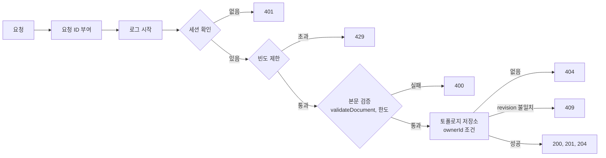

### 오류 응답

모든 오류는 한 가지 형태이고, 엔진의 오류와 같은 `{ code, params }` 구조입니다 (AD-14). 사용자에게 보일 문장은 서버가 만들지 않고 web의 메시지 카탈로그가 코드에서 만듭니다.

```json
{ "error": { "code": "TOPOLOGY_REVISION_CONFLICT", "params": { "currentRevision": 12 } } }
```

| 코드 | HTTP | 상황 |
|---|---|---|
| `UNAUTHENTICATED` | 401 | 세션 없음, 만료 |
| `VALIDATION_FAILED` | 400 | 스키마 불일치 |
| `LIMIT_EXCEEDED` | 400 | 장비·링크·토폴로지 수, 파일 크기 한도 초과 |
| `NOT_FOUND` | 404 | 없거나 남의 토폴로지 |
| `TOPOLOGY_REVISION_CONFLICT` | 409 | 다른 곳에서 먼저 저장됨 |
| `RATE_LIMITED` | 429 | 요청이 너무 잦음 |
| `INTERNAL` | 500 | 그 밖의 오류. 상세는 로그에만 남김 |

## 3.6 데이터베이스

### 테이블

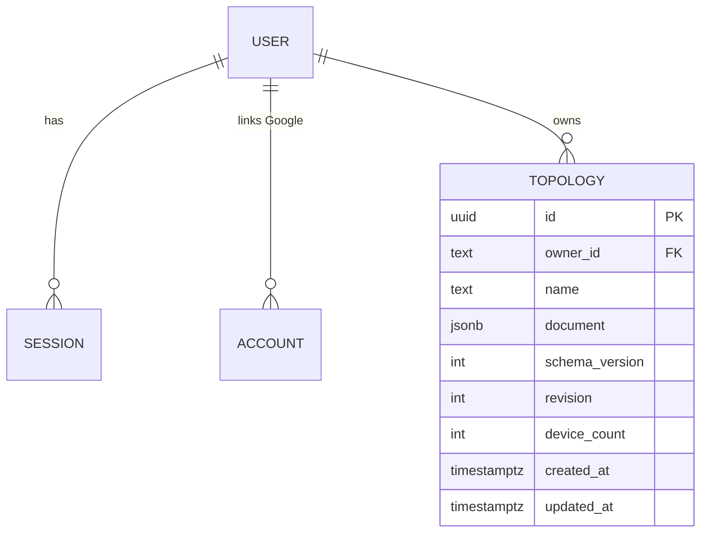

`USER`, `SESSION`, `ACCOUNT`와 그림에 없는 `VERIFICATION` 테이블은 인증 라이브러리가 만들고 관리합니다. `owner_id`의 타입은 그 라이브러리가 만든 `user.id`의 타입을 따르며, 1주차에 생성된 스키마를 보고 확정합니다. 우리가 정의하는 테이블은 `topology` 하나입니다.

| 열 | 용도 |
|---|---|
| `document` | 토폴로지 전체 (장비, 링크, 구성). 서버는 내용을 해석하지 않고 `validateDocument()`만 실행 |
| `schema_version` | Document 안의 `schemaVersion`을 옮겨 적은 사본. 원본은 문서 안의 값 |
| `revision` | 1에서 시작. 서버만 올리고, 모든 쓰기 응답에 담아 돌려줌. 충돌 감지에 사용 |
| `device_count` | 목록 화면에 보여 줄 값. 저장할 때 함께 기록 |

데이터베이스 변경은 인증 라이브러리의 스키마 생성, Drizzle Kit 마이그레이션 생성, 적용 순서로 합니다.

색인은 `(owner_id, updated_at DESC)` 하나입니다. 목록 조회가 이 색인을 씁니다.

### 저장 쿼리와 충돌

```sql
UPDATE topology
   SET document = $1, name = $2, device_count = $3,
       schema_version = $4, revision = revision + 1, updated_at = now()
 WHERE id = $5 AND owner_id = $6 AND revision = $7
RETURNING revision;
```

갱신된 행이 없으면, 같은 `id`와 `owner_id`로 다시 조회해 행이 있으면 409, 없으면 404를 돌려줍니다.

### 토폴로지를 문서 하나로 저장하는 이유

| | JSONB 문서 하나 (채택) | 장비·링크 정규화 테이블 |
|---|---|---|
| 저장과 불러오기 | 쿼리 하나, 원자적 | 여러 테이블, 트랜잭션 필요 |
| 스키마 변경 | `schemaVersion`과 변환 함수 | 테이블 마이그레이션 |
| 서버의 역할 | 저장소 | 토폴로지 구조를 알아야 함 |
| 약점 | 서버에서 "VLAN을 쓰는 토폴로지 수" 같은 통계를 내기 어려움 | — |

엔진은 항상 문서 전체를 읽고 쓰며, 서버에서 토폴로지 내부를 조회해야 하는 요구사항이 없습니다. 문서 크기는 512KB로 제한합니다 (NFR-6). trunk의 허용 VLAN은 범위(시작, 끝)의 목록으로 저장합니다.

### 마이그레이션과 백업

- 테이블 변경은 Drizzle Kit이 만든 마이그레이션 파일로 관리하고, 배포할 때 적용합니다.
- 백업은 하루 한 번 `pg_dump`를 떠서 7일치를 보관하고, 암호화해 서버 밖으로도 매일 복사합니다. 상세는 [05 문서](05-security-and-testing.md)의 SEC-26입니다.

## 3.7 실시간 통신

**MVP에는 실시간 채널이 없습니다** (AD-13). 콘솔 입력, 패킷 추적, 재생은 모두 브라우저 안에서 일어나므로 서버와 실시간으로 주고받을 것이 없습니다. 브라우저와 서버 사이의 통신은 자동 저장을 포함해 모두 HTTPS 요청·응답입니다.

| 필요 | 방식 |
|---|---|
| 콘솔 입출력 | 브라우저 안에서 엔진 호출 |
| 패킷 흐름 표시 | 브라우저 안에서 Trace 재생 |
| 저장 | `PUT /api/topologies/:id` (입력이 멈추고 3초 뒤) |
| 다른 탭의 변경 감지 | 저장할 때 `revision` 비교 |

### 자동 저장 흐름

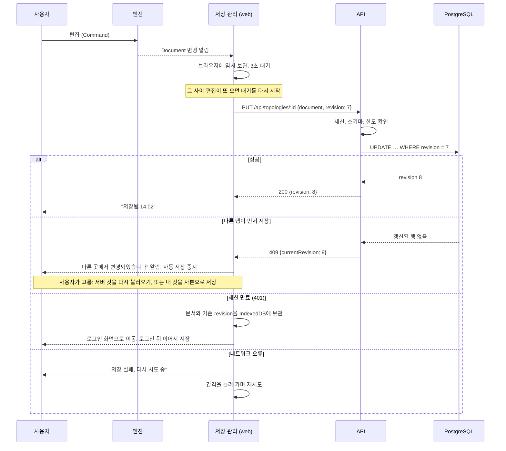

저장의 규칙은 다음과 같습니다 (AD-10).

- 저장 관리는 **한 번에 요청 하나만** 보냅니다. 요청 중에 생긴 변경은 응답으로 받은 새 `revision`으로 이어서 보냅니다. 자동 저장과 수동 저장이 겹쳐 자기 자신과 충돌하는 일을 막습니다.
- 충돌(409)이 나면 덮어쓰기를 제공하지 않습니다. 서버의 것을 다시 불러오거나, 내 것을 새 토폴로지로 저장합니다. 어느 쪽도 잃지 않습니다.
- 임시 보관은 IndexedDB에 `{ userId, topologyId, baseRevision, document }`로 둡니다. Google 로그인으로 페이지가 완전히 바뀌어도 남아 있습니다 (FR-2). 현재 사용자의 초안만 이어 저장하고, 로그아웃하면 지웁니다.
- 인증 정보는 브라우저 저장소에 두지 않습니다 (AD-12).

### 3차에서 실시간 채널이 필요해지는 경우

서버에서 실행되는 장비(FRRouting 컨테이너)를 붙이면 그 장비의 콘솔 입출력에 WebSocket이 필요합니다. 그때 새 AD로 추가합니다. 구조는 [3.14절](#314-3차-확장-서버에서-실행되는-장비)에 있습니다.

## 3.8 인증과 인가

### 로그인 흐름

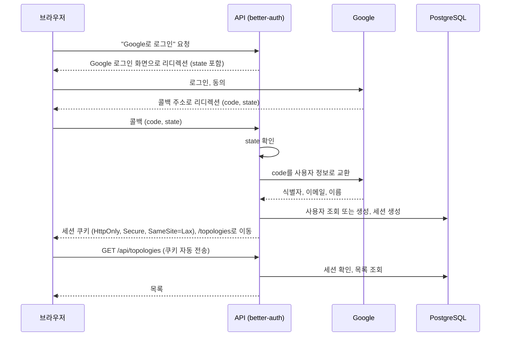

| 항목 | 설계 |
|---|---|
| 인증 수단 | Google 소셜 로그인만. 비밀번호를 받지 않음 (D12, D14) |
| 세션 | 서버 측 세션. 데이터베이스에 저장하고, 브라우저에는 식별자 쿠키만 둠 |
| 쿠키 | `HttpOnly`, `Secure`, `SameSite=Lax`. 라이브러리 기본값에 기대지 않고 설정에 명시하며, 응답 헤더를 확인하는 테스트를 둠 (AD-12) |
| 출처 | 운영과 로컬 모두 화면과 API가 같은 출처. 로컬은 개발 서버의 프록시로 맞춤 |
| 저장하는 개인정보 | Google 계정 식별자, 이메일, 표시 이름 (NFR-9) |
| 세션 만료 | 🟡 24시간 쓰지 않으면 만료. 쓰더라도 7일이 지나면 만료 |
| 로그아웃 | 서버의 세션을 삭제하고 쿠키를 지움 |

### 인가

역할이 없으므로 인가 규칙은 하나입니다: **사용자는 자기 토폴로지만 읽고 쓴다.**

이 규칙은 라우트마다 확인하지 않고 저장소 모듈에서 강제합니다 (AD-11). 저장소의 모든 함수가 `ownerId`를 필수 인자로 받아 쿼리 조건에 넣으므로, 확인을 빠뜨린 엔드포인트가 생길 수 없습니다. 남의 토폴로지 ID로 요청하면 404를 돌려줘 존재 여부도 알리지 않습니다.

보안 대책의 상세(요청 위조 방지, 입력 검증, 빈도 제한 수치, 보안 헤더)는 5단계 문서에서 다룹니다.

## 3.9 로깅

| 대상 | 방식 | 내용 |
|---|---|---|
| API 서버 | pino로 JSON 한 줄씩 표준 출력에 기록 | 요청, 업무 사건, 오류 |
| Caddy | 접근 로그를 표준 출력에 기록 | 요청 주소, 상태 코드, 소요 시간 |
| PostgreSQL | 기본 로그 | 오류, 느린 쿼리 |
| 브라우저 | MVP는 수집하지 않음 | 오류는 사용자 화면에만 표시 |
| 시뮬레이션 | 로그가 아니라 Trace로 사용자에게 보여 줌 | — |

컨테이너의 표준 출력은 Docker가 파일로 보관합니다. 🟡 컨테이너당 10MB 파일 5개로 돌려 씁니다.

### API 로그 항목

| 필드 | 예 |
|---|---|
| `time`, `level` | 시각, `info` |
| `reqId` | 요청마다 붙이는 ID. 응답 헤더에도 넣음 |
| `userId` | 내부 사용자 ID. 로그인 전에는 없음 |
| `method`, `path`, `status`, `durationMs` | `PUT`, `/api/topologies/:id`, 200, 18 |
| `event` | `auth.login`, `auth.logout`, `topology.create`, `topology.save`, `topology.delete`, `topology.conflict`, `validation.failed`, `rate.limited` |

로그에 **남기지 않는 것**: Document 본문, 세션 쿠키, OAuth 코드와 토큰, 이메일 (AD-15).

## 3.10 컨테이너 실행과 배포 환경

시뮬레이션 방식이므로 **장비를 실행하는 컨테이너는 없습니다.** 컨테이너는 서비스 자체를 배포하는 데만 씁니다.

### 컨테이너 구성

| 컨테이너 | 이미지 | 역할 | 외부에 여는 포트 | 저장소 |
|---|---|---|---|---|
| `caddy` | Caddy 2.11 | TLS 인증서 발급·갱신, HTTP를 HTTPS로 돌림, `app`으로 프록시 | 80, 443 | 인증서 볼륨 |
| `app` | 직접 빌드 (Node 24) | API와 SPA 정적 파일 제공 | 없음 | 없음 |
| `postgres` | PostgreSQL 18 | 데이터베이스 | 없음 | 데이터 볼륨 |

`app` 이미지는 두 단계로 빌드합니다. 첫 단계에서 web과 api를 빌드하고, 둘째 단계에는 실행에 필요한 파일만 넣습니다. 컨테이너는 root가 아닌 사용자로 실행합니다.

### 운영 환경의 네트워크 구성

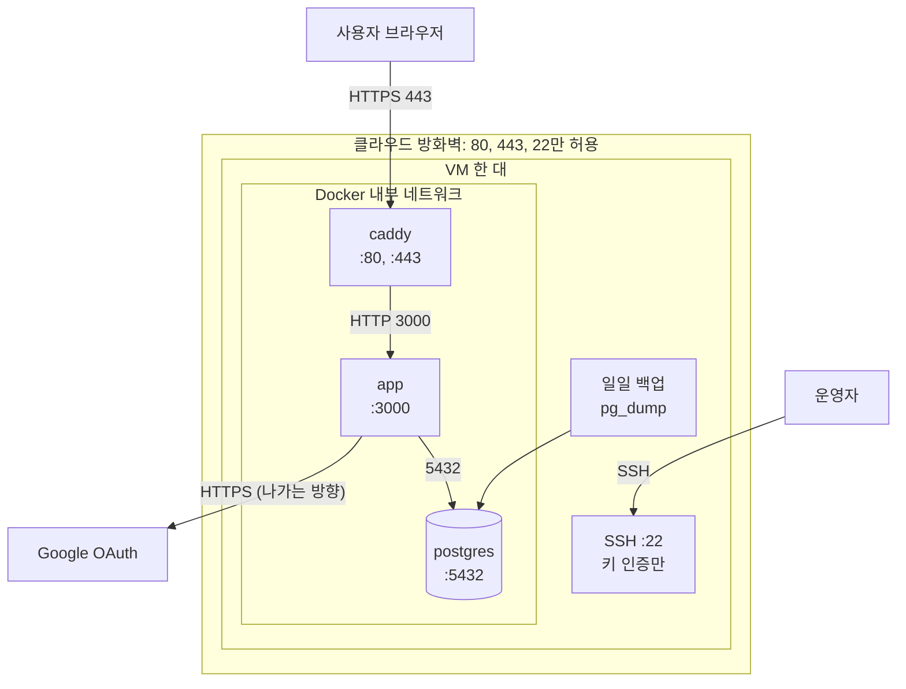

`app`과 `postgres`는 외부에 포트를 열지 않습니다. 데이터베이스에는 `app`과 백업 작업만 접근합니다.

### 추천 배포 위치

| 선택지 | 판단 | 근거와 단서 |
|---|---|---|
| **Oracle Cloud Always Free VM** | **추천** | Arm 인스턴스 합계 2 OCPU·메모리 12GB, 저장소 200GB를 무료로 제공 ([01 문서](01-technical-validation.md)의 출처 [47]). ⚠️ 인스턴스를 바로 할당받을 수 있는지, 유휴 인스턴스가 회수되는지는 미확인 |
| 관리형 플랫폼의 무료 플랜 | 대안 | 서버 관리가 필요 없음. ⚠️ 무료 한도와 휴면 정책을 조사하지 못함 |
| 팀원 PC | 시연용 예비 | 비용 없음. 항상 켜 두기 어렵고 외부 접속 설정이 필요 |

필요한 자원은 작습니다. 세 컨테이너를 합쳐 메모리 1GB 안팎으로 예상합니다. 🟡 이 수치는 측정값이 아닙니다.

❓ 도메인 이름과 TLS 인증서 발급 경로는 미결정입니다. Caddy가 인증서를 자동으로 발급받으려면 서버를 가리키는 도메인 이름이 필요합니다.

### 환경

| 환경 | 구성 | 용도 |
|---|---|---|
| 로컬 | Vite 개발 서버(web), api 프로세스, `postgres` 컨테이너. Vite가 `/api`를 api로 넘김 | 개발, 테스트 |
| 운영 | 위 컨테이너 세 개 | 실제 사용, 시연 |

준비 환경(staging)은 두지 않습니다. 3인·4주 규모에서는 로컬 확인과 자동 테스트로 대신합니다.

### 환경 변수

| 변수 | 내용 |
|---|---|
| `DATABASE_URL` | PostgreSQL 연결 주소 |
| `APP_URL` | 서비스의 공개 주소. 리디렉션과 쿠키 설정에 사용 |
| `AUTH_SECRET` | 세션 서명용 비밀값 |
| `GOOGLE_CLIENT_ID`, `GOOGLE_CLIENT_SECRET` | Google OAuth 자격 증명 |
| `LOG_LEVEL` | 로그 수준 |

비밀값은 저장소에 넣지 않고 서버의 환경 파일과 CI의 비밀 저장소에만 둡니다. api는 시작할 때 값이 빠져 있으면 실행하지 않습니다.

### 빌드와 배포 흐름

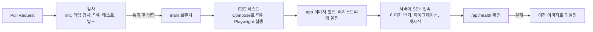

## 3.11 데이터 흐름

### 편집 명령의 흐름

캔버스에서 하든 CLI에서 하든 같은 길을 지납니다 (AD-3).

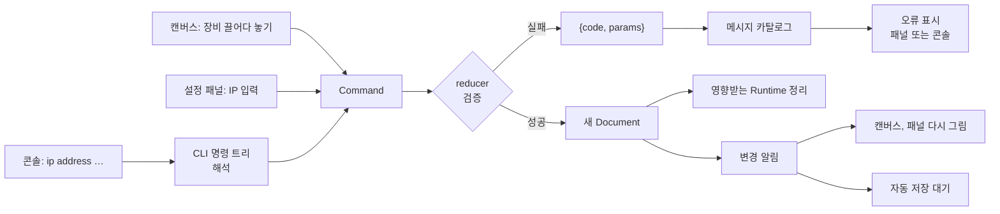

### ping 한 번의 흐름

PC1이 다른 네트워크의 PC2로 ping을 보내는 경우입니다. ARP 테이블이 비어 있다고 가정합니다.

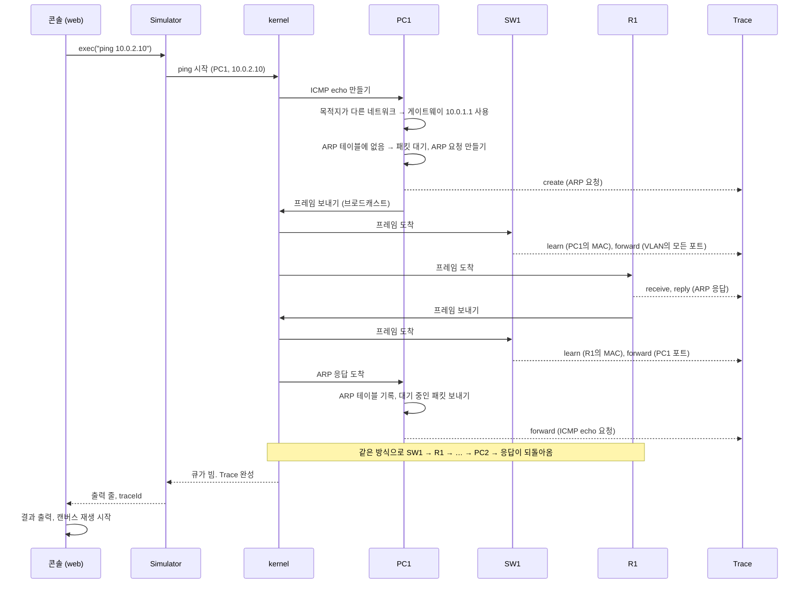

### 재생의 흐름

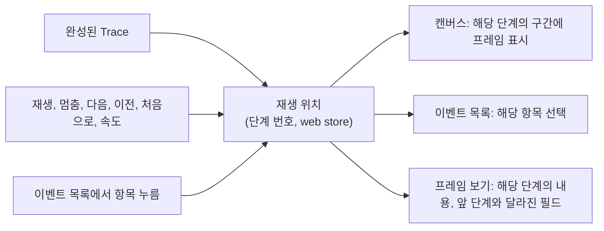

세 화면이 같은 재생 위치를 보므로 서로 어긋나지 않습니다 (FR-41).

## 3.12 기술 선택: 근거, 대안, 트레이드오프

| 영역 | 선택 | 근거 | 검토한 대안 | 감수하는 것 |
|---|---|---|---|---|
| 언어 | TypeScript 6.0.3, 전 영역 | 엔진·화면·서버가 같은 타입과 스키마를 공유. 팀원이 서로의 코드를 읽을 수 있음 | 서버만 Java·Python. TypeScript 7.0.2 (최신이지만 lint 도구가 쓰는 API가 아직 없어 typescript-eslint가 지원하지 않음. 기각) | 서버 쪽 생태계 선택 폭이 줄어듦. 최신 주 버전이 아님 |
| 저장소 구조 | pnpm 12 workspace 모노레포 | `shared`와 `engine`을 패키지로 분리해 의존 방향을 강제 (AD-2) | 저장소 분리, 단일 패키지 | 초기 설정이 조금 더 듦 |
| 코드 검사 | ESLint 10 + typescript-eslint 8.72 | 의존 방향(AD-2)과 엔진 안의 금지 함수(AD-5)를 규칙으로 막음 | 검사 없음 | TypeScript 버전이 typescript-eslint의 지원 범위(6.1 미만)에 묶임 |
| 화면 | React 19 + Vite 8 (SPA) | 서버 렌더링이 필요 없음. 엔진이 브라우저에서만 돎. 캔버스와 터미널 라이브러리가 React를 지원 | Next.js (서버 렌더링과 API를 한 프레임워크로), Svelte | 로그인 화면까지 스크립트로 그려짐. 검색 노출은 요구사항이 아님 |
| 캔버스 | @xyflow/react 12 | MIT. 노드 끌기, 연결, 확대·이동을 기본 제공. 노드에 연결점을 여러 개 둘 수 있음 | Cytoscape.js (그래프 분석 중심), Konva로 직접 구현 | 표시 배지를 제거할 수 없음 (Pro 구독 필요). 재생 애니메이션은 직접 그려야 함 |
| 콘솔 | @xterm/xterm 6 + 자체 줄 편집기 | 터미널다운 화면, 복사·붙여넣기, 스크롤. 나중에 실제 장비 콘솔을 붙이기 쉬움 | 입력창과 출력 영역을 직접 구현 | 줄 편집을 직접 구현해야 함. 일정이 밀리면 직접 구현한 입력창으로 바꿀 수 있고, `ConsolePort` 경계가 같아 교체 범위가 web에 한정됨 |
| 화면 상태 | Zustand 5 | 작고 단순. UI 상태만 담으므로 큰 도구가 필요 없음 | Redux Toolkit, React Context | 규칙이 느슨해 팀이 규칙(AD-4)을 지켜야 함 |
| 엔진 구조 | 이산 사건 kernel + 순수 함수 | 결정적, 단계별 재생과 단위 테스트가 쉬움, 타이머를 가상 시간으로 처리 | 장비 함수가 서로를 직접 호출하는 방식 | 직접 호출 방식보다 초기 구현이 조금 더 듦 |
| 엔진 실행 위치 | 화면과 같은 스레드, 동기식 호출 (AD-16) | 구현과 화면 연동이 단순. 장비 30대 ping 계산은 짧을 것으로 예상 | Web Worker (모든 호출이 비동기가 됨) | ⚠️ 계산이 길어지면 화면이 멈춤. NFR-2를 CI의 성능 테스트로 감시. 나중에 Worker로 옮기면 web의 호출부를 고쳐야 함 |
| API 프레임워크 | Hono 4 + @hono/node-server 2 | 작고 TypeScript 친화적. 정적 파일 제공과 Node 실행이 공식 문서에 있음 | Fastify 5 (성숙, 플러그인 풍부), NestJS (규모에 비해 무거움), Express | Fastify보다 운영 사례가 적음. 둘 중 어느 것이든 요구사항을 충족하며, 바꿔도 `apps/api` 안에서 끝남 |
| 인증 | better-auth 1.7 + Drizzle 어댑터 | Google 로그인, Hono 연동, Drizzle을 통한 PostgreSQL 저장이 공식 문서에 있고 패키지 간 요구 버전이 맞음 | arctic으로 직접 구현 (2026-07 폐기 표시되어 기각), @auth/core (0.x 버전) | 라이브러리가 사용자·세션 테이블 형태를 정함. ⚠️ 쿠키 속성의 기본값은 문서에서 확인하지 못해 명시적으로 설정 |
| 데이터베이스 | PostgreSQL 18 | JSONB, 동시 저장 처리, 널리 쓰임 | SQLite (서버 한 대에는 더 단순, 파일 복사로 백업), MongoDB | 컨테이너 하나와 백업 작업이 더 필요 |
| 데이터 접근 | Drizzle ORM 0.45 + pg 8 | 타입이 스키마에서 나옴. SQL에 가까워 저장 쿼리를 그대로 쓸 수 있음 | Prisma (`latest` 태그가 출시 후보판이어서 기각), SQL 직접 작성 | 0.x 버전이라 API가 바뀔 수 있음. 테이블이 하나여서 영향 범위가 작음 |
| 저장 형태 | JSONB 문서 통째 + `revision` | [3.6절](#토폴로지를-문서-하나로-저장하는-이유) | 정규화 테이블, 변경분만 보내기 | 저장할 때마다 문서 전체를 보냄 (최대 512KB) |
| 검증 | Zod 4, `shared`에 한 번 정의 | web·api·engine이 같은 스키마를 씀 (AD-9) | 각자 검증 | — |
| 실시간 통신 | 없음 | [3.7절](#37-실시간-통신) | WebSocket | 다른 탭의 변경을 저장 시점에야 앎 |
| 프록시와 TLS | Caddy 2.11 | 인증서 자동 발급·갱신, 설정이 짧음 | Nginx + certbot, Traefik | Nginx보다 자료가 적음 |
| 배포 | VM 한 대 + Docker Compose 5 | 구성 요소가 셋뿐. 전체를 직접 통제 | 관리형 플랫폼, Kubernetes | 서버 한 대가 멈추면 전체가 멈춤. 무중단 배포가 아님 |
| 테스트 | Vitest 5, fast-check 4, Playwright 1.64 | 엔진은 단위·속성 기반 테스트, 화면은 E2E. 상세는 5단계 문서 | Jest, Cypress | — |
| 로그 | pino 10, 표준 출력 | 구조적 로그를 가장 단순하게 남김 | 로그 수집 서비스 | 검색과 알림이 없음. 서버에 접속해 확인 |
| 스타일 | Tailwind CSS 4 | 별도 디자인 체계 없이 빠르게 화면을 만듦 | CSS Modules, 컴포넌트 라이브러리 | 클래스가 길어짐 |

Node.js는 24.22.2를 씁니다. 장기 지원(LTS) 계열이며 2026-10-20부터 유지보수 단계입니다. 확인한 패키지들의 Node 요구 범위를 모두 만족합니다. 2026-10-28에 LTS가 된 26.13.0도 같은 범위를 만족하므로 대안이 됩니다.

PostgreSQL은 18이 현재 정식 출시된 최신 주 버전입니다(19는 출시 후보 단계). Caddy 2.11.9는 조사 당일에 배포되어 컨테이너 이미지가 아직 올라오지 않았을 수 있습니다. 배포할 때 2.11 계열의 최신 이미지를 씁니다.

버전은 번호와 패키지 간 요구 범위를 확인한 것이며, 함께 실행해 본 것은 아닙니다. 1주차에 빈 프로젝트에서 전체를 한 번 실행해 확인합니다.

## 3.13 요구사항 대응

| 요구사항 묶음 | 구현 위치 | 지켜야 할 규칙 |
|---|---|---|
| 계정 (FR-1, FR-2) | `apps/api` 인증, `apps/web` 로그인 화면 | AD-12, AD-15 |
| 토폴로지 관리 (FR-3 ~ FR-8) | `apps/api` 저장소, `apps/web` 목록 화면, `shared` 스키마 | AD-9, AD-10, AD-11 |
| 편집기 (FR-9 ~ FR-14) | `apps/web` 캔버스, `engine` reducer | AD-3, AD-4 |
| 장비 (FR-15 ~ FR-18) | `engine` DeviceModel | AD-7 |
| 콘솔과 CLI (FR-19 ~ FR-24) | `engine` CLI 명령 트리, `apps/web` 콘솔 | AD-7, AD-8, AD-14 |
| IP 설정 (FR-25 ~ FR-27) | `engine` reducer, `apps/web` 설정 패널 | AD-3 |
| Switching, ARP, 루프 보호 (FR-28 ~ FR-30) | `engine` 프로토콜 모듈, kernel | AD-5, AD-7 |
| VLAN (FR-31 ~ FR-33) | `engine` 프로토콜 모듈 | AD-7, AD-8 |
| Routing, ICMP (FR-34 ~ FR-37) | `engine` 프로토콜 모듈 | AD-5, AD-7 |
| ping (FR-38) | `engine` DeviceModel, CLI 명령 트리 | AD-5, AD-8 |
| 추적과 재생 (FR-39 ~ FR-42) | `engine` Trace, `apps/web` 재생 화면 | AD-6 |
| 상태 표시 (FR-43, FR-44) | `engine`의 `DeviceView`, `apps/web` | AD-4, AD-7 |
| 엔진과 화면의 경계 | `engine`의 `Simulator`, `shared` 타입 | AD-16 |
| 오류 피드백 (FR-45 ~ FR-47) | `shared` 코드, `apps/web` 메시지 카탈로그 | AD-14 |
| 결정성 (NFR-11) | `engine` kernel | AD-5 |
| 데이터 한도 (NFR-6) | `shared` 상수, `engine` reducer, `apps/api` 검증 | AD-9 |

## 3.14 3차 확장: 서버에서 실행되는 장비

MVP에서는 만들지 않습니다. 지금 고정해 두는 것은 **콘솔 경계가 비동기라는 점 하나**입니다 (AD-7).

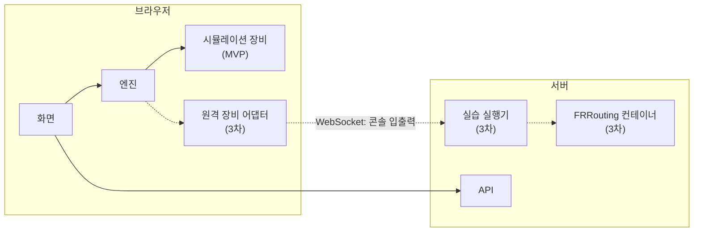

점선이 3차에 추가될 부분입니다. 시작하기 전에 확인해야 할 것은 [01 문서 1.9절](01-technical-validation.md#19-검증되지-않은-사항과-후속-확인)의 V4 ~ V7입니다. 특히 시뮬레이션 장비와 실제 장비가 프레임을 주고받는 경계(V7)는 구현 가능성이 확인되지 않았습니다. 콘솔만 연결하는 것보다 훨씬 어려운 문제입니다.

## 3.15 미검증과 미결정

| # | 항목 | 영향 | 확인 방법 | 시점 |
|---|---|---|---|---|
| X1 | ⚠️ better-auth가 Hono, Google, Drizzle·PostgreSQL과 설계대로 동작하는지. 문서와 패키지 요구 범위는 확인했고 실행은 하지 않음. 쿠키 속성 기본값과 `user.id` 타입도 함께 확인 | 인증 구현 전체, `owner_id` 타입 | 로그인만 되는 최소 서버를 만들어 확인 | 1주차 |
| X2 | ⚠️ 고른 버전 조합이 함께 동작하는지 (lint, 타입 검사, 테스트, 빌드) | 개발 환경 | 빈 프로젝트에서 전체 실행 | 1주차 |
| X3 | ✅ 해소: PostgreSQL 18이 정식 출시된 최신 주 버전임을 확인 | — | — | 완료 |
| X4 | ⚠️ 엔진을 화면과 같은 스레드에서 돌려도 화면이 멈추지 않는지 (NFR-2) | 엔진 실행 위치 | 장비 30대 토폴로지로 측정 | 1주차 |
| X5 | ⚠️ 장비 50대에서 캔버스와 재생이 끊기지 않는지 (NFR-3) | 캔버스 라이브러리 | 측정 | 2주차 |
| X6 | ⚠️ Oracle Cloud Always Free VM을 실제로 할당받을 수 있는지, 유휴 회수 조건 | 배포 위치 | 계정을 만들어 시도 | 1주차 |
| X7 | ❓ 도메인 이름과 TLS 인증서 발급 경로 | 로그인 (Google은 리디렉션 주소를 등록해야 함) | 무료 도메인 서비스 조사 | 1주차 |
| X8 | ⚠️ 공식 컨테이너 이미지(Node, PostgreSQL, Caddy)가 Arm에서 동작하는지 | 배포 위치 | 서버에서 실행 | 배포 시 |
| X9 | ❓ 백업의 서버 밖 보관 위치와 암호화 키 보관자. 서버 밖 사본 자체는 출시 조건 ([05 문서](05-security-and-testing.md)의 SEC-26) | 데이터 보존 | 팀 결정 | 출시 전 |
| X10 | ❓ 장비 아이콘 (직접 그림, 자유 라이선스 아이콘) | 화면 | 팀 결정 | 1주차 |
| X11 | ⚠️ 독립 검토에서 나온 중간·낮음 등급 지적 중 반영하지 않은 것 | 세부 계약 | 검토 파일을 보고 구현하면서 판단 | 1주차 |

### 독립 검토 결과

규칙 문서를 독립된 검토자 둘에게 맡겼습니다. 전체 내용은 규칙 문서 폴더의 `reviews/`에 있습니다.

| 검토 | 결과 | 반영 |
|---|---|---|
| 병렬 개발 시 어긋날 지점 찾기 | 치명 3건, 높음 7건, 중간 8건, 낮음 5건. 핵심 지적: 엔진과 화면이 만나는 세 경계(엔진 공개 인터페이스, 콘솔, 추적 기록)의 형태가 정해지지 않아 두 사람이 추측으로 만들게 됨 | 치명과 높음 10건을 모두 반영. AD-16을 새로 만들고 AD-3, AD-4, AD-5, AD-6, AD-7, AD-8, AD-9, AD-10, AD-14를 보강. 중간 8건은 대부분 반영 |
| 기술 버전과 호환성 확인 | 버전 번호 25개는 모두 일치. 높음 1건: TypeScript 7.0.2는 typescript-eslint가 지원하지 않음. 중간 5건, 낮음 5건 | TypeScript를 6.0.3으로 변경. 빠진 도구(ESLint, 인증 어댑터 등)를 목록에 추가. 쿠키 속성과 `owner_id` 타입을 규칙에 반영 |

## 3.16 검토 요청 사항

- [ ] **전체 구조**: 엔진은 브라우저, 서버는 저장소라는 분담에 동의하는지
- [ ] **기술 스택**: [3.12절](#312-기술-선택-근거-대안-트레이드오프)의 선택 중 바꾸고 싶은 것이 있는지. 팀이 이미 익숙한 도구가 있다면 그쪽이 낫습니다
- [ ] **배포 위치**: Oracle Cloud Always Free VM으로 시도하는 데 동의하는지
- [ ] **콘솔**: `@xterm/xterm` + 줄 편집기로 갈지, 처음부터 단순한 입력창으로 갈지
- [ ] **분담**: 팀이 나중에 정함. 영역별 작업 흐름은 [04 문서 4.6절](04-development-plan.md#46-영역별-작업량과-작업-흐름)에 있습니다
