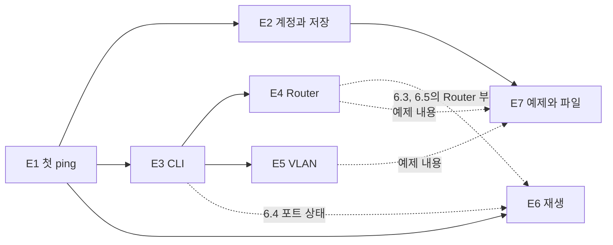
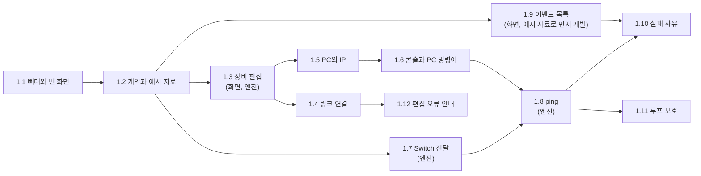
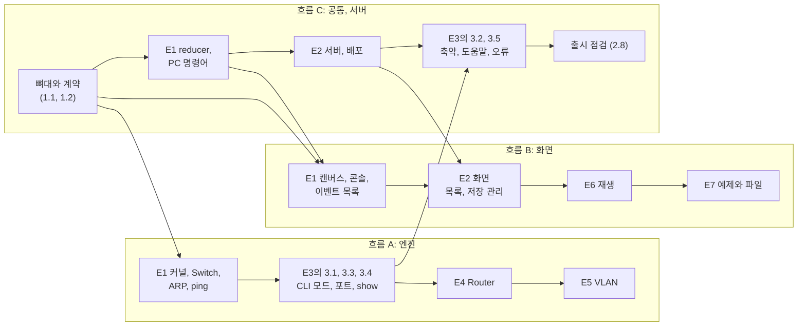
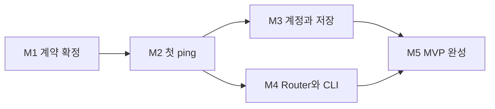
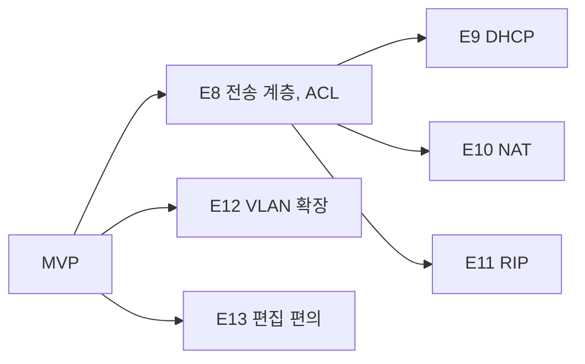

# 4. 상세 개발 계획 (Development Plan)

- 작성 기준일: 2026-11-05
- 상위 문서: [README.md](README.md) · 이전 문서: [03-system-design.md](03-system-design.md)
- 사용한 워크플로: BMad `bmad-create-epics-and-stories`, `bmad-advanced-elicitation` (사전 부검)
- 짝 문서: [epics.md](../../_bmad-output/planning-artifacts/epics.md). Story 39개의 수용 기준(Given / When / Then)이 있습니다. 이 문서는 범위, 분해 구조, 순서를 다루고, 작업 단위의 상세는 [04-tasks/](04-tasks/) 폴더의 Epic별 파일에 있습니다.

## 4.0 이 단계에서 확정된 결정

| # | 항목 | 결정 |
|---|---|---|
| D16 | 팀 | ✅ 3인. 분담은 팀이 나중에 정함. 이 문서의 담당은 사람이 아니라 **영역**으로 표기 |
| D17 | 일정 | ✅ 날짜와 투입 시간은 팀이 관리. 이 문서는 날짜 없이 **순서와 의존 관계**만 다룸 |
| D18 | Epic 구성 | ✅ MVP 7개 Epic. 사전 부검을 거쳐, 가장 불확실한 엔진을 첫 Epic에 두고 계정·저장을 둘째로 옮김 |

## 4.1 요약

| 항목 | 수 |
|---|---|
| MVP의 Epic | 7 |
| Feature | 17 |
| Story | 39 |
| Task | 94 |
| 작업량 추정 합계 | 약 109.5인일 |

🟡 작업량은 측정 없이 낸 추정입니다. 1인일은 한 사람이 하루 동안 그 작업에만 집중했을 때의 양입니다. 첫 Epic을 진행하며 실제 속도를 재서 나머지를 보정하는 것을 권합니다.

## 4.2 단계별 범위

| 단계 | 사용자가 얻는 것 | 포함 | 분해 수준 |
|---|---|---|---|
| **MVP** | 로그인해 PC·Switch·Router로 토폴로지를 만들고, CLI로 VLAN과 Static Routing을 설정하고, ping의 과정과 실패 원인을 재생하며 본다 | Epic 1 ~ 7 | Task와 Subtask까지 |
| **2차** | 주소를 자동으로 받고(DHCP), 주소를 바꿔 나가고(NAT), 경로를 자동으로 배우고(RIP), VLAN 간 라우팅을 링크 하나로 한다 | Epic 8 ~ 13 | Story 제목까지 |
| **3차** | 트래픽을 걸러 내고(Firewall), 터널을 만들고(VPN), L3 Switch와 OSPF를 쓴다. 서버에서 실행되는 장비를 붙일지 결정한다 | Epic 14 ~ 18 | Story 제목까지 |

2차와 3차를 Task까지 나누지 않은 이유: MVP를 만들며 엔진 구조와 실제 속도가 드러난 뒤에 나눠야 추측이 되지 않습니다. 각 단계를 시작할 때 이 문서와 같은 방식으로 분해합니다.

## 4.3 분해 구조 읽는 법

| 단위 | ID | 예 |
|---|---|---|
| Epic | `E1` | E1 첫 ping |
| Feature | `F1.4` | F1.4 L2 통신 엔진 |
| Story | `1.7` | 1.7 Switch가 프레임을 전달하고 MAC 주소를 학습한다 |
| Task | `T1.7.3` | T1.7.3 Switch 모델 |
| Subtask | Task 표 안의 `·` 항목 | · flooding 처리 |

### Task에 적힌 항목

| 항목 | 뜻 |
|---|---|
| 작업과 세부 작업 | 구현 내용. `·`로 시작하는 줄이 Subtask |
| 영역 | 담당 영역. 아래 표 참조 |
| 선행 | 먼저 끝나야 하는 Task. "없음"이면 바로 시작 가능 |
| 완료 기준 | 이 Task가 끝났다고 판단하는 조건. 아래 "공통 완료 조건"에 더해지는 것만 적음 |
| 테스트 방법 | 완료 기준을 확인하는 방법 |
| 난이도 | 하: 정해진 방식대로 하면 됨. 중: 설계 판단이나 경계 사례가 있음. 상: 불확실성이 있거나 다른 작업 여럿이 여기에 기댐 |
| 추정 | 인일. 🟡 측정 없는 추정 |

### 영역

| 영역 | 범위 | 위치 |
|---|---|---|
| 엔진 | 시뮬레이션 커널, 장비 모델, 프로토콜, reducer, CLI 명령 트리 | `packages/engine` |
| 화면 | 캔버스, 콘솔, 패널, 재생, 저장 관리, 메시지 카탈로그 | `apps/web` |
| 서버 | 인증, API, 데이터베이스 | `apps/api` |
| 배포 | 컨테이너, CI, 운영 서버, 백업 | `deploy/`, CI 설정 |
| 공통 | 계약 타입, 스키마, 예시 자료, 저장소 설정, E2E 테스트 | `packages/shared`, 저장소 루트 |

### 공통 완료 조건

모든 Task는 아래를 만족해야 끝난 것입니다. Task 표의 "완료 기준"에는 이것 외의 조건만 적었습니다.

- [ ] lint, 타입 검사, 단위 테스트, 빌드가 통과한다.
- [ ] 새로 만든 동작에 테스트가 있다.
- [ ] [규칙 문서](../../_bmad-output/planning-artifacts/architecture/architecture-PacketTracer-WEB-2026-11-05/ARCHITECTURE-SPINE.md)의 AD를 어기지 않는다.
- [ ] 다른 사람이 Pull Request를 검토했다.
- [ ] 해당 Story의 수용 기준 중 이 Task가 맡은 부분이 통과한다.

## 4.4 MVP 분해

Task 상세는 각 Epic의 파일에 있습니다.

### E1. 첫 ping — [작업 상세](04-tasks/epic-1-first-ping.md)

로그인 없이 브라우저에서 PC와 Switch를 놓고 연결해 ping하고, 이벤트 목록과 실패 사유를 본다.

| Feature | Story | Task 수 | 추정 |
|---|---|---|---|
| F1.1 프로젝트 기반과 계약 | 1.1 빈 편집기 화면이 주소에서 열린다 | 4 | 3.0 |
| | 1.2 엔진과 화면의 계약이 타입과 예시 자료로 확정된다 | 4 | 5.5 |
| F1.2 토폴로지 편집 | 1.3 장비를 놓고 옮기고 이름을 바꾸고 지운다 | 3 | 3.5 |
| | 1.4 포트를 골라 링크로 연결하고 지운다 | 3 | 3.0 |
| | 1.12 편집 중 할 수 없는 동작의 사유를 본다 | 1 | 1.0 |
| F1.3 PC 설정과 콘솔 | 1.5 PC에 IP를 설정한다 | 2 | 1.5 |
| | 1.6 콘솔을 열어 PC 명령어를 쓴다 | 2 | 4.0 |
| F1.4 L2 통신 엔진 | 1.7 Switch가 프레임을 전달하고 MAC 주소를 학습한다 | 4 | 5.0 |
| | 1.8 PC에서 ping을 실행해 결과를 본다 | 3 | 3.5 |
| | 1.11 고리 모양으로 연결해도 멈추지 않는다 | 2 | 1.5 |
| F1.5 추적과 실패 사유 | 1.9 이벤트 목록으로 통신 과정을 본다 | 4 | 3.5 |
| | 1.10 실패한 ping의 원인을 안다 | 2 | 2.0 |
| **합계** | 12 Story | 34 | **37.0** |

### E2. 계정으로 저장하고 이어서 한다 — [작업 상세](04-tasks/epic-2-account-and-save.md)

Google로 로그인하고, 토폴로지를 만들고, 자동 저장된 것을 다른 기기에서 연다.

| Feature | Story | Task 수 | 추정 |
|---|---|---|---|
| F2.1 로그인과 운영 배포 | 2.1 Google로 로그인한다 | 4 | 6.5 |
| | 2.2 운영 주소에서 서비스가 열린다 | 3 | 5.5 |
| F2.2 토폴로지 보관 | 2.3 토폴로지를 만들고 목록에서 본다 | 4 | 5.5 |
| | 2.4 편집 내용이 자동으로 저장되고 다시 열린다 | 3 | 3.5 |
| | 2.5 토폴로지의 이름을 바꾸고 복제하고 삭제한다 | 2 | 1.5 |
| F2.3 저장 안전장치 | 2.6 두 곳에서 편집해도 어느 쪽도 잃지 않는다 | 1 | 1.0 |
| | 2.7 로그아웃하고, 세션이 끊겨도 이어서 저장된다 | 2 | 2.5 |
| F2.4 출시 점검 | 2.8 출시 점검을 통과한다 | 3 | 4.5 |
| **합계** | 8 Story | 22 | **30.5** |

### E3. 장비를 명령어로 설정한다 — [작업 상세](04-tasks/epic-3-cli.md)

| Feature | Story | Task 수 | 추정 |
|---|---|---|---|
| F3.1 CLI 기반 | 3.1 콘솔에서 CLI 모드를 오간다 | 2 | 2.5 |
| | 3.2 명령어를 축약하고 Tab과 `?`를 쓴다 | 3 | 2.5 |
| | 3.5 잘못된 명령어의 위치와 사유를 본다 | 2 | 1.5 |
| F3.2 포트 제어와 조회 | 3.3 포트를 끄고 켠다 | 2 | 2.0 |
| | 3.4 `show` 명령어로 구성과 상태를 확인한다 | 2 | 2.5 |
| **합계** | 5 Story | 11 | **11.0** |

### E4. Router로 네트워크를 잇는다 — [작업 상세](04-tasks/epic-4-router.md)

| Feature | Story | Task 수 | 추정 |
|---|---|---|---|
| F4.1 Router 장비 | 4.1 Router를 놓고 인터페이스에 IP를 주고 켠다 | 3 | 3.0 |
| F4.2 패킷 전달 | 4.2 Router를 거쳐 옆 네트워크와 통신한다 | 2 | 3.0 |
| | 4.3 Static route로 먼 네트워크와 통신한다 | 3 | 2.5 |
| | 4.4 경로가 없거나 TTL이 다하면 알 수 있다 | 2 | 2.0 |
| **합계** | 4 Story | 10 | **10.5** |

### E5. VLAN으로 네트워크를 나눈다 — [작업 상세](04-tasks/epic-5-vlan.md)

| Feature | Story | Task 수 | 추정 |
|---|---|---|---|
| F5.1 VLAN | 5.1 VLAN을 만들고 지운다 | 1 | 1.5 |
| | 5.2 access 포트로 VLAN을 나눈다 | 2 | 2.0 |
| | 5.3 trunk로 Switch 사이에 VLAN을 잇는다 | 2 | 3.0 |
| **합계** | 3 Story | 5 | **6.5** |

### E6. 패킷 흐름을 재생하며 본다 — [작업 상세](04-tasks/epic-6-replay.md)

| Feature | Story | Task 수 | 추정 |
|---|---|---|---|
| F6.1 재생 | 6.1 프레임이 링크를 따라 움직이는 것을 본다 | 3 | 4.0 |
| | 6.2 재생을 멈추고 한 단계씩 따라간다 | 2 | 2.5 |
| | 6.3 프레임 내용을 계층별로 본다 | 1 | 1.5 |
| F6.2 상태 표시 | 6.4 포트 상태와 인터페이스 정보를 캔버스에서 본다 | 1 | 1.5 |
| | 6.5 장비 테이블을 패널로 본다 | 1 | 1.5 |
| **합계** | 5 Story | 8 | **11.0** |

### E7. 예제로 시작하고 파일로 주고받는다 — [작업 상세](04-tasks/epic-7-share.md)

| Feature | Story | Task 수 | 추정 |
|---|---|---|---|
| F7.1 공유와 예제 | 7.1 토폴로지를 파일로 내보내고 가져온다 | 2 | 1.5 |
| | 7.2 예제에서 시작한다 | 2 | 1.5 |
| **합계** | 2 Story | 4 | **3.0** |

## 4.5 의존 관계

### Epic 사이

실선은 "앞의 Epic이 끝나야 시작할 수 있다", 점선은 "일부 Story만 기다린다"는 뜻입니다.

- E1이 끝나면 E2, E3, E6을 동시에 시작할 수 있습니다.
- E4와 E5는 E3의 Story 3.1, 3.3, 3.4(CLI 모드, 포트 제어, `show running-config`)가 끝나면 동시에 진행할 수 있습니다. Story 3.2와 3.5는 기다리지 않아도 됩니다.
- E6의 Story 6.1과 6.2는 E1의 추적 기록만 있으면 만들 수 있습니다. Story 6.4는 E3의 포트 끄기, Story 6.3과 6.5의 Router 부분은 E4 뒤에 확인합니다.
- E7의 예제는 E4와 E5의 결과를 씁니다.

### E1 안의 흐름

E1은 세 영역이 가장 촘촘하게 얽히는 Epic입니다. Story 1.2(계약)가 끝나면 세 갈래로 나뉩니다.

화면 쪽은 엔진이 완성되기 전에도 `shared`의 예시 자료(Document와 기대 Trace)로 이벤트 목록을 만들 수 있습니다. 이것이 Story 1.2를 가장 먼저 하는 이유입니다.

## 4.6 영역별 작업량과 작업 흐름

### 영역별 합계

| 영역 | 추정 (인일) | 주요 내용 |
|---|---|---|
| 엔진 | 약 43 | 커널, Switch·PC·Router 모델, ARP, IPv4, ICMP, VLAN, CLI 명령 트리 |
| 화면 | 약 37 | 캔버스, 콘솔, 이벤트 목록, 재생, 저장 관리, 패널 |
| 서버 | 약 12 | 인증, 토폴로지 API, 데이터베이스, 출시 전 확인 |
| 배포 | 약 9 | CI, 컨테이너, 운영 서버, 백업, 운영 스크립트 |
| 공통 | 약 8.5 | 저장소 뼈대, 계약 타입, 스키마와 검증, 예시 자료, E2E 테스트 |

두 영역이 함께 하는 Task는 앞에 적힌 영역에 합산했습니다. 엔진과 화면이 전체의 약 73%입니다. 서버·배포·공통을 한 사람이 맡으면 다른 두 사람보다 일이 적으므로, 그 사람이 E1의 reducer와 E3의 일부를 함께 맡는 구성을 권합니다.

### 권장 작업 흐름 (3인, 분담 확정 전의 안)

분담은 팀이 정합니다. 아래는 세 흐름의 작업량이 비슷해지도록 나눈 한 가지 안입니다.

| 흐름 | 맡는 범위 | 추정 (인일) |
|---|---|---|
| **A. 엔진** | E1의 커널·Switch·ARP·ping → E3의 Story 3.1, 3.3, 3.4 → E4 → E5 | 약 36 |
| **B. 화면** | E1의 캔버스·콘솔·이벤트 목록 → E2의 화면 → E6 → E7 | 약 37 |
| **C. 공통·서버** | 저장소 뼈대와 계약 → E1의 reducer와 PC 명령어 → E2의 서버·배포 → E3의 Story 3.2, 3.5 → 출시 점검 | 약 36.5 |

세 흐름의 작업량이 비슷합니다. 흐름 C에는 보안·운영 작업(인증 설정, 컨테이너 강화, 배포 경로 보호, 백업)이 모여 있습니다.

Story 1.1과 1.2는 세 사람이 함께 하는 것을 권합니다. 여기서 정한 타입이 이후 모든 작업의 계약이 됩니다.

## 4.7 진행 순서와 확인 지점

날짜 대신 다섯 개의 확인 지점으로 순서를 정합니다. 각 지점은 눈으로 확인할 수 있는 결과로 정의했습니다.

| 지점 | 끝나는 범위 | 확인 방법 |
|---|---|---|
| **M1. 계약 확정** | Story 1.1, 1.2 | 배포된 주소에서 빈 편집기가 열린다. `shared`의 예시 자료로 엔진 쪽과 화면 쪽 테스트가 각각 통과한다 |
| **M2. 첫 ping** | E1 전체 | 배포된 주소에서 PC 2대와 Switch 1대를 연결해 ping에 성공하고, IP를 지우면 실패 사유가 표시된다 |
| **M3. 계정과 저장** | Story 2.1 ~ 2.4 | 운영 주소에서 Google로 로그인하고, 만든 토폴로지가 다른 기기에서 열린다 |
| **M4. Router와 CLI** | E3, E4 | 화이트보드의 예시 토폴로지를 CLI로 구성해 양 끝 PC 사이의 ping에 성공한다 |
| **M5. MVP 완성** | E5, E6, E7, Story 2.5 ~ 2.8 | VLAN 실습과 단계별 재생이 되고, 출시 점검을 통과한다 |

M3과 M4는 서로 기다리지 않고 동시에 진행됩니다.

### M1에서 함께 확인할 것

[03 문서 3.15절](03-system-design.md#315-미검증과-미결정)의 미검증 항목 중 첫 지점에서 확인할 것입니다.

- [ ] 고른 버전 조합으로 lint, 타입 검사, 테스트, 빌드가 함께 돈다 (X2)
- [ ] 배포 위치, 도메인 이름, TLS 발급 경로를 정했다 (X6, X7)
- [ ] 장비 아이콘을 어떻게 마련할지 정했다 (X10)

M2에서 확인할 것입니다.

- [ ] 장비 30대에서 ping 1회 계산이 100ms 안에 끝난다 (X4)
- [ ] E1의 실제 소요를 추정과 비교해 나머지 추정을 보정했다

M3에서 확인할 것입니다.

- [ ] 인증 라이브러리가 설계대로 동작하고, 쿠키 속성과 사용자 ID 타입을 확인했다 (X1)

## 4.8 우선순위

| 순위 | 범위 | 이유 |
|---|---|---|
| **1순위** (줄이지 않음) | E1, E2의 2.1 ~ 2.4와 2.8, E3, E4 | 편집기, PC·Switch·Router, CLI, Static Routing, ping, 실패 사유, 로그인과 저장. 화이트보드에서 체크된 항목과 제품의 뼈대 |
| **2순위** | E6의 6.1 ~ 6.4, E5의 5.1 ~ 5.2, E2의 2.5 ~ 2.7 | 재생과 VLAN의 기본, 저장 안전장치 |
| **3순위** (먼저 줄임) | E7, Story 6.5, Story 6.2의 이전 단계와 속도 조절, Story 5.3 | 없어도 핵심 실습이 됨 |

줄여야 할 때의 순서는 [02 문서 2.8절](02-requirements.md#28-mvp-범위)과 같습니다: E7 → 6.5 → 6.2의 일부 → 5.3 → E5 전체.

## 4.9 2차 범위

MVP 뒤에 진행합니다. Story 제목까지만 나눴습니다. 세부 기능 번호(T1, N1 등)는 [02 문서 2.5절](02-requirements.md#25-네트워크-기능-세분화와-의존성)의 것입니다.

| Epic | Feature | Story | 규모 |
|---|---|---|---|
| **E8. 트래픽을 조건으로 허용하고 막는다** | F8.1 전송 계층 모델 (T1) | 8.1 프레임에 UDP·TCP 포트 번호가 실린다 | 중 |
| | F8.2 표준 ACL (A1) | 8.2 출발지 주소로 트래픽을 허용하거나 막는다 | 중 |
| | | 8.3 ACL에 막힌 이유를 실패 사유로 본다 | 소 |
| **E9. 주소를 자동으로 받는다** | F9.1 DHCP (H1) | 9.1 Router가 주소 풀에서 주소를 나눠 준다 | 중 |
| | | 9.2 PC가 주소를 자동으로 받는다 | 중 |
| **E10. 주소를 바꿔 다른 네트워크로 나간다** | F10.1 NAT 기본 (N1, N2) | 10.1 인터페이스를 내부와 외부로 지정한다 | 소 |
| | | 10.2 Static NAT으로 주소를 1:1로 바꾼다 | 중 |
| | F10.2 NAT 확장 (N3, N4) | 10.3 주소 풀로 Dynamic NAT을 한다 | 중 |
| | | 10.4 포트 번호로 주소 하나를 여럿이 나눠 쓴다 (PAT) | 대 |
| | | 10.5 변환 테이블과 변환 전후의 프레임을 본다 | 소 |
| **E11. 경로를 자동으로 배운다** | F11.1 경로 선택 (R5) | 11.1 출처가 다른 경로 중 우선하는 것을 고른다 | 중 |
| | F11.2 RIP v2 (R6) | 11.2 Router끼리 경로를 주고받는다 | 대 |
| | | 11.3 링크가 끊기면 경로가 바뀐다 | 중 |
| | F11.3 경로 추적 (R4) | 11.4 traceroute로 지나는 Router를 본다 | 소 |
| **E12. 링크 하나로 VLAN 사이를 잇는다** | F12.1 VLAN 확장 (V4, V5) | 12.1 trunk의 native VLAN을 지정한다 | 소 |
| | | 12.2 Router의 서브인터페이스로 VLAN 사이를 라우팅한다 | 중 |
| **E13. 편집을 편하게 한다** | F13.1 편집 편의 | 13.1 편집을 되돌리고 다시 실행한다 | 중 |
| | | 13.2 계정과 내 자료를 직접 삭제한다 | 소 |

2차의 선행 조건: E8의 전송 계층 모델(8.1)이 E9, E10의 PAT, E11의 RIP보다 먼저 있어야 합니다. E10의 Dynamic NAT(10.3)은 표준 ACL(8.2)이 먼저 있어야 합니다.

## 4.10 3차 범위

| Epic | Feature | Story | 규모 |
|---|---|---|---|
| **E14. Firewall로 트래픽을 걸러 낸다** | F14.1 확장 ACL (A2) | 14.1 프로토콜과 포트로 트래픽을 허용하거나 막는다 | 중 |
| | F14.2 Firewall 장비 (F1) | 14.2 Firewall을 놓고 인터페이스 방향별 규칙을 건다 | 대 |
| | | 14.3 어느 규칙이 막았는지 본다 | 소 |
| **E15. 터널로 떨어진 네트워크를 잇는다** | F15.1 GRE 터널 (P1) | 15.1 터널 인터페이스를 만들어 패킷을 감싸 보낸다 | 대 |
| | F15.2 IPsec (P2) | 15.2 보호할 트래픽을 지정해 터널로 보낸다 | 대 |
| | | 15.3 감싸진 프레임의 안쪽과 바깥쪽을 본다 | 중 |
| **E16. Switch에서 VLAN 사이를 라우팅한다** | F16.1 L3 Switch (V6) | 16.1 L3 Switch를 놓고 VLAN 인터페이스에 IP를 준다 | 대 |
| **E17. 큰 네트워크의 경로를 자동으로 배운다** | F17.1 OSPF 단일 영역 (R7) | 17.1 Router끼리 이웃을 맺는다 | 대 |
| | | 17.2 최단 경로를 계산해 라우팅 테이블에 올린다 | 대 |
| **E18. 서버에서 실행되는 장비를 붙일지 결정한다** | F18.1 실측 | 18.1 FRRouting 컨테이너의 메모리와 필요 권한을 잰다 | 중 |
| | | 18.2 시뮬레이션 장비와 실제 장비가 프레임을 주고받을 수 있는지 시제품으로 확인한다 | 대 |
| | | 18.3 결과를 보고 도입 여부를 결정한다 | 소 |

❓ VPN의 종류와 암호화 표현 수준, Firewall의 상태 추적 여부는 3차를 시작할 때 정합니다. Spanning Tree Protocol은 3차 이후로 둡니다.

## 4.11 위험과 대응

| 위험 | 드러나는 시점 | 대응 |
|---|---|---|
| 엔진과 화면의 계약이 실제 구현과 맞지 않음 | M1 ~ M2 | Story 1.2에서 예시 자료를 함께 만들고, 계약을 바꿀 때는 `shared`의 타입과 예시 자료를 함께 고침 |
| 커널(T1.7.1)이 늦어져 엔진 작업 전체가 밀림 | M2 | 난이도 "상". 흐름 A가 가장 먼저 시작. 화면은 예시 자료로 계속 진행 |
| 콘솔의 줄 편집(T1.6.2)이 예상보다 큼 | M2 | 단순한 입력창으로 바꿀 수 있음. `ConsolePort` 경계가 같아 화면 안에서만 바뀜 |
| 운영 서버에서 Google 로그인이 안 됨 (도메인, 인증서) | M3 | Story 2.2를 E2의 앞쪽에 둠. 도메인 결정을 M1에서 함 |
| 인증 라이브러리가 설계대로 동작하지 않음 | M3 | T2.1.3에서 로그인만 되는 최소 구성을 먼저 확인 |
| `show running-config` 왕복(T3.4.1)이 명령어가 늘 때마다 깨짐 | M4 ~ M5 | 속성 기반 테스트를 CI에 두고, 명령어를 추가할 때 직렬화를 함께 정의하도록 명령 정의에 포함 |
| 재생 애니메이션(T6.1.2)이 캔버스 라이브러리와 맞지 않음 | M5 | 난이도 "상". 먼저 프레임 하나를 링크 위에 그리는 것부터 확인 |

## 4.12 가정과 미결정

| # | 내용 |
|---|---|
| 🟡 | 작업량 추정은 측정 없이 낸 값입니다. E1의 실제 소요로 보정합니다 |
| 🟡 | 권장 작업 흐름은 한 가지 안이며 팀의 분담 결정을 대신하지 않습니다 |
| 🟡 | 2차·3차의 규모(소, 중, 대)는 MVP의 Story와 견준 상대적 크기입니다 |
| ❓ | 3인의 분담 |
| ❓ | E2E 테스트에서 Google 로그인을 어떻게 대신할지 (테스트 환경 전용 로그인 경로). T2.3.4에서 정함 |

## 4.13 검토 요청 사항

- [ ] **Story 구성**: 39개 Story와 수용 기준([epics.md](../../_bmad-output/planning-artifacts/epics.md))에 빠지거나 틀린 것이 있는지
- [ ] **Task 분해**: [04-tasks/](04-tasks/)의 작업 단위가 실제로 착수할 수 있는 크기인지
- [ ] **우선순위**: [4.8절](#48-우선순위)의 순위에 동의하는지
- [ ] **2차·3차 범위**: [4.9절](#49-2차-범위)과 [4.10절](#410-3차-범위)의 구성에 동의하는지
