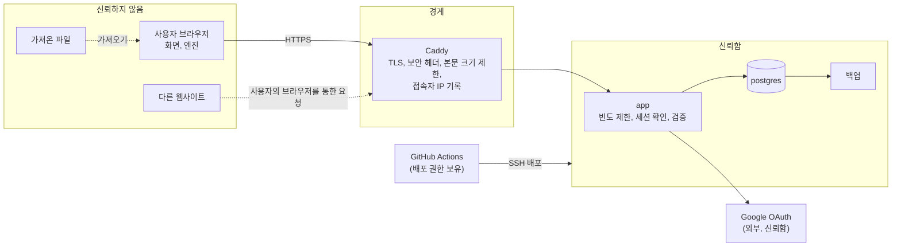
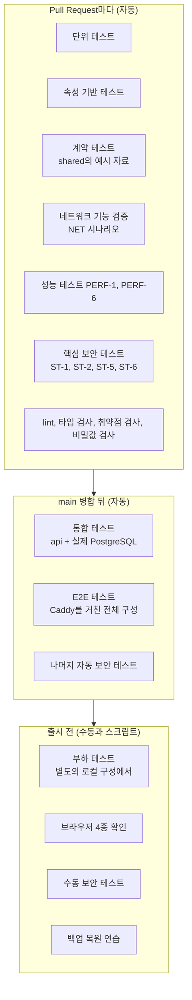

# 5. 보안과 테스트 (Security and Testing)

- 작성 기준일: 2026-11-05
- 상위 문서: [README.md](README.md) · 이전 문서: [04-development-plan.md](04-development-plan.md)
- 근거 문서: [03-system-design.md](03-system-design.md), [규칙 문서 (AD-1 ~ AD-16)](../../_bmad-output/planning-artifacts/architecture/architecture-PacketTracer-WEB-2026-11-05/ARCHITECTURE-SPINE.md), [01-technical-validation.md](01-technical-validation.md)의 1.6절
- 독립 검토: 규칙 문서 폴더의 `reviews/review-security-plan.md`. 높음 6건과 중간 12건을 이 문서에 반영했습니다 ([5.17절](#517-독립-검토-결과))

## 5.0 읽는 법

- `TH-n`은 위협, `SEC-n`은 보안 요구사항, `MAL-n`은 악의적인 네트워크 구성, `NET-n`은 네트워크 기능 검증, `PBT-n`은 속성 기반 테스트, `PERF-n`은 성능 테스트, `ST-n`은 보안 테스트, `E2E-n`은 E2E 시나리오입니다.
- "반영 작업"은 [04-tasks/](04-tasks/)의 Task 번호입니다. 이 문서에서 나온 항목은 해당 Task의 Subtask로 넣었습니다.
- 수치는 대부분 🟡 가정입니다. 운영하며 조정합니다.

### 이 단계에서 확정된 결정

| # | 항목 | 결정 |
|---|---|---|
| D19 | 가입 범위 | ✅ Google 계정이 있으면 누구나 가입. 전체 계정 수에 상한을 두고, 넘으면 새 가입을 막음 |

## 5.1 보안의 전제

**이 제품의 가장 큰 보안 장치는 구조입니다.** 네트워크 동작을 서버가 아니라 각 사용자의 브라우저에서 계산하므로 (AD-1), 서버는 사용자가 만든 네트워크 구성을 실행하지 않습니다. 서버 에뮬레이션 방식에서 필요했던 컨테이너 권한 관리, 실습 간 네트워크 분리, 외부 트래픽 차단이 MVP에는 없습니다 ([01 문서 1.6절](01-technical-validation.md#16-멀티테넌트-격리-서버-자원-보안-위험)).

남는 것은 일반적인 웹 서비스의 보안입니다: 로그인, 내 자료를 남이 못 보게 하는 것, 자료를 잃지 않는 것, 서버를 멈추지 않게 하는 것.

### 지킬 것

| 자산 | 내용 | 잃으면 생기는 일 |
|---|---|---|
| 계정 정보 | Google 계정 식별자, 이메일, 표시 이름 | 개인정보 노출 |
| 세션 | 로그인 상태를 나타내는 식별자 | 남이 내 계정으로 행동 |
| 토폴로지 | 사용자가 만든 문서 | 작업 유실, 남에게 노출 |
| 서비스 | 서버, 데이터베이스 | 모두가 못 씀 |
| 비밀값 | OAuth 자격 증명, 세션 서명값, 데이터베이스 암호, 배포 키 | 전체 계정과 서버 위험 |
| 백업 | 데이터베이스 사본 | 위의 계정 정보와 토폴로지가 함께 노출되거나 사라짐 |

### 신뢰 경계

브라우저에서 온 모든 값은 서버가 다시 검증합니다. 브라우저의 엔진이 한 검증은 사용 편의를 위한 것이고 보안 장치가 아닙니다.

### 누가 공격할 수 있나

| 행위자 | 할 수 있는 것 |
|---|---|
| 로그인하지 않은 외부인 | 주소로 요청을 보냄. 가입을 시도함 |
| 로그인한 사용자 | 자기 세션으로 임의의 API 요청을 보냄. 조작한 문서를 저장함 |
| 같은 컴퓨터의 다음 사용자 | 앞사람이 남긴 로그인 상태와 브라우저 저장소를 봄. 기술이 필요 없어 이 제품에서 가장 흔한 경우 |
| 다른 웹사이트 | 로그인한 사용자의 브라우저가 우리 서버로 요청을 보내게 유도함 |
| 조작된 파일을 건네는 사람 | 다른 사용자가 그 파일을 가져오게 함 |
| 오염된 의존성이나 CI 구성 요소 | 빌드와 배포 과정에서 코드를 실행함 |

## 5.2 위협과 대응

| # | 위협 | 대응 | 요구사항 |
|---|---|---|---|
| TH-1 | 남의 토폴로지를 읽거나 고침 | 저장소 계층에서 소유자 조건을 강제. 남의 것은 404 | SEC-5 |
| TH-2 | 세션 탈취 (스크립트로 쿠키 읽기, 평문 전송) | `HttpOnly`, `Secure` 쿠키. HTTPS만 사용 | SEC-2 |
| TH-3 | 다른 사이트가 사용자 몰래 요청을 보냄 | `SameSite=Lax` 쿠키. 상태를 바꾸는 요청의 `Origin` 확인. JSON 본문만 받음 | SEC-4 |
| TH-4 | 화면에 스크립트를 심음 (문서의 문자열, 가져온 파일) | 모든 문자열에 허용 문자와 길이 규칙. 값을 글자로만 표시. 콘텐츠 보안 정책 | SEC-7, SEC-9, SEC-10 |
| TH-5 | 콘솔에 제어 문자를 심어 화면을 조작 | 콘솔에 쓰는 함수 하나에서 제어 문자 제거 | SEC-11 |
| TH-6 | 조작된 문서로 서버나 다른 사용자의 화면을 망가뜨림 | 가져오기와 저장이 같은 검증 절차를 순서대로 실행 | SEC-7, SEC-8 |
| TH-7 | 대량 요청·대량 저장으로 서버를 멈추거나 디스크를 채움 | 본문 크기 제한, 빈도 제한, 문서 크기와 계정당 용량 한도, 컨테이너 자원 한도 | SEC-12 ~ SEC-15 |
| TH-8 | 대량 가입으로 계정 수 상한을 채워 정작 쓸 사람이 가입하지 못함 | 가입 방식 전환, 빈 계정 정리, 상한 80%에서 경고 | SEC-14 |
| TH-9 | 데이터베이스 질의 조작 | 매개변수를 쓰는 질의만 사용 | SEC-16 |
| TH-10 | 로그로 개인정보·인증 정보가 새어 나감 (api, Caddy, PostgreSQL) | 세 컨테이너의 로그 모두에서 금지 항목 제외 | SEC-18 |
| TH-11 | 비밀값 유출 (저장소, 이미지) | 환경 파일과 CI의 비밀 저장소에만 둠. Pull Request마다 비밀값 검사 | SEC-19 |
| TH-12 | 취약한 의존성 | 잠금 파일로 버전 고정. CI에서 취약점 검사 | SEC-20 |
| TH-13 | 테스트용 로그인 경로가 운영에 남음 | 주소가 로컬일 때만 경로를 등록. 아니면 실행 거부 | SEC-3 |
| TH-14 | 컨테이너가 뚫렸을 때 피해 확대 | 세 컨테이너 모두 권한 최소화. 데이터베이스는 최소 권한 계정으로 접속 | SEC-21 |
| TH-15 | 서버 접속 수단 탈취 | SSH 키 인증만, root 로그인 금지, 클라우드 방화벽 | SEC-22 |
| TH-16 | 악의적인 네트워크 구성으로 브라우저를 멈춤 | 이벤트 수 한도, 장비·링크·경로·VLAN 수 한도 | [5.7절](#57-악의적인-네트워크-구성-대응) |
| TH-17 | CI·배포 경로 장악 (오염된 패키지나 액션이 배포 키를 씀) | 보호된 배포 환경, Pull Request 워크플로에 비밀값 없음, 액션 고정, 배포 키의 명령 제한 | SEC-27 |
| TH-18 | 백업 유출 또는 서버와 함께 소실 | 암호화해 서버 밖에 매일 복사. 소유자만 읽기. 백업 나이 점검 | SEC-26 |
| TH-19 | 같은 컴퓨터의 다음 사용자가 앞사람의 계정과 초안에 접근 | 유휴 만료, Google 계정 선택 화면, 초안을 사용자에 묶고 로그아웃 때 삭제 | SEC-2, SEC-28 |
| TH-20 | 로그인 뒤 다른 사이트로 보내는 링크 (피싱), 로그인 요청 위조 | 로그인 뒤 이동 경로를 같은 출처로 제한. state 확인 | SEC-30 |
| TH-21 | 필요 이상으로 개인정보를 저장 | 저장하는 열을 테스트로 확인. 삭제 절차를 스크립트로 | SEC-29, SEC-31 |

## 5.3 인증과 인가

### 인증

| # | 요구사항 | 검증 | 반영 작업 |
|---|---|---|---|
| SEC-1 | 로그인은 Google 소셜 로그인만 쓴다. 비밀번호를 받지 않는다. 요청하는 정보는 식별자, 이메일, 이름뿐이다 | 로그인 화면에 다른 수단이 없음. Google 동의 화면의 항목 확인 | T2.1.3 |
| SEC-2 | 세션 쿠키는 `HttpOnly`, `Secure`, `SameSite=Lax`이고 `Domain` 속성을 두지 않는다. 설정에 명시한다. 세션은 서버에 저장하고, 로그인할 때 새로 만들고, 로그아웃할 때 지운다. 🟡 24시간 쓰지 않으면 만료되고, 쓰더라도 7일이 지나면 만료된다. Google 로그인은 항상 계정 선택 화면을 보여 준다 | ST-3, ST-4 | T2.1.3, T2.7.1 |
| SEC-3 | 테스트용 로그인 경로는 환경 변수가 켜져 있고 **`APP_URL`의 호스트가 로컬 주소일 때만** 등록한다. 변수가 켜져 있는데 호스트가 로컬이 아니면 api가 실행을 거부한다 | ST-12 | T2.3.4 |
| SEC-4 | 상태를 바꾸는 요청(POST, PUT, DELETE)은 `Origin` 헤더가 `APP_URL`과 같을 때만 받는다. 헤더가 없거나 `null`이면 거부한다. 본문은 JSON만 받는다. 다른 출처의 요청을 허용하지 않는다 | ST-5 | T2.1.1 |
| SEC-30 | 로그인 뒤 이동할 곳은 고정된 경로이거나 토폴로지 경로 형태에 맞는 같은 출처의 경로다. 절대 주소와 다른 형식은 무시한다. OAuth의 state를 확인한다. 사용자는 Google의 고유 식별자로 구분하고, 이메일이 같다고 계정을 잇지 않는다. 운영과 개발은 서로 다른 OAuth 클라이언트를 쓰고, 운영 클라이언트에는 운영 주소 하나만 등록한다 | ST-18, ST-21 | T2.1.3, T2.2.1 |

### 인가

역할이 없으므로 규칙은 하나입니다: **사용자는 자기 토폴로지만 읽고 쓴다.**

| # | 요구사항 | 검증 | 반영 작업 |
|---|---|---|---|
| SEC-5 | 토폴로지를 다루는 모든 질의는 저장소 모듈에만 있고 소유자 조건을 포함한다. 남의 토폴로지 요청에는 404를 돌려준다 | ST-1 | T2.3.1 |
| SEC-6 | `/api/auth/*`와 `/api/health`를 제외한 모든 `/api` 경로는 세션이 없으면 401을 돌려준다. 새 경로를 추가해도 기본이 "세션 필요"다. `/api/health`는 상태 한 단어만 돌려준다 | ST-2 | T2.1.3 |

토폴로지 ID는 추측하기 어려운 UUID이지만, 보호는 ID가 아니라 소유자 조건에 기댑니다.

### 같은 컴퓨터를 여럿이 쓸 때

실습실의 공용 컴퓨터에서는 다음 사람이 앞사람의 화면을 그대로 이어받습니다.

| # | 요구사항 | 검증 | 반영 작업 |
|---|---|---|---|
| SEC-28 | 브라우저에 보관하는 초안은 사용자 ID를 함께 담는다. 현재 사용자의 초안만 이어서 저장한다. 로그아웃하면 마지막 저장을 시도한 뒤 그 사용자의 초안을 지운다. 초안을 읽을 때 `validateDocument()`를 거친다. 🟡 7일 지난 초안은 지운다 | E2E-5 | T2.7.2 |

### 개인정보와 계정 삭제

| # | 요구사항 | 검증 | 반영 작업 |
|---|---|---|---|
| SEC-29 | 데이터베이스에 저장하는 개인정보는 Google 식별자, 이메일, 표시 이름뿐이다. 프로필 사진 주소, 세션의 접속 IP와 브라우저 정보, Google이 준 토큰은 저장하지 않도록 설정한다. 로그인 화면에 수집 항목, 백업 보존 기간, 문의 주소를 적는다 | ST-24 | T2.1.3, T2.1.4 |
| SEC-31 | 계정 삭제는 스크립트로 한다. 사용자 ID를 받아 토폴로지, 세션, 계정 연결, 인증 확인, 사용자 행을 한 트랜잭션으로 지우고 삭제 기록에 ID를 남긴다. 요청은 그 계정의 이메일 주소에서 온 것만 받는다. 백업에서 복원한 뒤에는 삭제 기록을 다시 적용한다 | ST-22 | T2.8.3 |

⚠️ 인증 라이브러리가 SEC-29의 항목을 저장하지 않도록 설정할 수 있는지는 확인하지 못했습니다. 끌 수 없는 항목이 있으면 [02 문서](02-requirements.md)의 NFR-9와 로그인 화면의 안내를 그에 맞게 고칩니다.

## 5.4 실행 환경 격리

### 브라우저

| # | 요구사항 | 검증 | 반영 작업 |
|---|---|---|---|
| SEC-9 | 화면은 문서의 값을 글자로만 표시한다. HTML이나 코드로 해석하는 방식(`dangerouslySetInnerHTML`, `innerHTML`, `outerHTML`, `insertAdjacentHTML`, `document.write`, `eval`, `new Function`)을 lint로 막는다. 엔진은 문서를 자료로만 읽는다 | lint 규칙. ST-8 | T1.1.2 |
| SEC-10 | 콘텐츠 보안 정책: 기본·스크립트·연결은 자기 출처만. 플러그인 금지. 기준 주소 변경 금지. 양식 제출은 자기 출처만. 다른 사이트의 틀 안 표시 금지. 이미지는 자기 출처와 데이터 주소. 인라인 스크립트와 문자열 실행은 허용하지 않는다. 인라인 스타일은 라이브러리가 요구할 때만 허용한다 | ST-9 | T2.2.2 |
| SEC-11 | 콘솔에 글자를 쓰는 함수는 하나이고, 줄 바꿈을 제외한 제어 문자를 지운다 | ST-8 | T1.6.2 |

### 서버

| # | 요구사항 | 검증 | 반영 작업 |
|---|---|---|---|
| SEC-21 | 세 컨테이너 모두 필요한 것 외의 Linux 권한을 없애고 권한 상승을 금지한다. `app`은 root가 아닌 사용자, 읽기 전용 파일 시스템, 크기가 제한된 임시 폴더를 쓴다. 포트를 외부에 여는 것은 `caddy`뿐이다. 어느 컨테이너도 Docker 소켓을 연결하지 않는다. 컨테이너마다 메모리·CPU·프로세스 수 한도를 둔다. api는 관리자 권한이 없고 애플리케이션 스키마만 가진 데이터베이스 계정으로 접속한다 | ST-13 | T2.2.2 |
| SEC-22 | 포트 제한(80, 443, 22)은 **클라우드 방화벽**에서 건다. SSH는 키 인증만 허용하고 root 로그인을 막는다. 운영체제 보안 업데이트를 적용한다 | ST-14 | T2.2.1 |
| SEC-19 | 비밀값은 서버의 환경 파일(소유자만 읽기)과 CI의 비밀 저장소에만 둔다. 저장소와 이미지에 넣지 않는다. Pull Request마다 비밀값 형태를 검사한다. 비밀값을 바꾸는 절차를 운영 문서에 적는다 | ST-20 | T2.2.2, T1.1.3 |
| SEC-27 | 배포 경로: main 브랜치는 검토를 거친 병합만 받는다. Pull Request 워크플로는 비밀값에 접근하지 못한다. 배포 작업은 보호된 환경에서만 돈다. 외부 액션은 버전을 고정한다. 배포용 SSH 키는 정해진 배포 명령만 실행할 수 있다. 레지스트리 자격 증명은 올리기용과 받기용을 나눈다. 의존성은 잠금 파일 그대로 설치하고 설치 스크립트를 끈다 | 설정 확인 (출시 점검표) | T1.1.3, T2.2.3 |
| SEC-26 | 백업: 하루 한 번, 압축, 소유자만 읽기, 세션 정보 제외. 암호화해 서버 밖으로 매일 복사한다. 7일치를 보관한다. 가장 최근 백업이 🟡 36시간보다 오래되면 경고한다. 복원 절차를 문서로 두고 한 번 실행한다 | ST-25. 복원 연습 | T2.8.1 |

서버는 사용자의 코드나 네트워크 구성을 실행하지 않습니다. 3차에서 서버에서 실행되는 장비를 도입하면 이 절의 내용으로는 부족하며, [01 문서 1.6절](01-technical-validation.md#16-멀티테넌트-격리-서버-자원-보안-위험)의 대책을 다시 설계해야 합니다.

## 5.5 자원 제한

| # | 대상 | 한도 (🟡) | 강제 위치 | 넘으면 | 반영 작업 |
|---|---|---|---|---|---|
| SEC-12 | 문서 크기 (UTF-8, 공백 없는 직렬화) | 512KB | `shared` 상수. web과 api | 거부와 사유 | T1.2.2, T2.3.2 |
| SEC-12 | 요청 본문 크기 | 1MB | Caddy와 api 양쪽 | 413 | T2.2.2, T2.3.2 |
| SEC-12 | 가져오기 파일 크기 | 2MB | web | 거부와 사유 | T7.1.2 |
| SEC-13 | 요청 빈도 (사용자별) | 쓰기 분당 60회, 읽기 분당 300회 | api 미들웨어 | 429 | T2.3.2 |
| SEC-13 | 요청 빈도 (로그인 전, IP별) | 분당 300회 | api 미들웨어. 세션 조회보다 먼저 | 429 | T2.1.1 |
| SEC-14 | 전체 계정 수 | 200 (환경 변수로 조정) | api의 사용자 생성 시점 | 가입 거부와 안내 화면 | T2.1.3 |
| SEC-14 | 계정당 토폴로지 수 | 50 | api | 400 `LIMIT_EXCEEDED` | T2.3.2 |
| SEC-14 | 계정당 토폴로지 총 용량 | 5MB | api | 400 `LIMIT_EXCEEDED` | T2.3.2 |
| SEC-15 | 토폴로지당 장비·링크 | 50대, 100개 | `shared` 상수. 엔진 reducer와 `validateDocument()` | 거부와 사유 | T1.3.1, T1.2.2 |
| SEC-15 | Router당 Static route | 100개 | 위와 같음 | 거부와 사유 | T4.3.1 |
| SEC-15 | Switch당 VLAN | 64개 | 위와 같음 | 거부와 사유 | T5.1.1 |
| SEC-15 | 통신 1회의 이벤트 | 2,000개 | 엔진 kernel | 중단, `LOOP_GUARD` | T1.11.1 |
| SEC-15 | 보관하는 추적 | 20개 | 엔진 | 오래된 것부터 삭제 | T1.7.1 |
| SEC-15 | 콘솔 입력 한 줄 | 512자 | 줄 편집기와 엔진 | 거부 | T1.6.2 |
| SEC-15 | 콘솔 화면 기록 | 장비당 5,000줄 | web store | 오래된 줄부터 삭제 | T1.6.2 |
| SEC-21 | 컨테이너 메모리 | `app` 512MB, `postgres` 512MB, `caddy` 128MB | Compose | 컨테이너 종료 뒤 재시작 | T2.2.2 |
| SEC-25 | 데이터베이스 질의 시간 | 5초 | 연결 설정 | 질의 취소, 500 | T2.1.2 |

### 한도에 관한 규칙

- **접속자 IP는 Caddy가 덮어쓴 전달 헤더에서만 읽습니다.** 사용자가 보낸 전달 헤더를 믿지 않습니다. api가 Caddy의 주소를 접속자로 보면 모든 사람이 한 한도를 나눠 쓰게 됩니다.
- **로그인 전 한도는 같은 IP의 수강생 30명이 동시에 로그인해도 걸리지 않게** 분당 300회로 잡았습니다. 강의실 전체가 한 IP로 나오는 경우를 고려한 값입니다.
- **계정 수 상한은 사용자를 새로 만들 때만 확인합니다.** 이미 가입한 사람은 상한과 무관하게 로그인됩니다.
- **수를 세는 한도(계정 수, 토폴로지 수, 총 용량)는 확인과 추가를 한 트랜잭션에서 처리합니다.** 동시에 온 요청이 함께 통과하지 못하게 합니다.
- **수 한도 안의 문서는 항상 크기 한도 안에 들어야 합니다.** 장비·링크·경로·VLAN을 한도까지 채운 가장 큰 문서가 512KB보다 작은지 테스트로 확인합니다.

### 계정 수 상한이 차는 경우 (TH-8)

누군가 버리는 계정으로 상한을 채우면 정작 쓸 사람이 가입하지 못합니다.

- 가입 방식을 환경 변수로 바꿀 수 있습니다: 열림(기본), 닫힘(새 가입 중지).
- 계정 수가 상한의 80%에 닿으면 로그에 경고를 남깁니다.
- 토폴로지가 없고 🟡 90일간 로그인하지 않은 계정을 지우는 스크립트를 둡니다.

### 저장 공간 계산

| 항목 | 최악의 경우 |
|---|---|
| 토폴로지 (계정 200개 × 5MB) | 1GB |
| 갱신으로 생기는 여분과 기록 파일 (🟡 2배로 가정) | 2GB |
| 서버 안의 백업 7일치 (압축 전 기준으로 계산) | 7GB |
| 컨테이너 이미지와 로그 | 🟡 5GB |
| **합계** | **약 15GB** |

⚠️ 추천한 무료 VM에서 실제로 쓸 수 있는 디스크 크기는 확인하지 못했습니다. 합계보다 작으면 계정 수 상한이나 계정당 용량을 낮춥니다.

## 5.6 API 보안

| # | 요구사항 | 검증 | 반영 작업 |
|---|---|---|---|
| SEC-7 | 문서의 모든 문자열에 허용 문자와 최대 길이, 모든 수에 범위, 모든 목록과 사전에 최대 개수가 있다. 장비와 링크의 ID는 UUID 형식이고 겹치지 않는다. 포트·인터페이스의 키는 그 장비 종류의 포트 이름이어야 한다. 링크는 서로 다른 두 장비를 잇는다. 토폴로지 이름은 1~100자이고 제어 문자가 없으며 `shared`의 함수 하나를 web과 api가 함께 쓴다 | ST-6 | T1.2.2 |
| SEC-8 | 가져오기와 저장은 같은 절차를 **이 순서로** 실행한다: 크기 확인 → 오류 처리 안에서 JSON 해석 → 금지 키(`__proto__`, `constructor`, `prototype`)와 중첩 깊이 확인 → 형식 확인(`kind`, `schemaVersion`이 1과 현재 사이의 정수) → `migrateDocument()` → `validateDocument()`. 이후에는 검증 함수가 돌려준 값만 쓴다. api는 요청 본문이 아니라 검증된 값을 저장한다 | ST-6, PBT-9 | T1.2.2, T2.3.2, T7.1.2 |
| SEC-16 | 데이터베이스 질의는 매개변수를 쓰는 방식만 쓴다. 값을 문자열로 이어 붙이지 않는다 | 코드 검토. ST-7 | T2.3.1 |
| SEC-17 | 오류 응답은 코드와 매개변수만 담고 내부 정보(질의, 경로, 스택)를 담지 않는다. `/api` 응답은 브라우저와 중간 서버가 저장하지 않게 한다 | ST-10 | T2.1.1 |
| SEC-18 | api, Caddy, PostgreSQL의 로그 어디에도 문서 본문, 쿠키, OAuth 코드·토큰, 이메일을 쓰지 않는다. Caddy의 접근 로그는 `/api/auth/*`의 질의 문자열을 지운다. PostgreSQL은 질의의 매개변수를 기록하지 않는다. 접근 로그의 IP 주소는 개인정보로 다루고 🟡 14일 뒤 지운다 | ST-11 | T2.1.1, T2.2.2 |
| SEC-20 | 의존성은 잠금 파일로 고정한다. CI에서 알려진 취약점을 검사하고 높은 등급이 있으면 실패한다 | ST-19 | T1.1.3 |
| SEC-23 | 보안 헤더: HTTPS 강제, 콘텐츠 종류 추측 금지, 다른 사이트의 틀 안 표시 금지, 참조 주소 제한 | ST-9 | T2.2.2 |
| SEC-24 | 관리용 엔드포인트를 만들지 않는다. 운영 작업은 SSH로 서버에서 스크립트로 한다 | 경로 목록 확인 | — |

## 5.7 악의적인 네트워크 구성 대응

시뮬레이션 방식이므로 **악의적인 구성의 영향은 그것을 만든 사람의 브라우저 탭에 한정됩니다.** 서버는 문서를 해석하지 않으므로 영향을 받지 않습니다. 대응의 목표는 "화면이 멈추지 않고, 왜 안 되는지 알려 주는 것"입니다.

남에게 영향을 주는 경로는 하나입니다: 조작된 파일을 건네 가져오게 하는 것. 그래서 가져오기에 서버와 같은 검증을 적용하고 (SEC-8), **토폴로지를 여는 것만으로는 어떤 계산도 시작하지 않습니다.** 계산은 사용자가 명령을 실행할 때만 일어납니다.

| # | 구성 | 일어날 수 있는 일 | 대응 | 검증 | 반영 작업 |
|---|---|---|---|---|---|
| MAL-1 | Switch를 고리 모양으로 연결 | 브로드캐스트가 끝없이 돎 | 이벤트 2,000개에서 중단하고 경고 | NET-6 | T1.11.1 |
| MAL-2 | Router들이 서로를 다음 홉으로 지정 | 패킷이 순환 | TTL이 0이 되면 폐기. 이벤트 한도 | NET-18 | T4.4.1 |
| MAL-3 | 한도에 가까운 큰 토폴로지에서 flooding | 계산이 길어짐 | 장비·링크 한도와 이벤트 한도 | PERF-6 | T1.11.2 |
| MAL-4 | 같은 IP를 여러 장비에 설정 | 응답이 뒤섞임 | 설정은 허용하고 경고. 먼저 도착한 응답을 쓰는 것으로 동작을 고정 | NET-8 | T1.5.1, T1.8.1 |
| MAL-5 | 특수 주소 설정 (`0.0.0.0`, `255.255.255.255`, `127.x`, `224.x` 이상) | 엔진의 가정이 깨짐 | 값 검증에서 거부 | 단위 테스트 | T1.2.2 |
| MAL-6 | 브로드캐스트 주소로 ping | 모든 장비가 응답 | MVP는 지원하지 않고 거부 | NET-9 | T1.8.3 |
| MAL-7 | Static route나 VLAN을 대량으로 추가 | 조회가 느려지고 문서가 커짐 | Router당 100개, Switch당 64개 한도 | 단위 테스트 | T4.3.1, T5.1.1 |
| MAL-8 | trunk 허용 목록에 VLAN 4,094개 | 문서가 커지고 처리가 느려짐 | 허용 목록을 범위(시작, 끝)의 목록으로 저장. 범위는 최대 64개 | 단위 테스트 | T5.3.1 |
| MAL-9 | 다음 홉이 자기 자신인 경로 | 조회가 끝나지 않음 | 다음 홉이 자기 주소면 거부 | 단위 테스트 | T4.3.1 |
| MAL-10 | 조작된 가져오기 파일 (깨진 참조, 과대, 깊은 중첩, 금지 키, 형식에 안 맞는 값) | 열 때 엔진이나 화면이 깨짐 | SEC-8의 절차 | ST-6, PBT-9 | T1.2.2, T7.1.2 |
| MAL-11 | 문자열에 스크립트나 제어 문자 | 화면 조작 | 허용 문자 규칙, 제어 문자 제거 | ST-8 | T1.2.2, T1.6.2 |
| MAL-12 | 매우 긴 명령어 줄, 빠른 반복 입력 | 화면이 느려짐 | 줄 길이 제한. 명령어는 하나씩 순서대로 실행 | 단위 테스트 | T1.6.2 |
| MAL-13 | 서버에 문서를 빠르게 반복 저장 | 서버 부하, 디스크 증가 | 사용자별 빈도 제한. 계정당 총 용량 한도 | ST-15 | T2.3.2, T2.4.2 |

### 3차에서 달라지는 것

서버에서 실행되는 장비를 도입하면 악의적인 구성이 서버와 다른 사용자에게 영향을 줄 수 있게 됩니다. 그때는 컨테이너 권한, 실습 간 네트워크 분리, 외부 트래픽 차단, 프레임 생성 제한이 필요합니다. [01 문서 1.6절](01-technical-validation.md#16-멀티테넌트-격리-서버-자원-보안-위험)에 정리해 두었고, 문서화된 완화책을 찾지 못한 항목(브로드캐스트 폭주)도 있습니다.

## 5.8 테스트 전략

| 종류 | 도구 | 대상 | 실행 시점 |
|---|---|---|---|
| 단위 | Vitest | 함수와 모듈 하나 | Pull Request |
| 속성 기반 | fast-check | 엔진과 검증의 불변 조건 | Pull Request |
| 계약 | Vitest + `shared` 예시 자료 | 엔진과 화면의 경계 | Pull Request |
| 네트워크 기능 검증 | Vitest (엔진을 Node에서 실행) | 프로토콜 동작 | Pull Request |
| 통합 | Vitest + PostgreSQL 컨테이너 | api와 데이터베이스 | main (핵심 보안 테스트는 Pull Request) |
| E2E | Playwright | 브라우저에서 전체 흐름 | main |
| 성능 | Vitest 측정, 부하 스크립트, 브라우저 도구 | NFR-2 ~ NFR-5 | Pull Request, 출시 전 |
| 보안 | Vitest, Playwright, 확인 스크립트, 수동 점검 | SEC 요구사항 | Pull Request, main, 출시 전 |

테스트 환경의 규칙입니다.

- **E2E와 헤더 관련 보안 테스트는 운영과 같은 Caddy 설정을 거치는 구성에서 실행합니다.** 보안 헤더와 본문 크기 제한은 Caddy가 걸기 때문에, Caddy를 거치지 않으면 확인할 수 없습니다.
- **E2E는 콘텐츠 보안 정책 위반이 콘솔에 하나라도 뜨면 실패합니다.**
- **쿠키 속성 테스트는 운영 설정으로 api를 띄워 실행합니다.**
- **부하 테스트는 운영 서버가 아니라 같은 구성을 로컬에 띄워 실행합니다.** 운영에서는 테스트용 로그인 경로를 켤 수 없기 때문입니다 (SEC-3).

엔진은 화면 없이 Node에서 실행되므로, 가장 중요한 프로토콜 동작을 가장 빠른 테스트로 검증할 수 있습니다. 테스트의 무게를 여기에 둡니다.

## 5.9 단위 테스트

| 영역 | 대상 | 확인하는 것 |
|---|---|---|
| `shared` | 값 검증 함수 | IPv4·마스크·VLAN 번호·이름의 경계값, 특수 주소 거부, 토폴로지 이름 규칙 |
| `shared` | `validateDocument()` | 유효한 문서 통과. 깨진 문서 유형별 오류 코드: 깨진 참조, 겹치는 ID, UUID가 아닌 ID, 포트 이름이 아닌 키, 같은 장비를 잇는 링크, 범위를 벗어난 좌표, 너무 긴 문자열, 제어 문자와 NUL, 금지 키, 깊은 중첩 |
| `shared` | 크기 한도 | 수 한도까지 채운 가장 큰 문서가 512KB보다 작고, 그 저장 요청이 1MB보다 작음 |
| 엔진 | reducer | Command별 Document 변화, 거부 조건과 오류 코드 |
| 엔진 | kernel | 사건 순서, 동시 사건의 순번, 타이머, 이벤트 한도, 추적 20개 한도 |
| 엔진 | Switch | 학습, 전달, flooding, 만료, VLAN별 테이블 |
| 엔진 | ARP | 요청·응답, 대기 패킷, 시간 초과 |
| 엔진 | IPv4와 라우팅 | 같은 네트워크 판정, 가장 긴 접두사 일치, TTL, MAC 교체 |
| 엔진 | ICMP | echo, 도달 불가, 시간 초과, 오류에 대한 오류 금지 |
| 엔진 | VLAN | access 분류, 태그 붙이기와 떼기, 허용 범위 |
| 엔진 | CLI | 모드 전환, 축약, 완성, 도움말, 오류 위치, 직렬화, 줄 길이 한도 |
| 화면 | 줄 편집기와 콘솔 쓰기 함수 | 입력, 이동, 이력, Tab, `?`, 제어 문자 제거, 화면 기록 5,000줄 한도 |
| 화면 | 저장 관리 | 대기, 단일 요청, 재시도, 충돌, 세션 만료, 초안의 사용자 확인 (가짜 시계와 가짜 API) |
| 화면 | 재생 계산 | Trace에서 단계 목록, 단계별 표시 내용 |
| 화면 | 메시지 카탈로그 | 코드별 문구, 매개변수 삽입 |
| 화면 | 포트 상태 표시 | 네 상태가 색 없이도 구별되는 글자나 모양을 가짐 (NFR-12) |
| 서버 | 미들웨어 | 요청 ID, 세션 확인, 빈도 제한, 접속자 IP 읽기, `Origin` 확인, 오류 형태 |
| 서버 | 저장소 | 소유자 조건, `revision` 처리, 한도의 트랜잭션 처리 |

### 속성 기반 테스트

임의의 입력을 만들어 "항상 성립해야 하는 성질"을 확인합니다. 예시 몇 개로는 놓치는 경계를 잡습니다.

| # | 성질 | 대상 | 반영 작업 |
|---|---|---|---|
| PBT-1 | 임의의 Command 열을 적용한 Document는 항상 `validateDocument()`를 통과한다 | reducer | T1.3.1 |
| PBT-2 | 같은 Document와 같은 입력은 항상 같은 Trace를 만든다 | kernel | T1.7.4 |
| PBT-3 | 임의의 구성에서 `show running-config`의 출력을 새 장비에 입력하면 같은 구성이 된다 | CLI | T3.4.1 |
| PBT-4 | 도움말에 나온 단어는 모두 입력할 수 있고, 입력할 수 있는 단어는 모두 도움말에 나온다 | CLI | T3.2.2 |
| PBT-5 | 유일한 접두사로 줄인 명령어는 원래 명령어와 같게 해석된다 | CLI | T3.2.1 |
| PBT-6 | 선택된 경로보다 더 길게 일치하는 경로는 없다 | 라우팅 | T4.3.2 |
| PBT-7 | 임의의 유효한 토폴로지에서 계산은 이벤트 한도 안에 끝나고 예외를 던지지 않는다 | kernel | T1.11.1 |
| PBT-8 | 임의의 문자열을 명령어로 넣어도 엔진은 예외를 던지지 않고 결과를 돌려준다 | CLI | T3.5.1 |
| PBT-9 | 임의의 JSON 값과 유효한 문서를 조금씩 망가뜨린 값을 가져오기 절차에 넣어도 예외가 나지 않는다. 통과한 문서는 엔진이 불러오고 스냅샷을 만들 수 있다 | 가져오기 절차 | T1.2.2 |

## 5.10 통합 테스트

| 대상 | 방법 | 확인하는 것 |
|---|---|---|
| 엔진 전체 | `Simulator`에 문서를 불러와 명령어 열을 `exec`로 실행 | 명령어로 구성하고 ping한 결과가 기대와 같음. [5.11절](#511-네트워크-기능-검증)의 시나리오 |
| 엔진과 화면의 계약 | `shared`의 예시 Document를 엔진에 넣어 만든 Trace를 예시 Trace와 비교. 화면은 예시 Trace를 그림 | 엔진이 만든 것을 화면이 읽을 수 있음. 한쪽이 형태를 바꾸면 실패 |
| api와 데이터베이스 | 테스트용 PostgreSQL 컨테이너에 마이그레이션을 적용하고 HTTP로 요청 | 상태 코드, 오류 코드, 소유자 분리, `revision` 충돌, 한도, 동시 요청에서의 한도 |
| 화면 컴포넌트 | 예시 `Snapshot`과 가짜 API로 컴포넌트 렌더링 | 캔버스, 콘솔, 이벤트 목록, 패널의 표시와 동작 |

## 5.11 네트워크 기능 검증

엔진이 프로토콜을 올바르게 흉내 내는지 확인하는 시나리오입니다. 각 시나리오는 예시 Document, 실행할 명령어 열, 기대 결과로 이루어지며 Pull Request마다 자동으로 실행됩니다. 기대 결과의 기준은 [02 문서](02-requirements.md)의 FR 검증 조건입니다.

⚠️ 실제 장비나 다른 시뮬레이터와 결과를 대조하는 검증은 MVP 범위에 없습니다. 이 제품은 구현한 범위의 동작만 보장합니다 ([02 문서 2.7절](02-requirements.md#27-비목표)).

### Switching과 ARP

| # | 토폴로지 | 조작 | 기대 결과 | 요구사항 |
|---|---|---|---|---|
| NET-1 | PC 2대, Switch 1대 | PC1에서 PC2로 ping | 4회 중 4회 성공. 첫 회차에 ARP 요청·응답이 먼저 나옴 | FR-28, FR-29, FR-38 |
| NET-2 | PC 3대, Switch 1대 | PC1에서 PC2로 ping | ARP 요청이 PC3에도 도착하고 PC3은 버림(`NOT_FOR_ME`). ICMP는 PC3에 가지 않음 | FR-28 |
| NET-3 | NET-1과 같음 | ping 뒤 MAC 주소 테이블 조회 | 두 PC의 주소가 각 포트에 있음 | FR-28 |
| NET-4 | NET-1과 같음 | 가상 시간 300초 경과 뒤 조회 | 테이블이 비어 있음 | FR-28 |
| NET-5 | PC 2대, Switch 2대를 링크 1개로 연결 | 양 끝 PC 사이 ping | 성공. 두 Switch가 모두 학습 | FR-28 |
| NET-6 | Switch 2대를 링크 2개로 연결, PC 1대 | PC에서 없는 주소로 ping | 이벤트 2,000개에서 중단. 결과 `loop-guard` | FR-30 |
| NET-7 | NET-1과 같음 | 같은 계산을 두 번 실행 | 두 Trace가 같음 | NFR-11 |
| NET-8 | PC 3대, Switch 1대. 두 PC에 같은 IP | 나머지 PC에서 그 IP로 ping | 먼저 도착한 ARP 응답을 쓰고, 실행할 때마다 결과가 같음. 중복 경고가 표시됨 | FR-27 |
| NET-9 | NET-1과 같음 | 네트워크의 브로드캐스트 주소로 ping | 거부되고 사유가 나옴 | — |

### 실패 사유

| # | 토폴로지와 조작 | 기대하는 폐기 사유 | 요구사항 |
|---|---|---|---|
| NET-10 | PC1의 포트에 링크가 없는 상태에서 ping | `NO_LINK` | FR-47 |
| NET-11 | PC1에 IP가 없는 상태에서 ping | `NO_IP` | FR-47 |
| NET-12 | 다른 네트워크 주소로 ping, 게이트웨이 없음 | `NO_GATEWAY` | FR-47 |
| NET-13 | 같은 네트워크의 없는 주소로 ping | `ARP_TIMEOUT` | FR-29, FR-47 |
| NET-14 | 중간 Switch 포트를 `shutdown`하고 ping | `IF_DOWN` | FR-18, FR-47 |
| NET-15 | 다른 VLAN의 PC로 ping | `VLAN_BLOCKED` | FR-32, FR-47 |
| NET-16 | trunk 허용 범위에서 뺀 VLAN으로 Switch를 건너 ping | `TRUNK_NOT_ALLOWED` | FR-33, FR-47 |
| NET-17 | 돌아오는 경로가 없는 Router 구성에서 ping | `NO_ROUTE` (돌아오는 쪽 Router) | FR-37, FR-47 |
| NET-18 | 두 Router가 서로를 다음 홉으로 지정 | `TTL_EXPIRED` | FR-37, FR-47 |

각 시나리오에서 `primaryDropSeq`가 가리키는 이벤트의 장비가 기대한 장비인지도 확인합니다.

### VLAN

| # | 토폴로지 | 조작 | 기대 결과 | 요구사항 |
|---|---|---|---|---|
| NET-20 | PC 4대, Switch 1대. VLAN 10과 20에 두 대씩 | 같은 VLAN끼리 ping | 성공. 다른 VLAN의 PC는 ARP 요청을 받지 않음 | FR-32 |
| NET-21 | NET-20과 같음 | MAC 주소 테이블 조회 | 항목마다 VLAN 번호가 있음 | FR-32 |
| NET-22 | Switch 2대를 trunk로 연결, 양쪽에 VLAN 10의 PC | 양 끝 ping | 성공. trunk 구간의 프레임에 VLAN 10 태그, PC 구간에는 태그 없음 | FR-33 |
| NET-23 | NET-22와 같음 | `show running-config` 출력을 새 Switch에 입력 | 같은 구성 | FR-23 |
| NET-24 | Switch 1대 | 포트를 없는 VLAN 30에 지정 | VLAN 30이 생기고 알림이 나옴 | FR-32 |
| NET-25 | Switch 1대 | 포트가 속한 VLAN을 삭제 뒤 ping | 실패 | FR-31 |

### Routing과 ICMP

| # | 토폴로지 | 조작 | 기대 결과 | 요구사항 |
|---|---|---|---|---|
| NET-30 | Router 1대의 두 인터페이스에 각각 PC 1대 | 인터페이스 설정 뒤 `show ip route` | 직접 연결 경로 2개 | FR-34 |
| NET-31 | NET-30과 같음 | 한쪽 PC에서 다른 쪽으로 ping | 성공. Router를 지난 프레임의 TTL이 1 줄고 MAC 주소가 바뀜 | FR-36 |
| NET-32 | NET-30과 같음 | 인터페이스를 `shutdown` 뒤 `show ip route` | 그 경로가 없음 | FR-34 |
| NET-33 | 화이트보드 구성 (Router 2대, Switch 2대, PC 2대) | CLI로 Static route를 넣고 양 끝 ping | 성공 | FR-35, FR-36 |
| NET-34 | NET-33과 같음 | 기본 경로 `0.0.0.0/0`만 넣고 ping | 성공 | FR-35 |
| NET-35 | Router 1대에 겹치는 경로 2개 | 더 구체적인 경로의 목적지로 ping | 접두사가 긴 경로로 나감 | FR-36 |
| NET-36 | Router 1대 | 다음 홉이 닿지 않는 `ip route` 입력 | 구성에는 있고 라우팅 테이블에는 없음 | FR-35 |
| NET-37 | NET-33에서 돌아오는 경로 제거 | ping | 실패. 출발지 PC는 응답을 받지 못하고, 실패 사유는 돌아오는 쪽 Router의 `NO_ROUTE` | FR-37 |
| NET-38 | NET-30과 같음 | PC에서 Router 인터페이스 주소로 ping, Router에서 PC로 ping | 둘 다 성공 | FR-36, FR-38 |

### CLI

| # | 조작 | 기대 결과 | 요구사항 |
|---|---|---|---|
| NET-40 | `enable` → `conf t` → `interface fa0/1` → `end` | 프롬프트가 단계마다 바뀌고 마지막에 관리자 모드 | FR-20, FR-21 |
| NET-41 | 사용자 모드에서 `configure terminal` | 오류: 현재 모드에서 쓸 수 없음 | FR-20, FR-46 |
| NET-42 | 모호한 축약 입력 | 오류: 모호함 | FR-21, FR-46 |
| NET-43 | `ip address 10.0.0.300 255.255.255.0` | 오류: 값 형식, 위치는 셋째 단어 | FR-46 |
| NET-44 | `hostname CORE` | 프롬프트와 Document의 이름이 함께 바뀜 | FR-10 |
| NET-45 | 설정한 뒤 `no` 형식으로 되돌리고 `show running-config` | 그 줄이 없음 | FR-22 |

## 5.12 성능 테스트

| # | 대상 | 방법 | 기준 | 실행 시점 | 반영 작업 |
|---|---|---|---|---|---|
| PERF-1 | 엔진 계산 (NFR-2) | 장비 30대 예시 Document에서 ping 1회 계산을 여러 번 실행해 중앙값을 냄 | 중앙값 100ms 이내. CI 장비의 편차를 고려한 여유를 테스트에 적어 둠 | Pull Request | T1.11.2 |
| PERF-2 | 화면 (NFR-3) | 장비 50대에서 장비 이동과 재생 중 화면 갱신 속도를 브라우저 도구로 측정 | 끊김 없음. 측정값을 기록 | Epic 6 완료 시, 출시 전 | T6.1.3 |
| PERF-3 | 로딩 (NFR-4) | 운영 주소에서 첫 화면과 토폴로지 열기 시간 측정 | 3초, 1초 이내 | 출시 전 | T2.8.2 |
| PERF-4 | 동시 저장 (NFR-5) | 운영과 같은 구성을 로컬에 띄우고, 가상 사용자 30명이 각자 토폴로지를 5초마다 저장하는 스크립트를 10분 실행 | 실패 0건. 응답 시간 기록 | 출시 전 | T2.8.2 |
| PERF-5 | 서버 자원 | PERF-4 실행 중 컨테이너의 메모리와 CPU, 디스크 증가량 기록 | 메모리 한도 안 | 출시 전 | T2.8.2 |
| PERF-6 | 최악의 계산 | 한도에 가까운 토폴로지(장비 50대, 고리 포함)에서 flooding을 Node에서 실행 | 이벤트 한도에서 멈추고 계산 시간이 🟡 500ms 이내. 화면이 응답하는지는 출시 전에 수동 확인 | Pull Request | T1.11.1 |

🟡 PERF-4의 저장 간격과 실행 시간은 가정입니다. 실제 사용 모습에 맞게 조정합니다. 로컬 구성의 결과는 운영 서버의 성능을 그대로 보여 주지는 않습니다.

## 5.13 보안 테스트

"실행" 열은 어디서 도는지입니다: PR은 Pull Request, main은 병합 뒤, 수동은 출시 전에 사람이 실행.

| # | 확인하는 것 | 방법 | 실행 | 요구사항 |
|---|---|---|---|---|
| ST-1 | 남의 토폴로지에 접근할 수 없음 | 사용자 A의 세션으로 사용자 B의 토폴로지에 조회·저장·삭제 요청. 모두 404 | PR | SEC-5 |
| ST-2 | 세션 없이 접근할 수 없음 | 경로 목록에서 자동으로 만든 요청을 세션 없이 호출. `/api/auth/*`와 `/api/health` 외에는 401. `/api/health`의 응답은 상태 한 단어 | PR | SEC-6 |
| ST-3 | 쿠키 속성 | 운영 설정으로 띄운 api에서, 인증 라이브러리가 세션을 만들 때의 응답에 `HttpOnly`, `Secure`, `SameSite=Lax`가 있고 `Domain`이 없음 | main | SEC-2 |
| ST-4 | 세션 수명 | 로그인 전후의 세션 식별자가 다름. 로그아웃 뒤 같은 쿠키는 401. 데이터베이스의 세션 행을 지우면 그 쿠키는 401. 유휴 만료와 절대 만료가 지난 세션은 401 | main | SEC-2 |
| ST-5 | 다른 출처의 요청 거부 | `Origin`이 다른 값, 없음, `null`인 POST·PUT·DELETE가 거부됨. 인증 라이브러리의 POST 경로에도 같게 적용됨. JSON이 아닌 본문이 거부됨 | PR | SEC-4 |
| ST-6 | 조작된 문서 거부와 정리 | 깨진 참조, 겹치는 ID, UUID가 아닌 ID, 포트 이름이 아닌 키, 한도 초과, 512KB 초과, 금지 키, 깊은 중첩, NUL 문자를 저장과 가져오기에 넣음. 모두 400으로 거부. 정의되지 않은 필드를 넣어 저장하면 조회할 때 그 필드가 없음 | PR | SEC-7, SEC-8 |
| ST-7 | 질의 조작 불가 | 이름과 ID 자리에 질의 조각을 넣어 요청. 검증에서 거부되거나 글자로 저장됨 | main | SEC-16 |
| ST-8 | 스크립트·제어 문자 무력화 | 장비 이름·VLAN 이름·토폴로지 이름에 `<script>`와 제어 문자를 넣은 문서는 거부됨. 콘솔 쓰기 함수에 제어 문자를 넣으면 지워져 나옴 (단위 테스트) | PR | SEC-7, SEC-9, SEC-11 |
| ST-9 | 보안 헤더의 값 | Caddy를 거친 구성에서 응답의 콘텐츠 보안 정책 지시문 값과 SEC-23의 네 헤더를 확인. E2E에서 정책 위반이 없음. 페이지에 넣은 인라인 스크립트가 실행되지 않음 | main | SEC-10, SEC-23 |
| ST-10 | 오류에 내부 정보 없음 | 데이터베이스를 끊은 상태와 처리기가 예외를 던지는 상태에서 응답 확인. 코드와 매개변수뿐. `/api` 응답에 저장 금지 헤더가 있음 | main | SEC-17 |
| ST-11 | 로그에 금지 항목 없음 | 이메일, 문서의 문자열, OAuth 코드 자리에 고유한 표식 문자열을 넣고 로그인·저장·검증 실패·서버 오류를 일으킨 뒤, 세 컨테이너의 로그 전체에서 표식과 쿠키 값을 검색. 없음 | main | SEC-18 |
| ST-12a | 테스트용 로그인 경로 (시작 시) | 테스트용 로그인을 켜고 `APP_URL`을 로컬이 아닌 주소로 두면 api가 실행을 거부 | PR | SEC-3 |
| ST-12b | 테스트용 로그인 경로 (배포 뒤) | 운영 주소에서 그 경로가 404 | 수동 (배포 뒤 확인 스크립트) | SEC-3 |
| ST-13 | 컨테이너 설정 | 실행 중인 세 컨테이너에서 항목별로 확인: 실행 사용자, 읽기 전용, 제거된 권한, 권한 상승 금지, 메모리·CPU·프로세스 수 한도, 공개 포트, Docker 소켓 미연결. api의 데이터베이스 계정이 관리자 권한이 아님 | 수동 (스크립트) | SEC-21 |
| ST-14 | 서버 노출 범위 | 외부에서 포트 확인: 80, 443, 22만 열림. SSH 암호 로그인과 root 로그인이 거부됨. 환경 파일의 권한 확인 | 수동 | SEC-22, SEC-19 |
| ST-15 | 빈도 제한 | 한도를 넘는 요청에 429. 다른 사용자는 영향 없음. 전달 헤더를 위조해도 한도를 피하지 못함. 같은 IP에서 30명이 로그인해도 걸리지 않음 | main | SEC-13 |
| ST-16 | 계정 수 상한 | 사용자 생성 지점을 직접 호출해 확인: 상한에서 새 가입 거부, 거부된 가입이 행을 남기지 않음, 이미 가입한 사용자는 로그인됨, 동시에 온 가입이 상한을 넘지 않음. 가입 방식이 "닫힘"이면 새 가입 거부. 실제 Google 로그인을 거친 확인은 수동 | main, 수동 | SEC-14 |
| ST-17 | 본문 크기 제한 | Caddy를 거친 구성에서 1MB를 넘는 본문과 길이를 밝히지 않은 본문을 보냄. 저장되지 않음 | main | SEC-12 |
| ST-18 | OAuth 요청 위조 방지 | 잘못된 state로 콜백 호출. 로그인되지 않음. 다른 브라우저에서 받은 유효한 state를 쓴 경우는 수동 확인 | main, 수동 | SEC-30 |
| ST-19 | 의존성 취약점 | CI의 취약점 검사 결과 | PR | SEC-20 |
| ST-20 | 비밀값 미포함 | Pull Request마다 변경분에서 비밀값 형태 검색. 출시 전에 빌드된 이미지에서 검색 | PR, 수동 | SEC-19 |
| ST-21 | 로그인 뒤 이동 경로 | 다른 사이트의 주소를 이동할 곳으로 넣어 로그인을 시작. 끝나면 `/topologies`에 있음 | main | SEC-30 |
| ST-22 | 계정 삭제 | 삭제 스크립트 실행 뒤 그 사용자 ID를 가리키는 행이 없고, 이전 세션 쿠키는 401, 삭제 기록에 ID가 있음 | main | SEC-31 |
| ST-23 | 동시 요청에서의 수 한도 | 토폴로지 49개 상태에서 생성 요청 20개를 동시에 보냄. 정확히 50개가 됨. 총 용량 한도도 같은 방식으로 확인 | main | SEC-14 |
| ST-24 | 저장하는 개인정보 | 로그인 뒤 인증 테이블의 열을 조회. SEC-29에 없는 개인정보 열이 비어 있음 | main | SEC-29 |
| ST-25 | 백업 | 백업 파일의 권한, 세션 테이블 미포함, 서버 밖 사본의 존재와 암호화, 가장 최근 백업의 나이 확인 | 수동 (스크립트) | SEC-26 |

### 요구사항과 테스트의 대응

빈칸이 있으면 그 요구사항은 검증되지 않는 것입니다.

| 요구사항 | 테스트 |
|---|---|
| SEC-1 | 수동 (로그인 화면, 동의 화면) |
| SEC-2 | ST-3, ST-4 |
| SEC-3 | ST-12a, ST-12b |
| SEC-4 | ST-5 |
| SEC-5 | ST-1 |
| SEC-6 | ST-2 |
| SEC-7 | ST-6, ST-8, 단위 테스트 |
| SEC-8 | ST-6, PBT-9 |
| SEC-9 | lint, ST-8 |
| SEC-10 | ST-9 |
| SEC-11 | ST-8 |
| SEC-12 | ST-6, ST-17, 단위 테스트 (크기 한도) |
| SEC-13 | ST-15 |
| SEC-14 | ST-16, ST-23 |
| SEC-15 | 단위 테스트, NET-6, PERF-6 |
| SEC-16 | ST-7, 코드 검토 |
| SEC-17 | ST-10 |
| SEC-18 | ST-11 |
| SEC-19 | ST-14, ST-20 |
| SEC-20 | ST-19 |
| SEC-21 | ST-13 |
| SEC-22 | ST-14 |
| SEC-23 | ST-9 |
| SEC-24 | ST-2 (경로 목록) |
| SEC-25 | 통합 테스트 (오래 걸리는 질의가 취소됨) |
| SEC-26 | ST-25, 복원 연습 |
| SEC-27 | 출시 점검표의 설정 확인 |
| SEC-28 | E2E-5, 단위 테스트 (저장 관리) |
| SEC-29 | ST-24 |
| SEC-30 | ST-18, ST-21 |
| SEC-31 | ST-22 |

## 5.14 E2E 테스트

브라우저에서 전체 흐름을 확인합니다. 로그인은 테스트 환경 전용 경로를 씁니다 (SEC-3). Caddy를 거친 구성에서 실행하고, 콘텐츠 보안 정책 위반이 뜨면 실패합니다. 수가 적어도 되도록, 프로토콜 동작의 세부는 [5.11절](#511-네트워크-기능-검증)의 엔진 테스트에 맡깁니다.

| # | 시나리오 | 대응하는 사용자 시나리오 | 추가 시점 |
|---|---|---|---|
| E2E-1 | 로그인, 새 토폴로지 만들기, 목록에서 확인 | UJ-1 | T2.3.4 |
| E2E-2 | PC 2대와 Switch 1대를 놓고 연결, IP 설정, ping 성공, 이벤트 목록 확인 | UJ-1 | Epic 2 |
| E2E-3 | 편집 뒤 저장됨 표시, 새 세션에서 열어 같은지 확인 | UJ-5 | T2.4.3 |
| E2E-4 | 탭 둘에서 편집해 충돌 알림, 사본으로 저장 | — | T2.6.1 |
| E2E-5 | 세션을 지운 뒤 편집, 다시 로그인해 변경이 남아 있는지 확인. 사용자 A의 초안이 남은 상태에서 사용자 B로 로그인하면 아무것도 올라가지 않고 B의 목록이 그대로임 | — | T2.7.2 |
| E2E-6 | 화이트보드 구성을 CLI로 설정하고 양 끝 ping 성공 | UJ-3 | Epic 4 |
| E2E-7 | VLAN을 나누고 다른 VLAN으로 ping 실패, 사유 확인 | UJ-2 | Epic 5 |
| E2E-8 | 실패한 ping을 단계별로 재생해 원인 이벤트 확인 | UJ-4 | Epic 6 |
| E2E-9 | 내보내고 가져와 같은 토폴로지인지 확인. 수 한도까지 채운 가장 큰 문서도 왕복됨. 예제로 시작해 ping | UJ-5 | Epic 7 |
| E2E-10 | 키보드만으로: 콘솔에 들어가 명령어 실행, 정해 둔 키로 콘솔에서 나오기, 재생 조작에 도달 (NFR-12) | — | Epic 6 |

콘솔은 Tab 키를 명령어 완성에 쓰므로, 키보드 사용자가 콘솔에서 빠져나올 키를 따로 정해야 합니다. ❓ 어떤 키로 할지는 T1.6.2에서 정합니다.

## 5.15 출시 점검표

공개 전에 모두 확인합니다. Story 2.8의 완료 조건입니다.

**기능**
- [ ] E2E-1 ~ E2E-10이 통과한다 (줄인 Epic의 시나리오는 제외).
- [ ] Chrome, Edge, Firefox, Safari 데스크톱에서 E2E-2와 E2E-3을 직접 해 보았다.

**성능**
- [ ] PERF-1과 PERF-6이 CI에서 통과한다.
- [ ] PERF-3, PERF-4, PERF-5를 실행하고 결과를 기록했다.

**보안**
- [ ] "PR"과 "main"으로 표시된 보안 테스트가 CI에서 통과한다.
- [ ] 수동 보안 테스트(ST-12b, ST-13, ST-14, ST-16의 수동 부분, ST-18의 수동 부분, ST-20의 이미지 검사, ST-25)를 실행했다.
- [ ] 운영용 OAuth 클라이언트에 등록된 주소가 운영 주소 하나뿐이고, 개발은 다른 클라이언트를 쓴다.
- [ ] 비밀값이 저장소 기록에 없다.
- [ ] main 브랜치 보호, Pull Request 워크플로의 비밀값 차단, 배포 환경 보호, 배포 키의 명령 제한이 설정되어 있다 (SEC-27).
- [ ] 로그인 화면에 수집 항목, 백업 보존 기간, 문의 주소가 적혀 있다.

**운영**
- [ ] 백업이 매일 생기고 서버 밖에 암호화된 사본이 있다. 백업에서 복원해 보았다.
- [ ] 서버를 재시작해도 토폴로지가 남아 있다.
- [ ] 로그에서 요청 ID로 한 요청을 따라갈 수 있다.
- [ ] 계정 삭제 스크립트와 빈 계정 정리 스크립트를 한 번 실행해 보았다.
- [ ] 전체 계정 수 상한과 계정당 용량을 실제 디스크 크기에 맞게 정했다.
- [ ] 디스크 사용량과 백업 나이를 확인하는 방법을 정했다.

## 5.16 미검증과 미결정

| # | 항목 | 영향 | 확인 방법 | 시점 |
|---|---|---|---|---|
| Y1 | ⚠️ 인증 라이브러리가 OAuth의 state를 확인하고 로그인 때 세션을 새로 만드는지 | SEC-2, SEC-30 | ST-4, ST-18 | T2.1.3 |
| Y2 | ⚠️ 캔버스·터미널 라이브러리가 인라인 스타일을 쓰는지 | SEC-10의 스타일 규칙 | 정책을 적용한 구성에서 E2E 실행 | T2.2.2 |
| Y3 | ⚠️ 가입 단계에서 계정 수 상한을 거는 지점 (라이브러리의 사용자 생성 전 확인) | SEC-14 | 라이브러리 문서와 시험 | T2.1.3 |
| Y4 | ⚠️ 인증 라이브러리가 프로필 사진, 접속 IP, 브라우저 정보, Google 토큰을 저장하지 않게 설정할 수 있는지. 유휴 만료와 절대 만료를 함께 설정할 수 있는지. 로그인 뒤 이동 경로를 어떻게 검증하는지 | SEC-2, SEC-29, SEC-30 | 생성된 테이블과 설정 확인, ST-21, ST-24 | T2.1.3 |
| Y5 | 🟡 빈도 제한과 자원 한도의 수치 | SEC-12 ~ SEC-15 | 운영하며 조정 | 출시 뒤 |
| Y6 | ⚠️ 빈도 제한을 메모리에 두면 서버 재시작 때 초기화됨 | SEC-13 | 서버 한 대 구성에서는 받아들임 | — |
| Y7 | ❓ 백업의 서버 밖 보관 위치와 암호화 키를 누가 가질지 | SEC-26 | 팀 결정 | T2.8.1 |
| Y8 | ❓ 디스크 사용량, 백업 나이, 서비스 가동 여부를 알려 주는 수단 | TH-7, TH-18 | 팀 결정. 최소한 점검 스크립트 | T2.8.3 |
| Y9 | ❓ 운영체제 보안 업데이트를 자동으로 할지 | SEC-22 | 배포 위치가 정해진 뒤 결정 | T2.2.1 |
| Y10 | ⚠️ 무료 VM에서 실제로 쓸 수 있는 디스크 크기 | 계정 수 상한 | 서버를 만든 뒤 확인 | T2.2.1 |
| Y11 | ⚠️ 본문이 한도를 넘을 때 Caddy가 돌려주는 상태 코드 | ST-17의 기대 결과 | 실행해 확인 | T2.2.2 |

## 5.17 독립 검토 결과

이 문서의 초안을 독립된 검토자에게 맡겼습니다. 치명 0건, 높음 6건, 중간 12건, 낮음 10건이 나왔습니다. 문서만 검토했고 실행해 본 것은 아닙니다.

| 등급 | 지적 | 반영 |
|---|---|---|
| 높음 | 로그인 전 빈도 제한이 Caddy 뒤에서는 모든 사람을 한 묶음으로 세고, 한 강의실(같은 IP)의 30명을 막을 수 있음 | IP를 읽는 곳을 정하고 한도를 분당 300회로 올림 (SEC-13) |
| 높음 | 테스트용 로그인 경로의 차단 조건이 모호해 운영에서 켜질 수 있음. 부하 테스트가 그것을 켜도록 유도함 | 로컬 주소일 때만 등록. 부하 테스트는 로컬 구성에서 (SEC-3, PERF-4) |
| 높음 | 백업이 보호 대상인 서버 안에만 있고 암호화되지 않음 | 서버 밖 암호화 사본을 출시 조건으로 (SEC-26) |
| 높음 | CI·배포 경로가 위협 목록에 없음 | TH-17과 SEC-27 추가 |
| 높음 | 계정 수 상한이 차면 쓸 사람이 가입하지 못하고 되돌릴 방법이 없음 | 가입 방식 전환, 빈 계정 정리, 경고 (SEC-14) |
| 높음 | 요구사항보다 많은 개인정보가 저장·기록될 수 있고 확인하는 테스트가 없음 | SEC-29, ST-24 추가. SEC-18을 세 컨테이너로 확대 |
| 중간 | 공용 컴퓨터, 가져오기 절차의 순서, 검증 규칙의 빈틈, 크기 한도 충돌, 헤더 테스트, 통과해 버리는 테스트, OAuth 세부, 계정 삭제, 동시 요청, 컨테이너 강화 범위, 접근성 테스트, 번호 중복 | 12건 모두 반영 |
| 낮음 | 10건 | 세션의 절대 만료, 상태 확인 응답, 응답 저장 금지, 금지할 화면 함수 목록, 쿠키의 `Domain` 속성, 감시 수단(미결정으로)을 반영. 취약점 검사의 예외 절차, 빈도 제한기의 내부 구조, PostgreSQL 볼륨 경로는 구현하면서 판단 |

## 5.18 검토 결과

2026-11-05 최종 검토에서 이 문서를 수정 없이 확정했습니다. 항목별 상태는 다음과 같습니다.

- [x] **한도 수치**: [5.5절](#55-자원-제한)의 한도(계정 200개, 계정당 5MB, 문서 512KB, 분당 요청 수)를 문서대로 둡니다. 측정 없는 🟡 가정이므로 운영하며 조정합니다.
- [ ] **백업의 서버 밖 보관**: 어디에 두고 암호화 키를 누가 가질지는 ❓ 미결정입니다 (Y7). 출시 조건이므로 T2.8.1을 시작하기 전에 팀이 정해야 합니다.
- [x] **세션 만료**: 24시간 유휴, 7일 절대 만료를 문서대로 둡니다.
- [x] **출시 점검표**: [5.15절](#515-출시-점검표)을 문서대로 둡니다.
- [x] **실제 장비와의 대조**: 네트워크 기능 검증은 FR 기준으로 하고 실제 장비와 대조하지 않습니다.
