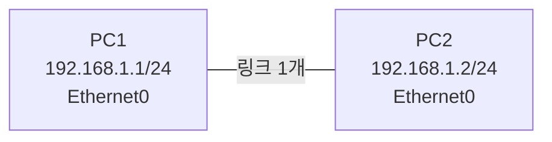
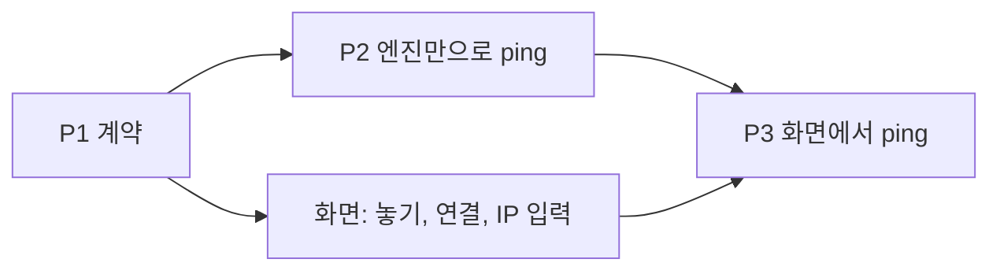
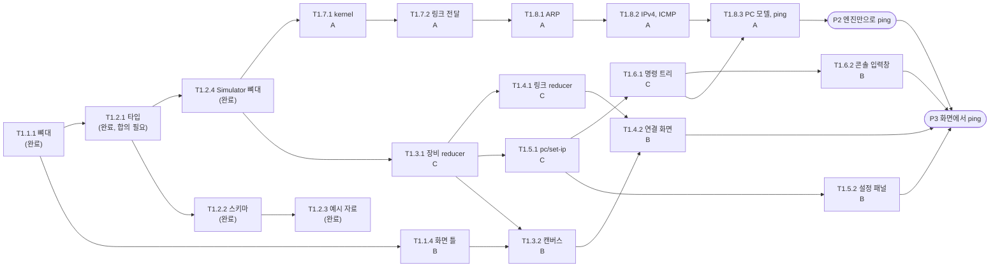

# 6. 첫 목표: PC 2대 통신 (Two-PC Ping)

- 작성 기준일: 2026-11-05
- 상위 문서: [README.md](README.md) · 바탕 문서: [04-development-plan.md](04-development-plan.md), [04-tasks/epic-1-first-ping.md](04-tasks/epic-1-first-ping.md)
- 이 문서의 위치: E1(첫 ping)의 **앞부분만 잘라낸 계획**입니다. E1 전체를 대신하지 않습니다.

## 6.1 목표

**PC 2대를 놓고 링크 하나로 직접 연결한 뒤, 한쪽에서 `ping`을 실행해 응답이 돌아오는 것을 확인한다.**

Switch, 이벤트 목록, 실패 사유 표시는 이 목표에 넣지 않았습니다. 가장 불확실한 부분(엔진의 kernel과 ARP·ICMP)이 실제로 도는지를 가장 짧은 경로로 먼저 확인하는 것이 목적입니다.

🟡 가정: 실제 장비에서는 PC끼리 직접 연결할 때 케이블 종류를 가리지만, 시뮬레이터에서는 구분하지 않습니다. 계획 문서의 링크 모델(`{ id, ends: [PortRef, PortRef] }`)에 케이블 종류가 없습니다.

### 이번 범위에서 뺀 것

| 뺀 것 | 이유 | 돌아오는 시점 |
|---|---|---|
| **디자인** — 색, 아이콘, 배치 다듬기, Tailwind | 요청에 따라 분담에서 제외. 화면은 동작만 하면 됨 | 통신 확인 뒤 T1.1.4의 나머지 |
| **인프라** — CI, lint 규칙, 배포, DB | 요청에 따라 분담에서 제외. 배포 연결은 [T0.1](../task-logs/T0.1-repo-and-deploy-setup.md)에서 끝남 | T1.1.2, T1.1.3은 통신 확인 뒤 |
| Switch (T1.7.3) | PC 2대 직접 연결에는 필요 없음 | 바로 다음 목표 |
| 이벤트 목록, 실패 사유, 추적 링크 (Story 1.9, 1.10) | 통신이 되는지 확인하는 데 필요 없음 | Switch 다음 |
| 이름 바꾸기, 삭제, 삭제 확인, 편집 오류 알림 (T1.3.3, T1.4.3, T1.12.1) | 장비를 놓고 연결하기만 하면 됨 | E1의 나머지 |
| 루프 보호, 성능 테스트, 결정성 테스트 (Story 1.11, T1.7.4) | Switch가 있어야 의미가 있음 | E1의 나머지 |
| xterm 콘솔 (T1.6.2의 대부분) | 입력창 하나와 출력 영역으로 대신함. [개발 계획 4.11절](04-development-plan.md#411-위험과-대응)이 허용한 대체안 | E1의 나머지 |

## 6.2 확인 지점

날짜 대신 눈으로 확인할 수 있는 결과 세 개로 순서를 정합니다.

| 지점 | 끝난 상태 | 확인 방법 |
|---|---|---|
| **P1. 계약** | PC 2대 통신에 필요한 타입과 예시 Document가 `shared`에 있다 | `pnpm check` 통과. 예시 Document가 스키마 검증을 통과하는 테스트 |
| **P2. 엔진만으로 ping** | 화면 없이 테스트 코드에서 ping이 성공한다 | engine의 통합 테스트: 예시 Document를 불러와 PC1의 콘솔에서 `ping 192.168.1.2`를 실행하면 응답 4회. Trace에 ARP 요청·응답과 ICMP 요청·응답이 순서대로 있음 |
| **P3. 화면에서 ping** | 배포된 주소에서 직접 해 본다 | `https://ping9.vercel.app`에서 PC 2대를 놓고, 연결하고, IP를 넣고, 콘솔에서 ping → 응답 4회. 한쪽 IP를 지우고 다시 ping → 응답 없음 |

P2가 이 계획의 핵심입니다. P2가 되면 통신 자체는 검증된 것이고, P3은 그것을 화면에 연결하는 일입니다.

## 6.3 3인 분담

### 먼저 끝낸 것 (2026-11-05)

세 사람이 서로를 기다리지 않고 시작할 수 있도록, 시작 조건이 되는 Task를 먼저 끝냈습니다. 이로써 **P1(계약)이 끝났습니다.** 다만 타입의 형태는 혼자 정한 초안이라 [T1.2.1 기록의 "팀이 정해야 할 것"](../task-logs/T1.2.1-shared-types.md#팀이-정해야-할-것)을 세 사람이 함께 확인해야 합니다.

| Task | 기록 | 원래 담당 |
|---|---|---|
| T1.1.1 모노레포 뼈대 | [기록](../task-logs/T1.1.1-monorepo-skeleton.md) | — |
| T1.2.1 `shared` 타입 | [기록](../task-logs/T1.2.1-shared-types.md) | C |
| T1.2.2 스키마와 검증 | [기록](../task-logs/T1.2.2-document-validation.md) | C |
| T1.2.3 예시 자료 | [기록](../task-logs/T1.2.3-example-data.md) | B |
| T1.2.4 `Simulator` 뼈대 | [기록](../task-logs/T1.2.4-simulator-skeleton.md) | A |

각자의 첫 Task와 남은 양은 다음과 같습니다.

| 담당 | 첫 Task | 남은 Task | 남은 추정 (인일) |
|---|---|---|---|
| A | T1.7.1 kernel | T1.7.1 → T1.7.2 → T1.8.1 → T1.8.2 → T1.8.3 | 약 6.5 |
| B | T1.1.4 화면 틀 | T1.1.4 → T1.3.2 → T1.4.2 → T1.5.2 → T1.6.2 → P3 확인 | 약 5.5 |
| C | T1.3.1 장비 reducer | T1.3.1 → T1.4.1 → T1.5.1 → T1.6.1 | 약 4.0 |

C의 남은 양이 가장 적습니다. C가 P2의 통합 테스트(예시 Document를 불러와 `ping`을 실행하고 [기대 Trace](../task-logs/T1.2.3-example-data.md)와 비교)를 A와 함께 맡거나, 분담에서 뺀 CI(T1.1.3)와 lint 규칙(T1.1.2)을 맡는 것을 권합니다.

아래 표는 처음 세운 분담 그대로이며, 위에서 끝낸 Task가 포함되어 있습니다.

사람 이름 대신 A, B, C로 적었습니다. 누가 어느 것을 맡을지는 팀이 정합니다. 디자인과 인프라 작업은 이 표에 없습니다.

| 담당 | 맡는 범위 | Task (순서대로) | 추정 (인일) |
|---|---|---|---|
| **A. 통신 엔진** | 프레임이 실제로 오가게 하는 부분 | T1.2.4 → T1.7.1 → T1.7.2 → T1.8.1 → T1.8.2 → T1.8.3 | 약 7.5 |
| **B. 화면** | 장비를 놓고, 연결하고, 값을 넣고, 명령을 치는 부분 | T1.2.3 → T1.1.4(틀만) → T1.3.2 → T1.4.2 → T1.5.2 → T1.6.2(입력창) | 약 6.5 |
| **C. 계약과 구성 변경** | 세 사람이 공유하는 타입, 그리고 Document를 바꾸는 부분 | T1.2.1 → T1.2.2(일부) → T1.3.1 → T1.4.1 → T1.5.1 → T1.6.1 | 약 6.5 |

🟡 추정은 [E1 작업 상세](04-tasks/epic-1-first-ping.md)의 값에서 이번 범위에 맞게 줄인 것이며 측정값이 아닙니다.

### A. 통신 엔진

| 순서 | Task | 이번 범위에서 할 것 | 뺀 것 | 선행 | 추정 |
|---|---|---|---|---|---|
| 1 | T1.2.4 `Simulator` 뼈대 | `load`, `getSnapshot`, `subscribe`, `dispatch`, `console`, `getTrace`의 빈 구현. 스냅샷 불변, `docVersion` | — | T1.2.1 | 1.0 |
| 2 | T1.7.1 kernel | 가상 시계, 사건 큐, `SimContext`, Trace 기록기 | — | T1.2.4 | 2.0 |
| 3 | T1.7.2 Ethernet 포트와 링크 전달 | `DeviceModel` 인터페이스, `Frame`, 링크 지연 1,000, MAC 주소 계산 | — | T1.7.1 | 1.0 |
| 4 | T1.8.1 ARP | 테이블, 요청·응답, 대기 패킷, 2초 뒤 폐기 | — | T1.7.2 | 1.5 |
| 5 | T1.8.2 IPv4와 ICMP echo | 같은 네트워크 판정, echo 요청에 응답 | 게이트웨이 선택 (같은 네트워크만 다룸) | T1.8.1 | 1.0 |
| 6 | T1.8.3 PC 모델과 ping | PC 모델 조립, `ping <IP>` 4회와 결과 줄, 통계 | `arp -a`, `arp -d`, 추적 링크 줄 | T1.8.2, C의 T1.6.1 | 1.0 |

T1.7.1(kernel)이 난이도 "상"이고 A의 나머지가 모두 여기에 기댑니다. A는 P1이 끝나는 즉시 시작합니다.

### B. 화면

| 순서 | Task | 이번 범위에서 할 것 | 뺀 것 | 선행 | 추정 |
|---|---|---|---|---|---|
| 1 | T1.2.3 예시 자료 | 예시 Document(PC 2대 직접 연결), 그에 대한 기대 Trace, 스키마 통과 테스트 | 장비 30대 예시, Switch가 든 예시 | T1.2.1, T1.2.2 | 1.0 |
| 2 | T1.1.4 편집기 화면 틀 | `@xyflow/react` 빈 캔버스, 장비 목록·속성 패널·콘솔이 들어갈 영역 | Tailwind, 배치 다듬기, 경로 구성 | T1.1.1 | 0.5 |
| 3 | T1.3.2 캔버스 노드와 끌어다 놓기 | 스냅샷에서 노드 계산, PC 끌어다 놓기, 옮기기, `Simulator` 구독 연결 | 아이콘, 종류별 노드 모양 | T1.2.4, C의 T1.3.1 | 1.5 |
| 4 | T1.4.2 연결 화면 | PC에서 PC로 선 끌기, 링크 그리기 | 포트 고르는 창 (PC는 포트가 하나), 링크 삭제 | C의 T1.4.1 | 1.0 |
| 5 | T1.5.2 PC 설정 패널 | IP와 마스크 입력, 입력란 옆 오류 문구 | 게이트웨이, 중복 경고 | C의 T1.5.1 | 1.0 |
| 6 | T1.6.2 콘솔 화면 | 입력창 하나와 출력 영역. Enter로 `exec`, 결과 줄 출력 | xterm, 줄 편집, 입력 이력, 장비별 탭 | C의 T1.6.1 | 1.0 |
| 7 | P3 확인 | 배포된 주소에서 6.2절의 P3 순서를 직접 해 봄 | — | A의 T1.8.3 | 0.5 |

B는 엔진을 기다리지 않습니다. T1.2.3의 예시 Document를 `Simulator.load`에 넣어 캔버스에 그리는 것부터 시작하고, C의 reducer가 들어오는 대로 놓기·연결·IP 입력을 붙입니다.

### C. 계약과 구성 변경

| 순서 | Task | 이번 범위에서 할 것 | 뺀 것 | 선행 | 추정 |
|---|---|---|---|---|---|
| 1 | T1.2.1 `shared` 타입 | `TopologyDocument`, `PortRef`, PC 구성, `Command`(`device/add`, `device/move`, `link/add`, `pc/set-ip`), `DispatchResult`, `Snapshot`, `ConsoleResult`, `ConsoleLine`, `Trace`, `TraceEvent`, `FrameSnapshot` | Switch·Router 구성, 나머지 `Command`, 알림·폐기 사유 코드 전체 | T1.1.1 | 1.5 |
| 2 | T1.2.2 스키마와 검증 | Zod 스키마, `validateDocument()`(링크 끝의 실재, 포트당 링크 하나), IPv4·마스크 검증 함수 | 금지 키, 깊이 제한, 크기 한도, 가져오기 절차 (보안 항목 SEC-7, SEC-8, SEC-12) | T1.2.1 | 1.0 |
| 3 | T1.3.1 reducer: 장비 | `device/add`(기본 이름 `PC1`, `PC2`), `device/move` | `device/rename`, `device/remove` | T1.2.4 | 1.0 |
| 4 | T1.4.1 reducer: 링크 | `link/add`(포트 실재, 포트 점유, 같은 장비 연결 검증) | `link/remove`, 장비 삭제 시 링크 정리 | T1.3.1 | 1.0 |
| 5 | T1.5.1 reducer: `pc/set-ip` | 값 검증, 네트워크·브로드캐스트 주소 거부 | 게이트웨이, 중복 IP 알림 | T1.3.1 | 0.5 |
| 6 | T1.6.1 명령 트리와 PC 명령어 | 명령 정의 형태, 해석기, `ConsolePort.exec`, `ipconfig`, `ipconfig <IP> <마스크>` | `ipconfig /all`, `help`, 게이트웨이 인자 | T1.5.1 | 1.5 |

C의 첫 일(T1.2.1)이 A와 B의 시작 조건입니다. **T1.2.1은 C가 초안을 쓰고 세 사람이 함께 보고 합의한 뒤 병합합니다.** 여기서 정한 형태를 바꾸면 세 사람의 코드가 모두 바뀝니다.

## 6.4 진행 순서와 만나는 지점

세 사람이 서로를 기다리게 되는 지점은 네 곳입니다.

| 지점 | 누가 누구를 기다리나 | 줄이는 방법 |
|---|---|---|
| T1.2.1 타입 | A와 B가 C를 | 가장 먼저 하고, 하루 안에 합의해 병합 |
| T1.2.4 `Simulator` 뼈대 | B와 C가 A를 | A가 kernel보다 먼저 끝냄. 빈 구현이라 작음 |
| T1.3.1 ~ T1.6.1 reducer와 명령 트리 | B가 C를 | C가 Task 하나를 끝낼 때마다 바로 병합. B는 그동안 예시 Document로 화면을 만듦 |
| T1.6.1 명령 트리 | A의 `ping`이 C를 | C가 명령 정의 형태(타입)를 먼저 병합. A는 그 형태에 `ping`을 추가 |

## 6.5 같은 파일을 건드리지 않게 나누는 법

| 폴더 | 주로 고치는 사람 | 다른 사람이 고칠 때 |
|---|---|---|
| `packages/shared/src` | C | 타입 변경은 PR에서 A와 B가 모두 확인 |
| `packages/engine/src/kernel`, `devices`, `protocols` | A | — |
| `packages/engine/src/reducer`, `cli` | C | A가 `cli`에 `ping`을 추가할 때는 명령 정의 파일만 추가 |
| `packages/engine/src/simulator.ts` | A | C가 `dispatch`를 reducer에 연결할 때 함께 확인 |
| `apps/web/src` | B | — |

폴더 이름은 제안입니다. T1.2.4와 T1.3.1을 시작할 때 확정합니다.

## 6.6 이 목표 뒤에 할 것

P3이 끝나면 E1의 나머지로 돌아갑니다. 추천 순서는 다음과 같습니다.

1. Switch (T1.7.3) — PC 2대와 Switch 1대로 ping. 이때 원래 계획의 M2(첫 ping)에 가까워집니다.
2. 이번에 줄인 부분 채우기 — `shared`의 보안 검증(T1.2.2의 나머지), 삭제·이름 바꾸기, xterm 콘솔.
3. 이벤트 목록과 실패 사유 (Story 1.9, 1.10).
4. 미뤄 둔 인프라 — lint 규칙(T1.1.2), CI(T1.1.3). **팀원이 여럿 병합하기 시작하면 CI가 없는 기간이 길수록 깨진 `main`을 늦게 발견합니다.** P1 직후에 넣는 것을 권합니다.

## 6.7 가정과 미결정

| # | 내용 |
|---|---|
| 🟡 | PC끼리 직접 연결을 허용합니다. 케이블 종류는 구분하지 않습니다 |
| 🟡 | 이번 범위의 ping은 같은 네트워크 안에서만 다룹니다. 게이트웨이는 Router(E4)에서 필요해집니다 |
| 🟡 | 콘솔은 입력창으로 시작합니다. `ConsolePort` 경계가 같아 나중에 xterm으로 바꿔도 engine은 바뀌지 않습니다 |
| 🟡 | 추정 인일은 측정값이 아닙니다. P2까지의 실제 소요를 Task 기록에 적어 나머지 추정을 보정합니다 |
| ❓ | A, B, C를 누가 맡을지 |
| ❓ | CI(T1.1.3)를 P1 직후에 넣을지, P3 뒤로 미룰지 |
