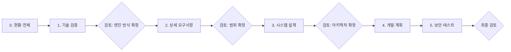

# PacketTracer WEB 프로젝트 계획서

웹 브라우저에서 네트워크 장비를 배치·연결하고 구성과 동작을 실습하는 웹 기반 네트워크 시뮬레이터의 기획·설계·개발 계획 문서 모음입니다.

- 작성 기준일: 2026-11-05
- 작성 방식: BMad Method 워크플로를 단계별로 실행하고, 단계마다 검토를 받은 뒤 다음 단계로 넘어갑니다.
- 이번 단계의 범위: 문서만 작성합니다. 소스코드와 실행 환경은 건드리지 않습니다.

## 문서 목록과 진행 상태

| 단계 | 문서 | 사용한 BMad 워크플로 | 상태 |
|---|---|---|---|
| 0 | [00-current-state.md](00-current-state.md) — 현황, 전제, 확정된 결정 | `bmad-product-brief` (Discovery) | 작성 완료 |
| 1 | [01-technical-validation.md](01-technical-validation.md) — 기술 검증, 엔진 방식 비교와 추천 | `bmad-deep-recon` (technical) | 검토 완료 (엔진 = 브라우저 시뮬레이션 확정) |
| 2 | [02-requirements.md](02-requirements.md) — 사용자 시나리오, 기능 명세, 의존성 | `bmad-product-brief` → `bmad-prd` | 검토 완료 (MVP 범위 확정, 강사·과제 기능 제외) |
| 3 | [03-system-design.md](03-system-design.md) — 아키텍처, 데이터 흐름, 기술 선택 근거 | `bmad-architecture` | 검토 완료 |
| 4 | [04-development-plan.md](04-development-plan.md) — MVP·2차·3차 범위, 작업 분해, 순서. 작업 상세는 [04-tasks/](04-tasks/) | `bmad-create-epics-and-stories`, `bmad-advanced-elicitation` | 검토 완료 |
| 5 | [05-security-and-testing.md](05-security-and-testing.md) — 보안 대책, 테스트 계획 | 전용 워크플로 없음. 03 문서와 규칙 문서를 바탕으로 작성하고 독립 검토를 거침 | 검토 완료 (독립 검토 반영) |

**2026-11-05 최종 검토에서 0~5단계 계획서 전체가 확정되었습니다.** 확정은 문서 내용을 그대로 받아들인다는 뜻이며, 각 문서에 🟡 가정, ❓ 미결정, ⚠️ 미검증으로 표시한 항목은 그 상태 그대로 남아 있습니다.

팀 공유용 요약 페이지: [team-overview.html](team-overview.html). 위 문서를 한 화면으로 간추린 것이며, 내용이 다르면 위 문서가 맞습니다.

## 검토 게이트

엔진 방식(Simulation / Emulation / Hybrid)이 이후 모든 문서의 전제이므로, 1단계 검토에서 이것을 확정한 뒤에 2단계를 시작합니다.

## 표기 규칙

| 표기 | 의미 |
|---|---|
| ✅ 확정 | 사용자가 답했거나 근거 자료로 확인한 사항 |
| 🟡 가정 | 확인 없이 문서 작성을 위해 둔 전제. 틀리면 문서를 고쳐야 합니다 |
| ❓ 미결정 | 아직 결정하지 않은 사항. 결정 주체와 시점을 함께 적습니다 |
| ⚠️ 미검증 | 기술적으로 가능한지 직접 확인하지 못한 사항 |

## BMad 작업 기록 위치

| 내용 | 경로 |
|---|---|
| 제품 브리프 작업 공간 (결정 기록 포함) | `_bmad-output/planning-artifacts/briefs/brief-PacketTracer-WEB-2026-11-05/` |
| 기술 조사 원자료 (출처별 요약, 주장 원장) | `_bmad-output/planning-artifacts/research/technical-web-network-simulator-engine-2026-11-05/` |
