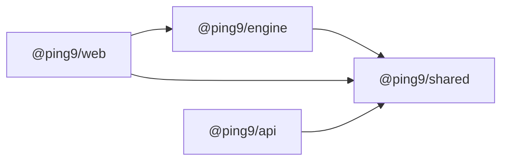

# T1.1.1 모노레포와 패키지 뼈대

| 항목 | 내용 |
|---|---|
| Task | `T1.1.1` — [E1 작업 상세](../project-plan/04-tasks/epic-1-first-ping.md) |
| Story | 1.1 빈 편집기 화면이 주소에서 열린다 |
| 영역 | 공통 |
| 담당 | SDY |
| 기간 | 2026-11-05 |
| 브랜치 / PR | `feat/T1.1.1-monorepo-skeleton` / PR은 아직 열지 않음 |
| 상태 | 구현과 검증 완료. 다른 팀원의 PR 검토가 남음 |

## 1. 목표와 완료 기준

- [x] 새로 받은 저장소에서 설치 뒤 lint, 타입 검사, 테스트, 빌드가 모두 통과한다.
- [x] 패키지마다 테스트 1개가 통과한다.
- [x] pnpm workspace와 `apps/web`, `apps/api`, `packages/shared`, `packages/engine`이 있다.
- [x] 공유 TypeScript 설정이 있다.
- [x] Stack 표의 버전이 고정되어 있다.
- [x] 루트 스크립트 `lint`, `typecheck`, `test`, `build`가 있다.
- [ ] 다른 사람이 Pull Request를 검토했다. (공통 완료 조건)

## 2. 진행 방식

1. [규칙 문서](../../_bmad-output/planning-artifacts/architecture/architecture-PacketTracer-WEB-2026-11-05/ARCHITECTURE-SPINE.md)의 Stack 표와 AD-1, AD-2, AD-5를 읽고, 표의 버전이 npm에 실제로 있는지 `npm view`로 확인했다.
2. `pnpm-workspace.yaml`에 workspace와 버전 목록(catalog)을 만들었다.
3. 루트에 `package.json`, `tsconfig.base.json`, `eslint.config.js`, `.nvmrc`를 만들었다.
4. 패키지 4개에 `package.json`, `tsconfig`, 자리표시 소스, 테스트 1개씩을 만들었다.
5. 설치 뒤 네 검사를 실행했다. 통과를 확인한 다음, 일부러 틀린 코드를 넣어 lint·타입 검사·테스트가 각각 실패하는지 확인했다.
6. 커밋한 뒤 임시 폴더에 새로 복제해 `pnpm install --frozen-lockfile`과 `pnpm check`를 실행했다.
7. 브랜치를 push해 Vercel 미리보기 빌드가 통과하는지 확인했다.

### 주요 결정

| 결정 | 이유 | 버린 대안 |
|---|---|---|
| 버전을 `pnpm-workspace.yaml`의 `catalog` 한 곳에 고정하고, 각 `package.json`에는 `catalog:`라고 적음 | 패키지마다 같은 라이브러리의 버전이 어긋나지 않음. 아직 쓰지 않는 라이브러리(xyflow, Hono, Zod 등)의 버전도 미리 고정해 둘 수 있음 | 각 `package.json`에 버전을 직접 적음 |
| 패키지 이름은 `@ping9/shared`, `@ping9/engine`, `@ping9/web`, `@ping9/api` | 프로젝트 이름과 맞춤. npm에 올리지 않으므로 `private: true` | `@packettracer/*` |
| `shared`와 `engine`은 빌드 결과가 아니라 소스(`src/index.ts`)를 내보냄 | web은 Vite가, 테스트는 Vitest가 TypeScript를 직접 읽음. 고칠 때마다 다시 빌드할 필요가 없음 | `dist`를 내보내고 의존 패키지가 빌드를 기다림 |
| `shared`와 `engine`의 TypeScript 설정에 DOM과 Node 타입을 넣지 않음 (`lib: ["ES2023"]`, `types: []`) | engine에서 `setTimeout`, `document`, `process`를 쓰면 **타입 검사가 실패**함. AD-1과 AD-5를 lint 규칙(T1.1.2)보다 먼저 한 겹 막음 | 모든 패키지가 같은 설정을 씀 |
| 테스트는 패키지마다 `vitest run`, 루트는 `pnpm -r run test` | 패키지 하나만 돌리기 쉬움. Vitest의 다중 프로젝트 설정에 기대지 않음 | 루트에 Vitest 설정 하나 |
| web의 테스트는 `react-dom/server`의 `renderToString`으로 그림 | 브라우저 흉내 환경(jsdom)을 추가하지 않고도 컴포넌트가 그려지는지 확인됨. Stack 표에 jsdom이 없음 | jsdom과 Testing Library 추가 (T1.1.4에서 필요하면 정함) |
| `engines.node`는 `>=24.19.0 <25`, `.nvmrc`는 `24.22.2` | Stack 표는 24.22.2. 이 작업을 한 PC는 24.19.0이라 범위로 둠 | 24.22.2로 정확히 고정 (지금 PC에서 설치가 막힘) |
| `vercel.json`을 pnpm 빌드로 바꿈 | `apps/web/index.html`이 Vite 진입 파일로 바뀌어, 그대로 두면 병합 뒤 운영 화면이 깨짐 | T1.1.4까지 미룸 |

## 3. 변경 내용

| 파일 | 변경 |
|---|---|
| `pnpm-workspace.yaml` | workspace(`apps/*`, `packages/*`)와 버전 catalog |
| `package.json` | 루트 스크립트 `lint`, `typecheck`, `test`, `build`, `check`, `dev`. `packageManager: pnpm@12.16.1` |
| `pnpm-lock.yaml` | 잠금 파일 |
| `tsconfig.base.json` | 공유 TypeScript 설정 (strict, `noUncheckedIndexedAccess`, `verbatimModuleSyntax`) |
| `eslint.config.js` | ESLint와 typescript-eslint의 추천 규칙. 문서·도구 폴더 제외 |
| `.nvmrc` | Node 24.22.2 |
| `packages/shared/` | `package.json`, `tsconfig.json`, `tsconfig.build.json`, `src/index.ts`, `src/index.test.ts` |
| `packages/engine/` | 같은 구성. `@ping9/shared`에 의존 |
| `apps/api/` | 같은 구성. `@ping9/shared`에 의존. Node 타입 포함 |
| `apps/web/` | Vite + React 최소 구성. `@ping9/engine`과 `@ping9/shared`를 불러오는 자리표시 화면 |
| `vercel.json` | `installCommand: pnpm install --frozen-lockfile`, `buildCommand: pnpm --filter @ping9/web build`, `outputDirectory: apps/web/dist` |

의존 방향 (AD-2):



각 `package.json`에는 위 화살표에 해당하는 workspace 패키지만 적었습니다. 이것을 어기면 실패하게 만드는 lint 규칙은 T1.1.2의 일입니다.

## 4. 결과와 검증

Stack 표의 버전이 npm에 있는지 (`npm view <패키지>@<버전> version`):

```text
pnpm@12.16.1 ✓   typescript@6.0.3 ✓ (latest는 7.0.2)   eslint@10.14.0 ✓   typescript-eslint@8.72.1 ✓
react@19.3.1 ✓   react-dom@19.3.1 ✓   vite@8.3.5 ✓   @vitejs/plugin-react@6.2.1 ✓   vitest@5.1.0 ✓
zod@4.6.7 ✓   hono@4.13.16 ✓
@eslint/js@10.14.0 ✗ 없음 → latest인 10.0.1을 씀
```

네 검사 (이 폴더에서):

```text
> pnpm lint        $ eslint .                                   [exit 0]
> pnpm typecheck   shared, engine, api, web: Done               [exit 0]
> pnpm test        shared 1 passed, engine 1 passed,
                   api 1 passed, web 1 passed                   [exit 0]
> pnpm build       shared, engine, api: tsc Done
                   web: vite v8.3.5, 18 modules transformed,
                   dist/assets/index-*.js 219.84 kB (gzip 68.85 kB), built in 178ms   [exit 0]
```

검사가 틀린 코드를 잡는지 (확인 뒤 지움):

```text
lint      engine에 any와 안 쓰는 변수 → no-explicit-any, no-unused-vars 오류 2개     [exit 1]
typecheck engine에서 setTimeout, document, process 사용 →
          TS2304 Cannot find name 'setTimeout'
          TS2584 Cannot find name 'document'
          TS2591 Cannot find name 'process'                                          [exit 1]
test      expect(1).toBe(2) → 1 failed | 1 passed                                    [exit 1]
```

깨끗한 폴더에서 (커밋 `05495e7`을 임시 폴더에 새로 복제):

```text
> pnpm install --frozen-lockfile
  Lockfile is up to date, resolution step is skipped
  Packages: +136    Done in 1.5s using pnpm v12.16.1
> pnpm check
  typecheck 4개 Done / test 4개 패키지 각 1 passed / build 4개 Done      [exit 0]
```

Vercel 미리보기 빌드 (브랜치 push 뒤, 배포 `dpl_CrnM4h9nMDkyN74V7PRCAgFkYqhd`):

```text
Warning: Due to "engines": { "node": ">=24.19.0 <25" } ... Node.js Version "24.x" will be used instead (프로젝트 설정은 26.x)
Detected `pnpm-lock.yaml` version 9 generated by pnpm@12.x from package.json#packageManager pnpm@12.16.1
Running "install" command: `pnpm install --frozen-lockfile`...   Done in 2.3s using pnpm v12.16.1
vite v8.3.5 building client environment for production...        ✓ built in 237ms
Build Completed in /vercel/output [3s]     Deployment completed     status: Ready (preview)
```

실행하지 않은 것:

- 미리보기 주소를 브라우저에서 열어 화면을 보는 것. 미리보기에는 Vercel 인증 보호가 켜져 있습니다. 빌드 성공과 로컬 `vite build` 결과로만 확인했습니다.
- `pnpm dev`로 개발 서버를 띄워 화면을 보는 것.
- macOS와 Linux에서의 설치. 이 작업은 Windows(arm64)에서 했고, Linux는 Vercel 빌드로만 확인됐습니다.

## 5. 추정과 실제

| 추정 (인일) | 실제 (인일) | 차이의 이유 |
|---|---|---|
| 1.0 | 약 0.1 | Claude가 작성하고 검증함. 사람이 직접 하는 Task의 속도를 가늠하는 자료로는 쓸 수 없음 |

## 6. 계획과 달라진 점

| 항목 | 계획 | 실제 | 이유 |
|---|---|---|---|
| web의 Vite·React 구성 | T1.1.4에서 | 최소 구성만 이 Task에서 | web의 `build`와 `test`가 통과하려면 빌드 도구가 있어야 함. 경로, 화면 배치, Tailwind, `@xyflow/react`는 그대로 T1.1.4의 일 |
| `vercel.json`의 빌드 설정 | T1.1.4의 "정적 호스팅에 배포" | 이 Task에서 | 2절의 결정 참조 |
| api의 Hono | — | 설치하지 않음 | 서버 코드는 T2.1.1부터. 버전은 catalog에 고정해 둠 |
| Node 버전 | 24.22.2 | 로컬 24.19.0, Vercel 24.x | 범위로 허용. 이 PC의 Node는 올리지 않음 |
| Stack 표에 없는 패키지 | — | `@eslint/js` 10.0.1, `@types/node` 24.19.2, `@types/react` 19.3.0, `@types/react-dom` 19.3.0 | 타입과 추천 규칙 묶음. catalog에 "Stack 표에 없음"으로 표시 |

[03 문서 3.15절](../project-plan/03-system-design.md#315-미검증과-미결정)의 X2("고른 버전 조합으로 lint, 타입 검사, 테스트, 빌드가 함께 돈다")는 **일부만** 확인됐습니다. 함께 돌려 본 것은 TypeScript, ESLint, typescript-eslint, React, Vite, @vitejs/plugin-react, Vitest입니다. 나머지(xyflow, xterm, Zustand, React Router, Tailwind, Zod, Hono, better-auth, Drizzle, pg, pino, fast-check, Playwright)는 버전만 고정했고 설치하지 않았습니다.

## 7. 남은 일과 다음 Task에 전할 것

남은 일:

- 이 브랜치의 Pull Request를 열고 팀원 한 명이 검토.
- T1.1.2(lint 규칙), T1.1.3(CI)은 손대지 않음.

다음 Task에 전할 것:

- **처음 받을 때**: Node 24와 pnpm이 필요합니다. `corepack enable`로 pnpm을 켜거나(권한 오류가 나면 `npm install -g pnpm@12.16.1`), 그 뒤 `pnpm install`, `pnpm check`.
- **이 PC에서 한 설정**: `pnpm` 명령이 없어서 `corepack enable --install-directory %APPDATA%\npm pnpm`으로 사용자 폴더에 등록했습니다. 저장소 밖의 변경입니다.
- **라이브러리를 추가할 때**: catalog에 이미 있으면 `package.json`에 `"이름": "catalog:"`라고 적습니다. 없으면 catalog에 먼저 추가합니다.
- **자리표시 코드**: 각 패키지의 `src/index.ts`에 있는 `*_PACKAGE_NAME` 상수는 패키지 연결 확인용입니다. T1.2.1(shared), T1.2.4(engine), T1.1.4(web), T2.1.1(api)에서 지우고 실제 코드로 바꿉니다.
- **`dist` 폴더**: `shared`, `engine`, `api`의 `build`는 테스트를 뺀 소스가 컴파일되는지 확인하는 용도이고, 만들어진 `dist`를 쓰는 곳은 없습니다. api를 Vercel Functions로 올릴 때의 묶음 방식은 T2.1.1에서 정합니다.
- **T1.1.4**: `vercel.json`에 SPA 경로용 rewrite가 아직 없습니다. 경로를 추가할 때 함께 넣어야 합니다.
- **T1.1.2**: engine의 금지 함수 중 `setTimeout`, `setInterval`은 이미 타입 검사에서 걸립니다. `Date.now`, `Math.random`은 ES 표준이라 타입 검사로는 걸리지 않으므로 lint 규칙이 필요합니다.
