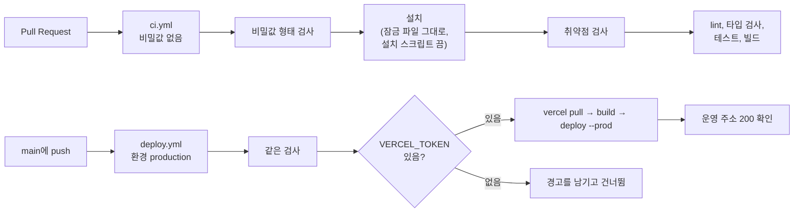

# T1.1.3 CI 검사와 운영 배포

| 항목 | 내용 |
|---|---|
| Task | `T1.1.3` — [E1 작업 상세](../project-plan/04-tasks/epic-1-first-ping.md). 배포 자동화는 [T2.2.3](../project-plan/04-tasks/epic-2-account-and-save.md)의 일부를 앞당김 |
| Story | 1.1 빈 편집기 화면이 주소에서 열린다 |
| 영역 | 배포 |
| 담당 | SDY |
| 기간 | 2026-11-05 |
| 브랜치 / PR | `feat/T1.1.3-ci-and-deploy` / [PR #2](https://github.com/TL-cg11/PING9-archive/pull/2) — `main`에 병합됨 (병합 커밋 `4513d26`). 다른 팀원의 검토 없이 소유자가 병합 |
| 상태 | 일부 완료 — CI는 동작함. **Actions 배포는 [T0.4](T0.4-public-repo-and-git-deploy.md)에서 없앰.** `main` 브랜치 보호가 남음 |

> **정정 (2026-11-05, [T0.4](T0.4-public-repo-and-git-deploy.md)).** 이 문서의 "토큰으로 배포하면 누가 커밋했든 배포됨"은 사실이 아니었습니다. 토큰을 등록한 뒤 팀원의 커밋으로 실행하니 Vercel이 CLI 배포도 막았습니다. 그래서 `deploy.yml`을 없애고 저장소를 공개로 바꿔 Vercel의 Git 연동 배포로 돌아갔습니다. 7절의 "소유자가 직접 해야 하는 것"과 "그 뒤에 할 것"의 첫 항목은 더 하지 않습니다.
>
> 이 문서의 PR 링크, 실행 번호, 커밋 해시는 옛 저장소(비공개 `TL-cg11/PING9-archive`)의 것입니다. 지금 저장소의 해시와의 대응은 T0.4 기록의 4절에 있습니다.

## 1. 목표와 완료 기준

- [x] Pull Request에서 lint, 타입 검사, 단위 테스트, 빌드가 실행된다.
- [ ] 검사가 실패한 Pull Request는 병합할 수 없다. — **아직.** `main` 브랜치 보호를 켜야 합니다 (7절).
- [x] 의존성 캐시.
- [x] 의존성 취약점 검사, 높은 등급이면 실패 (SEC-20).
- [x] 변경분의 비밀값 형태 검사 (SEC-19).
- [x] Pull Request 워크플로는 비밀값에 접근하지 않음, 외부 액션 버전 고정, 잠금 파일 그대로 설치하고 설치 스크립트 끔 (SEC-27).
- [ ] `main` 브랜치 보호 (SEC-27). — 위와 같음.
- [ ] 팀원의 커밋도 `main`에 들어오면 운영에 배포된다. — 워크플로는 있으나 **토큰이 없어 배포 단계를 건너뜀** (7절).

## 2. 진행 방식

1. 쓸 액션의 최신 릴리스와 그 커밋 해시를 `gh api`로 확인했다.
2. 비밀값 검사를 외부 액션 없이 저장소 안의 스크립트로 만들고 테스트를 붙였다.
3. PR용 워크플로(`ci.yml`)와 `main`용 워크플로(`deploy.yml`)를 나눴다.
4. 배포용 GitHub 환경 `production`을 만들고 `main`에서만 쓸 수 있게 했다. Vercel 팀 ID와 프로젝트 ID를 그 환경의 변수로 넣었다.
5. 새로 복제한 폴더에서 `ci.yml`과 같은 명령을 차례로 실행했다.
6. PR을 열어 GitHub에서 CI가 도는 것을 확인했다.

### 구성



### 주요 결정

| 결정 | 이유 | 버린 대안 |
|---|---|---|
| 배포를 Vercel의 Git 연동이 아니라 GitHub Actions에서 함 | Hobby 플랜의 Vercel은 소유자가 아닌 사람의 커밋을 배포하지 않음 ([T0.1 기록](T0.1-repo-and-deploy-setup.md)의 V2, 실제로 팀원 커밋 2개가 "Deployment was blocked"). 토큰으로 배포하면 누가 커밋했든 배포됨 | 저장소를 공개로 전환, Pro 플랜, 소유자만 `main`에 병합 |
| PR 워크플로와 배포 워크플로를 파일로 나눔 | PR 워크플로에는 비밀값을 가리키는 줄이 아예 없음 (SEC-27). 한 파일에 조건으로 나누면 실수로 PR에서 비밀값이 읽힐 수 있음 | 워크플로 하나에 `if`로 분기 |
| 비밀값은 GitHub 환경 `production`에 두고, 그 환경은 `main` 브랜치만 쓸 수 있음 | "배포 작업은 보호된 환경에서만 실행" (SEC-27). 다른 브랜치의 워크플로가 토큰을 읽지 못함 | 저장소 전체의 비밀값 |
| 비밀값 검사를 저장소 안의 스크립트(`scripts/check-secrets.mjs`)로 만듦 | 널리 쓰는 gitleaks 액션은 별도의 사용 계약(EULA)을 따름. 대신 동의할 수 없어 쓰지 않음. 스크립트는 의존성이 없어 설치 전에 실행됨 | `gitleaks/gitleaks-action`, gitleaks 실행 파일을 내려받아 실행 |
| 외부 액션을 커밋 해시로 고정 | 태그는 다른 커밋으로 옮겨질 수 있음 (SEC-27) | `@v7` 같은 태그 |
| 토큰이 없으면 실패하지 않고 경고만 남기고 건너뜀 | 토큰을 등록하기 전에도 `main`의 검사는 돌아야 함. 그동안은 Vercel의 Git 연동이 소유자의 커밋을 배포함 | 토큰이 없으면 실패 |
| Vercel의 Git 연동을 아직 끄지 않음 | Actions 배포가 한 번 성공하기 전에 끄면 운영 배포가 멈춤 | 지금 끔 |
| 한 워크플로에 작업(job) 하나 | 비공개 저장소의 무료 Actions 시간은 작업마다 분 단위로 올림. 작업을 셋으로 나누면 같은 일에 세 배가 듦 | 검사, 취약점, 비밀값을 작업 셋으로 |
| 미리보기 배포는 만들지 않음 | PR 워크플로가 비밀값에 접근하지 않아야 하므로 PR에서는 Vercel 토큰을 쓸 수 없음 | PR마다 미리보기 배포 |

## 3. 변경 내용

| 파일 | 내용 |
|---|---|
| `.github/workflows/ci.yml` | PR마다: 비밀값 검사 → 설치 → 취약점 검사 → lint → 타입 검사 → 테스트 → 빌드 |
| `.github/workflows/deploy.yml` | `main`에 push될 때: 같은 검사 → Vercel 운영 배포 → 운영 주소 확인 |
| `scripts/check-secrets.mjs` | 비밀값 형태 14종과 넣으면 안 되는 파일(`.env*`, 키 파일, `.vercel/`)을 찾음 |
| `scripts/check-secrets.test.mjs` | 스크립트의 테스트 35개 (`node --test`) |
| `package.json` | `test`가 스크립트 테스트도 실행. `test:scripts`, `check:secrets` 추가 |
| `eslint.config.js` | `scripts/`의 Node 전역 이름 허용 |

저장소 밖에 만든 것 (GitHub 설정):

| 대상 | 내용 |
|---|---|
| 환경 `production` | 새로 만듦. 배포할 수 있는 브랜치는 `main`뿐 |
| 환경 변수 `VERCEL_ORG_ID`, `VERCEL_PROJECT_ID` | Vercel 팀과 프로젝트의 ID. 비밀값이 아님 |

고정한 버전:

| 대상 | 버전 | 커밋 해시 |
|---|---|---|
| `actions/checkout` | v7.0.1 | `3d3c42e5aac5ba805825da76410c181273ba90b1` |
| `pnpm/action-setup` | v6.1.1 | `73e46992e05b19abd31f2f3c20e0e7370d762115` |
| `actions/setup-node` | v7.1.0 | `949feb2413d6458794dcd2491c4babbbce0c15c1` |
| Vercel CLI | 65.11.0 | — |

## 4. 결과와 검증

비밀값 검사 스크립트:

```text
> pnpm test:scripts
  tests 35 / pass 35 / fail 0
> node scripts/check-secrets.mjs --range origin/main..HEAD
  비밀값 검사 통과: 파일 381개, 커밋 범위 origin/main..HEAD
```

스크립트가 실제로 잡는지 (확인 뒤 지움):

```text
가짜 GitHub 토큰을 engine의 파일에 넣음  → packages/engine/src/zz-leak.ts:1: GitHub 토큰        [exit 1]
.env.production을 추적 대상에 넣음       → .env.production: 환경 변수 파일은 저장소에 넣지 않습니다  [exit 1]
둘 다 지운 뒤                           → 비밀값 검사 통과: 파일 381개                          [exit 0]
```

`ci.yml`과 같은 명령을 새로 복제한 폴더에서 (커밋 `421a411`):

```text
node scripts/check-secrets.mjs                       비밀값 검사 통과: 파일 381개
pnpm install --frozen-lockfile --ignore-scripts      Lockfile is up to date / Done in 1.7s
pnpm audit --audit-level high                        1 vulnerabilities found, Severity: 1 moderate   [exit 0]
pnpm lint / typecheck / test / build                 모두 exit 0
  test: 스크립트 35 + shared 268 + api 2 + engine 70 + web 6 = 381개 통과
```

취약점 검사에서 보통 등급 1건이 보고됩니다. 높은 등급이 아니어서 통과하지만 남아 있는 것은 사실입니다.

PR에서의 실행 결과 ([PR #2](https://github.com/TL-cg11/PING9-archive/pull/2), 실행 번호 41981281987, 커밋 `421a411`):

```text
check   pass   40초   (ubuntu-latest, Node 24.22.2, pnpm 12.16.1)
  success  Checkout
  success  Set up pnpm
  success  Set up Node.js
  success  Scan for secrets        비밀값 검사 통과: 파일 381개, 커밋 범위 origin/main..HEAD
  success  Install dependencies    Done in 1.9s using pnpm v12.16.1
  success  Audit dependencies      1 vulnerabilities found, Severity: 1 moderate
  success  Lint
  success  Typecheck
  success  Test                    스크립트 35, shared 268, api 2, engine 70, web 6
  success  Build                   apps/web: built in 251ms
```

로컬은 Windows(arm64)와 Node 24.19.0이고 CI는 Linux(x64)와 Node 24.22.2입니다. 두 환경에서 같은 결과가 나왔습니다. Node 24.22.2는 Stack 표의 버전이며 여기서 처음 실행됐습니다.

병합 뒤 `main`에서의 Deploy 워크플로 (실행 번호 41981645575, 커밋 `4513d26`):

```text
conclusion: success
  success  Checkout / Set up pnpm / Set up Node.js
  success  Scan for secrets
  success  Install dependencies
  success  Audit dependencies
  success  Lint, typecheck, test, build
  success  Skip deploy when the Vercel token is not registered
  skipped  Pull Vercel project settings
  skipped  Build for Vercel
  skipped  Deploy to production
  skipped  Verify the production URL responds
warning: 배포 건너뜀 - 환경 production에 VERCEL_TOKEN이 없어 배포하지 않았습니다.
```

- 환경 `production`이 `main` 브랜치의 실행을 받아들였습니다.
- 토큰이 없을 때 실패하지 않고 경고를 남기며 건너뛰는 동작이 설계대로입니다.
- 이 커밋의 운영 반영은 Vercel의 Git 연동이 했습니다 (`Vercel: Deployment has completed`). 병합 커밋의 작성자가 저장소 소유자 계정이기 때문입니다. 운영 주소 `/`와 `/mockup.html`은 모두 200입니다.

실행하지 않은 것:

- **운영 배포 단계.** 토큰이 없어 한 번도 실행되지 않았습니다. `vercel pull`, `build`, `deploy`의 세 명령이 Actions에서 실제로 도는지는 토큰 등록 뒤에 확인됩니다.
- **실패하는 PR을 올려 병합이 막히는지.** 브랜치 보호를 켜지 않았습니다.

## 5. 추정과 실제

| 추정 (인일) | 실제 (인일) | 차이의 이유 |
|---|---|---|
| 0.5 | 약 0.1 | Claude가 작성함. 배포 워크플로(T2.2.3의 일부)까지 포함 |

## 6. 계획과 달라진 점

| 항목 | 계획 | 실제 | 이유 |
|---|---|---|---|
| 배포 자동화의 시점 | E2의 T2.2.3 | 지금 | 팀원의 커밋이 배포되지 않는 문제가 이미 생김 |
| 배포 방식 | 컨테이너 이미지 빌드, 레지스트리, 서버에서 받기, 실패 시 이전 이미지로 되돌림 | Vercel CLI로 배포 | [T0.1](T0.1-repo-and-deploy-setup.md)에서 배포를 Vercel로 바꿈. 되돌리기는 Vercel 대시보드의 이전 배포로 함 |
| `/api/health` 확인 | 배포 뒤 상태 확인 | 운영 주소의 200만 확인 | api가 아직 없음. T2.1.1 뒤에 추가 |
| 비밀값 검사 도구 | 정해지지 않음 | 저장소 안의 스크립트 | 2절의 결정 참조 |
| 미리보기 배포 | 계획에 없음. Vercel의 Git 연동이 소유자의 PR에만 만들어 줌 | Actions에서는 만들지 않음 | 2절의 결정 참조 |
| `main` 브랜치 보호 | 이 Task에 포함 | 켜지 않음 | 켜면 `main`에 직접 push할 수 없게 되어 지금의 작업 방식이 바뀜. 소유자의 결정이 필요 |

## 7. 남은 일과 다음 Task에 전할 것

소유자가 직접 해야 하는 것:

1. **Vercel 토큰 만들기.** [Vercel 계정의 Tokens](https://vercel.com/account/tokens)에서 범위를 팀 `TLC7`로 한 토큰을 만듭니다.
2. **GitHub에 등록.** 아래 명령을 실행하고 토큰을 붙여 넣습니다. 토큰은 저장소, 채팅, 문서 어디에도 적지 않습니다.

   ```bash
   gh secret set VERCEL_TOKEN --env production --repo TL-cg11/PING9
   ```

3. 등록한 뒤 `main`에 커밋이 들어오거나 Actions 화면에서 Deploy 워크플로를 직접 실행하면 배포 단계가 돕니다.

그 뒤에 할 것:

- Actions 배포가 한 번 성공하면 `vercel.json`에 `"git": { "deploymentEnabled": false }`를 넣어 Vercel의 Git 연동 배포를 끕니다. 끄지 않으면 소유자의 커밋은 두 번 배포되고, 팀원의 커밋에는 "Deployment was blocked" 실패 표시가 계속 붙습니다.
- `main` 브랜치 보호를 켭니다: PR로만 병합, `check` 통과 필수. 켜는 순간부터 소유자도 `main`에 직접 push할 수 없습니다.
- T1.1.2(lint 규칙)는 손대지 않았습니다.

다음 Task에 전할 것:

- **모든 사람**: PR을 올리면 `check`가 돕니다. 로컬에서 미리 보려면 `pnpm check`와 `pnpm check:secrets`.
- 비밀값 검사에 의도한 예시 값이 걸리면 그 줄에 `secret-scan: allow`라고 적습니다.
- 비밀값 검사는 형식이 뚜렷한 14종만 봅니다. 형식이 없는 비밀번호나 새 형식의 토큰은 잡지 못합니다. 통과했다고 비밀값이 없다는 뜻은 아닙니다.
- 액션의 버전을 올릴 때는 태그와 커밋 해시를 함께 바꿉니다.
- **T2.1.1 (api)**: 배포 뒤 확인에 `/api/health`를 추가합니다.
- **T2.8.1 (백업)**: 예약 실행 워크플로를 따로 만들고, DB 주소는 환경 `production`의 비밀값으로 둡니다.
