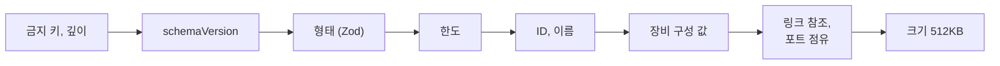

# T1.2.2 Document 스키마와 검증

| 항목 | 내용 |
|---|---|
| Task | `T1.2.2` — [E1 작업 상세](../project-plan/04-tasks/epic-1-first-ping.md) |
| Story | 1.2 엔진과 화면의 계약이 타입과 예시 자료로 확정된다 |
| 영역 | 공통 |
| 담당 | SDY |
| 기간 | 2026-11-05 |
| 브랜치 / PR | `feat/story-1.2-contract` / PR은 아직 열지 않음 |
| 상태 | 구현과 검증 완료. PR 검토가 남음 |

## 1. 목표와 완료 기준

- [x] 깨진 문서 유형마다 구별되는 오류 코드로 거부한다.
- [x] 임의의 JSON을 넣어도 예외가 나지 않는다 (AD-9, SEC-7, SEC-8).
- [x] 수용 기준: 링크 끝이 없는 장비를 가리키는 문서, 포트 하나에 링크가 둘인 문서, 이름이 겹치는 문서가 각각 다른 코드로 거부된다.
- [x] 수 한도까지 채운 가장 큰 문서가 512KB 안에 든다 (SEC-12).
- [ ] 다른 사람이 Pull Request를 검토했다.

## 2. 진행 방식

1. 값 검증 함수의 테스트를 경계값 표로 먼저 쓰고(`values.test.ts`) 함수를 만들었다.
2. 형태는 Zod 스키마로, 그 뒤의 값·참조·유일성·한도는 직접 쓴 코드로 나눴다.
3. 유효한 문서 하나를 한 곳씩 망가뜨리는 표로 `validateDocument()`의 오류 코드를 확인했다.
4. fast-check로 임의의 값, 임의의 JSON, 예시 문서를 망가뜨린 값을 2,300번 넣어 예외가 없는지 확인했다 (PBT-9).

### 주요 결정

| 결정 | 이유 | 버린 대안 |
|---|---|---|
| Zod는 형태만, 값과 참조는 직접 쓴 코드 | Zod의 오류는 `{ code, params }` 형태가 아니고 문구가 영어임. "구별되는 오류 코드"를 직접 정하려면 값 검사를 손으로 써야 함 | Zod의 `refine`에 모두 넣고 오류를 변환 |
| `validateDocument()`는 **검증된 값**을 돌려주고, 정의되지 않은 필드는 그 값에 없음 | SEC-8: "이후에는 검증 함수가 돌려준 값만 쓴다". 문서에 끼워 넣은 `onclick` 같은 필드가 저장되지 않음 (ST-6) | 넣은 값을 그대로 통과시킴 |
| 금지 키와 깊이 검사를 `validateDocument()` 안에도 넣음 | 가져오기 절차를 거치지 않고 직접 불리는 경로(engine의 `load`)에서도 같은 보호가 적용됨 | 가져오기 절차에만 |
| 스키마와 타입이 어긋나면 타입 오류가 나게 함 (`schema.ts` 끝의 타입 검사) | 타입(T1.2.1)과 스키마를 따로 적었으므로 한쪽만 고치는 실수를 막아야 함 | 스키마에서 타입을 뽑아 씀 (`z.infer`). 이 경우 계약을 읽으려면 스키마를 읽어야 함 |
| 인터페이스 주소의 규칙(특수 주소, 마스크 /1~/30, 네트워크·브로드캐스트 주소 거부, 게이트웨이가 같은 네트워크)을 `shared`의 함수로 두고 `validateDocument()`도 씀 | reducer(T1.5.1)와 문서 검증이 같은 규칙을 쓰게 됨. 손으로 만든 파일로 engine의 가정을 깨지 못함 (MAL-5) | reducer에만 둠 |
| 문서 안의 모든 문자열은 64자까지 | SEC-7 "모든 문자열에 최대 길이". ID(36자), 주소(15자), 이름(32자), 포트 이름(18자)이 모두 이 안 | 필드마다 다른 한도 |
| `TextEncoder` 없이 UTF-8 바이트 수를 직접 셈 | `shared`는 DOM과 Node의 타입을 쓰지 않음 ([T1.1.1](T1.1.1-monorepo-skeleton.md)의 결정) | `TextEncoder` |

검증 순서 (`validateDocument`):



가져오기 절차 (`parseDocumentJson`, SEC-8의 순서): 크기(2MB) → JSON 해석 → 금지 키와 깊이 → `schemaVersion` → `migrateDocument()` → `validateDocument()`.

## 3. 변경 내용

| 파일 (`packages/shared/src/`) | 내용 |
|---|---|
| `values.ts` | `parseIpv4`, `formatIpv4`, `checkIpv4`, `checkHostIpv4`, `maskToPrefixLength`, `prefixLengthToMask`, `checkMask`, `isSameNetwork`, `checkInterfaceAddress`, `checkGateway`, `checkVlanId`, `checkDeviceName`, `checkVlanName`, `checkTopologyName`, `isUuid`, `utf8ByteLength` |
| `schema.ts` | `topologyDocumentSchema`, `traceSchema`, 스키마와 타입의 일치 검사 |
| `validate.ts` | `validateDocument`, `migrateDocument`, `parseDocumentJson`, `documentByteSize`, `validateTrace` |
| `values.test.ts`, `validate.test.ts`, `validate.property.test.ts` | 테스트 222개 |
| `package.json` | `zod`(의존), `fast-check`(개발 의존) |

## 4. 결과와 검증

```text
> pnpm --filter @ping9/shared test
  src/values.test.ts              120 passed
  src/validate.test.ts             97 passed
  src/validate.property.test.ts     5 passed
```

수용 기준의 세 경우:

```text
링크 끝이 없는 장비를 가리킴   → LINK_DEVICE_NOT_FOUND
포트 하나에 링크가 둘          → PORT_IN_USE
장비 이름이 겹침              → DUPLICATE_DEVICE_NAME
```

가장 큰 문서의 크기 (Router 50대, Router마다 인터페이스 4개와 Static route 100개, 링크 100개, 모든 문자열을 가장 긴 유효한 값으로):

```text
464,141바이트 (한도 524,288바이트의 약 89%)
```

속성 기반 테스트 (PBT-9): 임의의 값 500번, 임의의 JSON 500번, 임의의 글자 300번, 예시 문서를 한 곳씩 망가뜨린 값 1,000번. 예외 0건. 통과한 문서는 다시 넣어도 같은 결과.

스키마와 타입의 일치 검사가 실제로 동작하는지: `Link` 타입에 필드 하나를 임시로 추가하니 `schema.ts`에서 `TS2344: Type 'false' does not satisfy the constraint 'true'`가 났고, 되돌리니 통과했습니다.

그 밖에 테스트로 확인한 것:

- 특수 주소 거부 (MAL-5): `0.0.0.0`, `255.255.255.255`, `127.x`, `224.x` 이상.
- 금지 키 `__proto__`, `constructor`, `prototype`을 깊은 곳에서도 찾고, 검증 뒤 `Object.prototype`이 오염되지 않음.
- 순환 참조, 20만 단계 중첩, 읽을 때 예외를 던지는 값(접근자, Proxy)에도 예외 없이 거부.
- 문서가 아닌 값 11종(null, 수, 함수, Symbol, BigInt, Date, Map 등).

실행하지 않은 것: 가져오기 파일의 겉 포장(`{ kind: "topology-export", name, document }`) 처리. T7.1.2의 범위입니다.

## 5. 추정과 실제

| 추정 (인일) | 실제 (인일) | 차이의 이유 |
|---|---|---|
| 2.0 | 약 0.15 | Claude가 작성함 |

## 6. 계획과 달라진 점

| 항목 | 계획 | 실제 | 이유 |
|---|---|---|---|
| 범위 | [PC 2대 계획](../project-plan/06-two-pc-ping-plan.md)은 보안 항목(금지 키, 깊이, 크기 한도, 가져오기 절차)을 뒤로 미룸 | Task 전체를 구현 | 저장소에 깨진 문서가 들어온 뒤에 검증을 조이면 기존 자료가 거부될 수 있음 |
| `validateTrace()` | Task에 없음 | 추가 | 수용 기준 "예시 Document와 기대 Trace가 스키마 검증을 통과"를 확인하려면 Trace의 스키마가 필요. engine 테스트(T1.7.x)도 씀 |
| 문서에 없던 한도 | — | 좌표 ±1,000,000, VLAN 이름 32자, trunk의 허용 VLAN 범위 64개, 중첩 깊이 12 | SEC-7 "모든 수에 범위, 모든 목록에 최대 개수". 수치는 🟡 가정 |
| 가장 큰 문서의 여유 | — | 약 11% | 한도 수치를 올리면 512KB를 넘을 수 있음. 한도를 바꿀 때 이 테스트가 알려 줌 |

## 7. 남은 일과 다음 Task에 전할 것

- **T1.3.1, T1.4.1, T1.5.1 (reducer)**: 값 검증은 `values.ts`의 함수를 그대로 씁니다. 같은 규칙을 다시 쓰지 않습니다. reducer가 만든 Document는 `validateDocument()`를 통과해야 합니다 (PBT-1).
- **T1.6.1 (CLI)**: 인자 검증도 같은 함수를 씁니다. CLI가 더하는 것은 틀린 단어의 위치뿐입니다.
- **T2.3.2 (api의 저장)**: `parseDocumentJson()`이 돌려준 `document`를 저장합니다. 요청 본문을 그대로 저장하지 않습니다.
- **T7.1.2 (가져오기)**: 파일의 겉 포장을 벗긴 뒤 `parseDocumentJson()`과 같은 절차를 씁니다. 토폴로지 이름은 `checkTopologyName()`.
- `schemaVersion`을 올릴 때: `limits.ts`의 `CURRENT_SCHEMA_VERSION`, `schema.ts`, `migrateDocument()`를 함께 고칩니다.
- 장비 이름의 중복은 대소문자를 구분해 비교합니다 (`PC1`과 `pc1`은 다른 이름). 문서에 규칙이 없어 이렇게 정했습니다.
