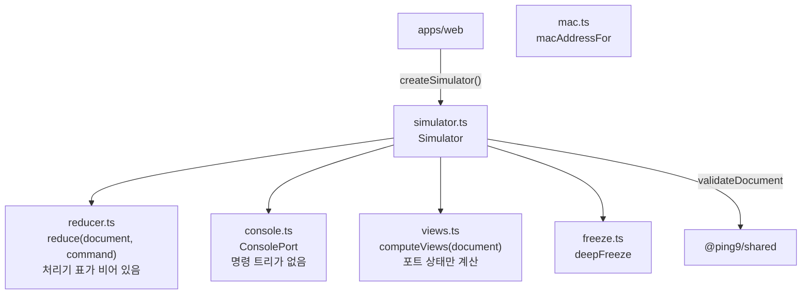

# T1.2.4 `Simulator` 뼈대

| 항목 | 내용 |
|---|---|
| Task | `T1.2.4` — [E1 작업 상세](../project-plan/04-tasks/epic-1-first-ping.md) |
| Story | 1.2 엔진과 화면의 계약이 타입과 예시 자료로 확정된다 |
| 영역 | 엔진 |
| 담당 | SDY |
| 기간 | 2026-11-05 |
| 브랜치 / PR | `feat/story-1.2-contract` → `main`에 병합 (병합 커밋 `df29791`). PR 없음 |
| 상태 | 완료. 다른 팀원의 검토 없이 병합함 (저장소 소유자 결정) |

## 1. 목표와 완료 기준

- [x] web이 `Simulator`만 import해 예시 Document를 불러오고 스냅샷을 받는다 (AD-16).
- [x] `load`, `getSnapshot`, `subscribe`, `dispatch`, `console`, `getTrace`가 빈 동작으로라도 타입대로 응답한다.
- [x] 스냅샷이 변경 불가능하고, `docVersion`과 `runtimeVersion`이 있다.
- [x] 알 수 없는 `Command`는 오류 결과로 돌려준다. 사용자 입력 때문에 예외를 던지지 않는다.
- [ ] 다른 사람이 Pull Request를 검토했다.

## 2. 진행 방식

1. [03 문서 3.4절](../project-plan/03-system-design.md#34-네트워크-실행-엔진)의 `Simulator`와 `ConsolePort`를 `packages/engine`에 인터페이스로 옮겼다.
2. `createSimulator()`를 만들고, 뒤에 올 Task가 채울 자리(reducer, 콘솔, 표시용 값)를 파일로 나눴다.
3. 포트 상태는 Document만으로 계산할 수 있어 지금 구현했다. 화면(B)이 첫날부터 링크와 포트 상태를 그릴 수 있다.
4. web의 자리표시 화면이 `createSimulator()`에 예시 Document를 불러와 요약을 그리게 바꿨다.

### 구조



| 파일 | 지금 하는 일 | 채울 Task |
|---|---|---|
| `simulator.ts` | 상태 보관, 버전 관리, 스냅샷 캐시, 구독 | T1.7.1에서 kernel과 Trace 보관을 연결 |
| `reducer.ts` | `handlers` 표에서 처리기를 찾음. 표가 비어 있어 모든 Command가 `UNKNOWN_COMMAND` | T1.3.1 `device/*`, T1.4.1 `link/*`, T1.5.1 `pc/set-ip` |
| `console.ts` | 프롬프트, 빈 줄, 줄 길이 한도, 없는 장비 처리. 그 밖의 모든 명령어는 `CLI_UNKNOWN_COMMAND` | T1.6.1 명령 트리, T3.2.x 완성과 도움말 |
| `views.ts` | Document에서 포트 상태 4종을 계산. 테이블은 빈 배열 | T1.7.3, T1.8.3에서 `DeviceModel.view()`가 테이블을 채움 |
| `mac.ts` | 장비 ID와 포트 순번에서 MAC 주소 계산 | — |

### 주요 결정

| 결정 | 이유 | 버린 대안 |
|---|---|---|
| `load()`는 `validateDocument()`를 거치고 결과 값을 돌려줌 | "engine의 불러오기가 이 함수를 쓴다"(AD-9)와 "예외를 던지지 않는다"(AD-16)를 함께 지키려면 실패를 값으로 돌려줘야 함 | 문서대로 `void`. 이 경우 깨진 문서에 대해 예외를 던지거나 조용히 무시해야 함 |
| `getTrace()`는 없으면 `undefined` | 같은 이유. 오래된 추적은 20개 한도로 사라질 수 있음 | 문서대로 `Trace`만. 없을 때 예외 |
| 스냅샷과 Document를 깊은 곳까지 얼림 (`Object.freeze`) | 화면이 스냅샷을 제자리에서 고치면 **그 자리에서 예외**가 남. 타입의 `readonly`는 `as`로 풀 수 있지만 얼린 값은 풀 수 없음 | 타입의 `readonly`만 믿음 |
| 바뀐 것이 없으면 `getSnapshot()`이 같은 참조를 돌려줌 | React의 `useSyncExternalStore(simulator.subscribe, simulator.getSnapshot)`에 그대로 넣을 수 있음. 매번 새 객체면 무한히 다시 그림 | 호출마다 새로 만듦 |
| `docVersion`과 `runtimeVersion`은 `load()` 때 0으로 돌아가지 않고 계속 오름 | 버전으로 변화를 감지하는 쪽이 "0에서 0"을 놓치지 않음 | `load()` 때 0으로 초기화 |
| 넣은 문서가 아니라 검증 함수가 돌려준 값을 보관 | 호출한 쪽의 객체가 얼지 않고, 호출한 쪽이 나중에 그 객체를 고쳐도 engine의 상태가 바뀌지 않음 | 넣은 값을 그대로 얼림 |
| 처리기가 없는 Command도 `UNKNOWN_COMMAND` | 임시 오류 코드를 만들면 화면의 문구 목록에도 임시 항목이 생김. 처리기가 채워지면 저절로 사라짐 | `COMMAND_NOT_IMPLEMENTED` 코드 추가 |
| MAC 주소 계산 함수를 지금 만듦 | [T1.2.3](T1.2.3-example-data.md)의 기대 Trace에 MAC 주소가 적혀 있어, engine이 같은 값을 만든다는 것을 지금 테스트로 고정해야 함 | T1.7.2까지 미룸 |

## 3. 변경 내용

| 파일 | 내용 |
|---|---|
| `packages/engine/src/simulator.ts` | `Simulator`, `LoadResult`, `createSimulator()` |
| `packages/engine/src/console.ts` | `ConsolePort`, `createConsolePort()` |
| `packages/engine/src/reducer.ts` | `reduce()`, `ReduceResult`, `CommandHandler<T>`, 빈 처리기 표 |
| `packages/engine/src/views.ts` | `computeViews()` |
| `packages/engine/src/mac.ts` | `macAddressFor()` |
| `packages/engine/src/freeze.ts` | `deepFreeze()` |
| `packages/engine/src/index.ts` | `createSimulator`, `macAddressFor`, 타입 `Simulator`, `LoadResult`, `ConsolePort`만 내보냄 |
| `packages/engine/src/*.test.ts` | 테스트 70개 |
| `apps/web/src/app.tsx`, `app.test.tsx` | 자리표시 화면이 `Simulator`에 예시를 불러와 요약을 그림 |
| `apps/api/src/index.ts`, `index.test.ts` | 자리표시 정리. `shared`의 검증 절차를 불러오는 테스트 |

## 4. 결과와 검증

```text
> pnpm --filter @ping9/engine test
  src/simulator.test.ts            63 passed
  src/mac.test.ts                   6 passed
  src/simulator.property.test.ts    1 passed
> pnpm --filter @ping9/web test
  src/app.test.tsx                  1 passed   (그 밖에 contract.test.ts 5개)
> pnpm --filter @ping9/api test
  src/index.test.ts                 2 passed
```

Task의 테스트 방법 세 가지:

| 확인할 것 | 테스트가 본 것 |
|---|---|
| 스냅샷 불변성 | 스냅샷의 버전, 장비 이름, 좌표, 배열, 표시용 값, 추적 목록을 고치려 하면 모두 `TypeError`. JSON으로 적었다가 읽어도 같음 (함수, `Map`, 클래스 인스턴스 없음) |
| 버전 증가 규칙 | 처음은 0/0. `load()`마다 둘 다 1 증가. 거부된 `load()`와 거부된 `dispatch()`에서는 스냅샷의 참조가 그대로이고 구독자도 불리지 않음 |
| 예외를 던지지 않음 | `load()`에 문서가 아닌 값 6종, `dispatch()`에 Command 18종과 Command가 아닌 값 8종(`null`, `{ type: 5 }`, `{ type: "__proto__" }` 등), `exec()`에 긴 줄과 문자열이 아닌 값, 없는 장비의 콘솔 |

속성 기반 테스트 (PBT-9의 뒷부분): 예시 문서를 한 곳씩 바꾼 값 1,000개를 `load()`에 넣음. `load()`의 통과 여부가 `validateDocument()`와 항상 같았고, 통과한 33개는 모두 스냅샷과 장비별 콘솔 프롬프트가 만들어짐.

포트 상태: 링크가 있으면 `up`, 없으면 `no-link`, 끈 포트는 `admin-down`(링크가 없어도 이것이 먼저), 상대 포트가 꺼져 있으면 `peer-down`.

전체 검사와 배포:

```text
> pnpm check   (새로 복제한 폴더에서, 커밋 9832791)
  lint 통과 / typecheck 4개 패키지 / test 346개 통과 (shared 268, engine 70, web 6, api 2) / build 4개 패키지
> Vercel 미리보기 빌드 (커밋 9832791)
  success | Deployment has completed
```

web 묶음의 크기: `index-*.js` 328.57 kB (gzip 100.21 kB). T1.1.1의 219.84 kB에서 늘었습니다. 자리표시 화면이 예시 자료와 Zod를 포함하기 때문입니다.

`main` 병합과 운영 배포 (Story 1.2 전체):

병합하려는 사이에 팀원(`yysong1249`)의 PR #1(T0.2 화면 시안 페이지, `apps/web/public/mockup.html`)이 `main`에 들어와 있어 fast-forward가 되지 않았습니다. 팀원의 커밋을 그대로 두고 병합 커밋으로 합쳤습니다. 겹친 파일은 `docs/task-logs/README.md` 하나였고, 양쪽의 줄을 모두 남겼습니다.

```text
> git push origin main            (첫 시도)
  rejected: 원격 main에 커밋 2개가 더 있음 (7221e88, a2936a7)
> git merge --no-ff origin/main
  CONFLICT (content): docs/task-logs/README.md   → 양쪽 줄을 모두 남김
> pnpm check                      (병합한 상태에서)
  test 346개 통과, build 통과, dist에 index.html과 mockup.html      [exit 0]
> git push origin main            → df29791
> gh api repos/TL-cg11/PING9/commits/df29791/status
  success | Deployment has completed
> curl https://ping9.vercel.app/              200
> curl https://ping9.vercel.app/mockup.html   200   (팀원의 시안 페이지가 그대로 열림)
```

브라우저에서 `https://ping9.vercel.app/`을 열어 확인: "예시 토폴로지: 장비 2대 (PC1, PC2), 링크 1개"가 그려지고 콘솔 오류가 없습니다. 화면이 engine의 `Simulator`에 `shared`의 예시 Document를 불러와 스냅샷을 읽었다는 뜻입니다.

실행하지 않은 것:

- `dispatch()`가 받아들여지는 경우. 처리기가 하나도 없어 "받아들여지면 `docVersion`이 1 오르고 Document의 참조가 바뀐다"는 규칙은 코드에는 있지만 테스트로 확인하지 못했습니다. T1.3.1에서 첫 처리기와 함께 확인해야 합니다.

## 5. 추정과 실제

| 추정 (인일) | 실제 (인일) | 차이의 이유 |
|---|---|---|
| 1.0 | 약 0.1 | Claude가 작성함 |

## 6. 계획과 달라진 점

| 항목 | 계획 문서 (03 문서 3.4절) | 실제 | 이유 |
|---|---|---|---|
| `load()`의 반환 | `void` | `{ ok: true } \| { ok: false, error }` | 2절의 결정 참조 |
| `getTrace()`의 반환 | `Trace` | `Trace \| undefined` | 2절의 결정 참조 |
| 버전의 시작 | "Document를 열 때 0으로 시작"은 가상 시계에 관한 문장. 버전에 관한 규칙은 없음 | `load()`마다 계속 오름 | 2절의 결정 참조 |
| 포트 상태 계산 | Task에 없음 (T1.7.3의 `view()`) | 이 Task에서 구현 | Document만으로 계산되고, 화면이 바로 쓸 수 있음 |
| MAC 주소 계산 함수 | T1.7.2 | 이 Task에서 구현 | 2절의 결정 참조 |
| 담당 | [PC 2대 계획](../project-plan/06-two-pc-ping-plan.md)에서는 A | 먼저 작성함 | 세 사람이 시작하기 전에 필요한 것이어서 |

`load()`와 `getTrace()`의 반환 타입은 문서와 다르므로 **팀 합의 뒤 03 문서를 고쳐야** 합니다.

## 7. 남은 일과 다음 Task에 전할 것

- **A (T1.7.1 kernel)**: `simulator.ts`의 `traces`에 `{ trace, summary }`를 앞에 넣고 20개를 넘으면 뒤를 버립니다. Runtime이나 추적 목록이 바뀌면 `runtimeVersion`을 올리고 `changed()`를 부릅니다.
- **A (T1.7.2)**: MAC 주소는 `macAddressFor(deviceId, portIndex(kind, port))`로 얻습니다. 다른 곳에서 MAC 주소를 만들지 않습니다.
- **A (T1.7.3, T1.8.3)**: `views.ts`의 빈 테이블(`arpTable`, `macTable`)을 장비 모델의 `view()`로 채웁니다.
- **C (T1.3.1 ~ T1.5.1)**: `reducer.ts`의 `handlers`에 처리기를 추가합니다. 처리기는 받은 Document를 고치지 않고 새 객체를 돌려줍니다. Document는 얼어 있어 제자리에서 고치면 예외가 납니다. 첫 처리기를 넣을 때 4절의 "실행하지 않은 것"(받아들여진 `dispatch()`의 버전 규칙)을 테스트로 채워 주세요.
- **C (T1.6.1)**: `console.ts`의 `exec`가 지금 `CLI_UNKNOWN_COMMAND`를 돌려주는 자리에 명령 트리의 해석기를 연결합니다. 장비의 CLI 세션(모드)은 Runtime에 두어야 하므로 `createConsolePort`의 인자가 늘어날 것입니다.
- **B (T1.3.2)**: 화면은 `useSyncExternalStore(simulator.subscribe, simulator.getSnapshot)`으로 스냅샷을 받습니다. `apps/web/src/app.tsx`의 모듈 수준 `simulator`는 자리표시이니 store로 옮기세요.
- **E4 (T4.1.x)**: 구성에 없는 Router 인터페이스를 "꺼짐"으로 본 것은 🟡 가정입니다 (`views.ts`의 `isAdminUp`).
- 마지막 8자리가 같은 UUID 둘은 같은 MAC 주소를 갖습니다. 장비 50대에서 겹칠 확률은 천만 분의 3 정도라 따로 막지 않았습니다.
