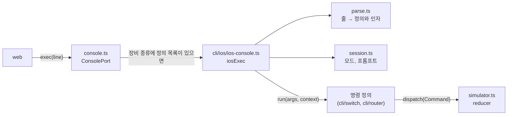

# T3.1.1 명령 트리 확장: 모드와 세션

| 항목 | 내용 |
|---|---|
| Task | `T3.1.1` — [E3 작업 상세](../project-plan/04-tasks/epic-3-cli.md) |
| Story | 3.1 콘솔에서 CLI 모드를 오간다 |
| 영역 | 엔진 |
| 담당 | SDY |
| 기간 | 2026-11-05 |
| 브랜치 / PR | `feat/T3.1.1-cli-modes-and-session` / PR 아직 없음 |
| 상태 | 구현 완료. PR과 검토 남음 |

설계: [스위치와 VLAN 설계](../superpowers/specs/2026-11-05-switch-vlan-design.md) 7절 · 계획: [첫 화면까지](../superpowers/plans/2026-11-05-switch-vlan-first-screen.md) Task 1, 2

## 1. 목표와 완료 기준

- [x] 명령 정의 하나를 추가하면 해석과 프롬프트가 따로 수정 없이 동작한다 (AD-8).
- [x] 장비별 CLI 세션(현재 모드, 대상 인터페이스·VLAN)을 Simulator가 보관한다.
- [x] 프롬프트를 계산한다: `이름>`, `이름#`, `이름(config)#`, `이름(config-if)#`, `이름(config-vlan)#`.
- [x] 현재 모드에서 쓸 수 없는 명령어를 거부한다 (`CLI_WRONG_MODE`).
- [x] lint, 타입 검사, 단위 테스트, 빌드가 통과한다.
- [ ] 다른 사람이 Pull Request를 검토했다.

모드 전환 규칙 자체(어느 명령이 어느 모드로 가는가)는 명령 정의에 들어 있으므로 T3.1.2에서 `enable`, `configure terminal` 등을 넣으면서 표로 테스트한다.

## 2. 진행 방식

1. `packages/engine/src/cli/ios`를 만들었다. 이 폴더는 장비 종류를 모른다. Switch와 Router가 각자의 명령 정의 목록을 얹어 쓴다.
2. 테스트를 먼저 쓰고 실패를 확인한 뒤 구현했다 (해석기 → 세션과 프롬프트 → 콘솔 실행).
3. `console.ts`가 장비 종류별 정의 목록(`DEFINITIONS_BY_KIND`)을 보고 `cli/ios`로 넘기게 했다. 지금은 목록이 비어 있어 모든 장비의 동작이 전과 같다.
4. `simulator.ts`에 장비별 세션 보관소를 두고, `load()`가 성공하면 비우게 했다.

### 구조



### 주요 결정

| 결정 | 이유 | 버린 대안 |
|---|---|---|
| 명령 정의의 형태는 `{ modes, devices?, tokens, help, run }` | 03 문서 3.4절의 `defineCommand`를 따름. 해석, 프롬프트, (뒤의 Task에서) 줄임·완성·도움말이 이 목록 하나에서 나옴 | 장비별로 `switch`문을 쓰는 해석기 |
| `no` 형식을 처리기 필드가 아니라 일반 키워드로 정의 (`["no", "vlan", …]`) | 해석·도움말·완성이 `no`를 따로 다룰 필요가 없음. 정의된 `no` 명령어만 입력되므로 FR-22의 "정의에 있는 것만 허용"이 그대로 성립 | 정의에 `no` 처리기 필드 |
| 오류는 "가장 많은 단어가 일치한 정의"의 것을 고름. 같으면 미완성 > 값 오류 > 남는 단어 > 불일치 | 정의 둘이 앞부분을 공유할 때 더 깊은 곳의 오류가 사용자에게 유용함 | 정의 순서대로 첫 오류 |
| VLAN 번호는 십진수 숫자(`/^[0-9]{1,9}$/`)만 수로 읽음 | `1e1`, `0x10`, `10.0`, `-1`이 `Number()`로 수가 되는 것을 막음 | `Number(text)`로 읽고 범위만 검사 |
| 하위 설정 모드에서 config 모드의 명령을 받아들임 | IOS와 같음 (`config-vlan`에서 `vlan 20`, `interface fa0/1`) | 하위 모드에서는 `exit` 뒤에만 허용 |
| 세션이 바뀌어도 `runtimeVersion`을 올리지 않고 구독자를 부르지 않음 | 프롬프트는 `ConsoleResult`에 담겨 돌아가므로 화면이 다시 그릴 것이 없음 | 세션을 스냅샷에 담기 |
| 설정 중이던 VLAN이 사라지면 config 모드로 돌아감 (`effectiveSession`) | 다른 경로(화면, 다른 터미널)에서 지워져도 없는 대상을 계속 가리키지 않게 함 | 그대로 두고 다음 명령에서 오류 |

## 3. 변경 내용

| 파일 | 변경 |
|---|---|
| `packages/engine/src/cli/ios/define.ts` | 새로. `CliMode`, `CliSession`, `CommandDefinition`, `defineCommand`, `param` |
| `packages/engine/src/cli/ios/parse.ts` | 새로. `parseLine`: 줄 → 정의와 인자, 또는 오류 코드와 틀린 단어의 위치 |
| `packages/engine/src/cli/ios/session.ts` | 새로. `INITIAL_SESSION`, `promptFor`, `effectiveSession`, `linesFromDispatch` |
| `packages/engine/src/cli/ios/ios-console.ts` | 새로. `iosExec`, `iosPrompt`, `IosConsoleEnv` |
| `packages/engine/src/cli/ios/index.ts` | 새로. 위 이름을 내보냄 |
| `packages/engine/src/console.ts` | `createConsolePort`의 두 번째 인자를 `IosConsoleEnv`로. 장비 종류별 정의 목록이 있으면 `cli/ios`로 넘김 |
| `packages/engine/src/simulator.ts` | 세션 보관소, `load()` 때 비움, 콘솔에 `dispatch` 전달 |
| `packages/engine/src/**/*.test.ts` | 해석기 22개, 세션 12개, 콘솔 실행 6개, Simulator 1개 테스트 추가 |
| `docs/superpowers/` | 설계 문서, 화면 시안, 구현 계획 |

## 4. 결과와 검증

```text
$ pnpm check
ℹ pass 35
ℹ fail 0
packages/shared test:  Test Files  5 passed (5)
packages/shared test:       Tests  268 passed (268)
apps/api test:  Test Files  1 passed (1)
apps/api test:       Tests  2 passed (2)
packages/engine test:  Test Files  6 passed (6)
packages/engine test:       Tests  111 passed (111)
apps/web test:  Test Files  2 passed (2)
apps/web test:       Tests  6 passed (6)
apps/web build: ✓ built in 221ms

$ pnpm check:secrets
비밀값 검사 통과: 파일 387개
```

engine 테스트는 70개에서 111개가 됐다. 기존 테스트는 고치지 않았고 모두 통과한다.

화면에서의 확인은 하지 않았다. 이 Task에는 사용자가 칠 수 있는 명령어가 아직 없다 (T3.1.2에서 들어온다).

## 5. 추정과 실제

| 추정 (인일) | 실제 (인일) | 차이의 이유 |
|---|---|---|
| 2.0 | 측정하지 않음 (한 작업 세션 안에서 끝남) | 설계 문서에서 형태를 먼저 정했고, 줄임·완성·도움말은 뒤의 Task로 남김 |

## 6. 계획과 달라진 점

- **분담이 계층별에서 장비별로 바뀌었다.** [06 문서](../project-plan/06-two-pc-ping-plan.md) 6.3절과 6.5절은 `cli`를 C(계약과 구성 변경)에게 배정했다. 지금은 PC, Switch, Router로 나누며, 이 Task는 Switch 담당이 했다.
- **T1.6.1의 "명령 정의 형태와 해석기"를 여기서 만들었다.** T3.1.1의 선행인 T1.6.1이 아직 없어서다. PC 명령어(`ipconfig` 등)는 만들지 않았다.
- **`no` 형식을 일반 키워드로 정의한다.** 03 문서 3.4절은 "정의에 `no` 처리기가 있는 명령어만 허용"이라고 적었다. 결과는 같다.
- **`serialize`는 넣지 않았다.** `show running-config`(T3.4.1)에서 더한다.
- **PC의 CLI는 이 명령 트리를 쓰지 않아도 된다.** AD-8은 "명령 트리 하나"를 전제로 한다. Switch와 Router는 `cli/ios`를 함께 쓰고, PC는 담당의 판단에 맡긴다.

## 7. 남은 일과 다음 Task에 전할 것

- **Router 담당에게**: `enable`, `configure terminal`, 모드, 프롬프트, 해석기를 다시 만들지 않는다. `packages/engine/src/cli/router/`에 명령 정의 목록을 만들고 `console.ts`의 `DEFINITIONS_BY_KIND`에 `router: ROUTER_COMMANDS` 한 줄을 더하면 된다. IPv4·마스크 같은 매개변수 타입은 `define.ts`의 `ParamType`과 `parse.ts`의 `readParam`에 더한다.
- **PC 담당에게**: `console.ts`에서 PC 분기를 더하면 된다. `cli/ios`를 써도 되고 따로 만들어도 된다.
- 줄임 입력(T3.2.1), Tab 완성과 `?` 도움말(T3.2.2), 오류 분류의 나머지(T3.5.1)는 `parse.ts`의 일치 결과를 그대로 쓴다. `complete`와 `help`는 지금 `null`과 `[]`를 돌려준다.
- `CliSession.targetPort`는 형태만 있다. `interface` 명령(T3.3.1)에서 쓴다.
