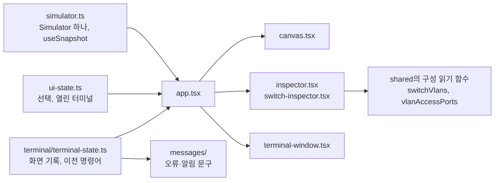

# T5.4.1 Switch 화면: 틀, 캔버스, 터미널 창, 속성 패널

| 항목 | 내용 |
|---|---|
| Task | `T5.4.1` — **계획 문서에 없는 새 ID.** E5([작업 상세](../project-plan/04-tasks/epic-5-vlan.md))에 화면 Task가 없어 다음 번호를 붙였다 |
| Story | 5.1 VLAN을 만들고 지운다 (화면 쪽) |
| 영역 | 화면 |
| 담당 | SDY |
| 기간 | 2026-11-05 ~ 2026-11-06 |
| 브랜치 / PR | `feat/T5.4.1-switch-screen` (`feat/T5.1.1-vlan-config`에서 가지를 침) / [PR #7](https://github.com/TL-cg11/PING9/pull/7) |
| 상태 | 구현 완료. PR과 검토 남음 |

설계: [스위치와 VLAN 설계](../superpowers/specs/2026-11-05-switch-vlan-design.md) 8절 · 시안: [화면 시안](../superpowers/specs/2026-11-05-switch-vlan-mockup.html) · 계획: [첫 화면까지](../superpowers/plans/2026-11-05-switch-vlan-first-screen.md) Task 7 ~ 9

## 1. 목표와 완료 기준

- [x] 브라우저에서 Switch 터미널에 `enable` → `configure terminal` → `vlan 30` → `name LAB` → `end` → `show vlan brief`를 치면 속성 패널의 VLAN 목록이 바로 바뀐다.
- [x] 화면의 색, 글꼴, 간격, 터미널 창의 모양이 시안과 같다.
- [x] 화면이 VLAN 소속이나 포트 상태를 직접 계산하지 않는다 (AD-7).
- [x] 터미널을 닫았다 열어도 출력과 모드가 남는다 (FR-19).
- [x] lint, 타입 검사, 단위 테스트, 빌드가 통과한다.
- [ ] 다른 사람이 Pull Request를 검토했다.

## 2. 진행 방식

1. **틀과 캔버스**: 시안의 `<style>`에서 필요한 규칙을 값 그대로 꺼내 `editor.css`로 옮겼다 (줄 범위로 뽑는 스크립트를 썼고, 고친 것은 `.app`의 행 수 하나다). 로고 이미지도 시안에서 꺼냈다. 노드의 모양은 시안의 그리기 코드를 React로 옮겼다.
2. **터미널 창**: 화면 기록과 이전 명령어를 순수 함수(`terminal-state.ts`)로 만들고, 창(`terminal-window.tsx`)은 받은 상태를 그리기만 하게 했다.
3. **한국어 문구**: 모든 오류 코드와 알림 코드의 문구를 `Record`로 만들었다. 코드를 더하고 문구를 빠뜨리면 타입 검사가 실패한다 (AD-14).
4. **속성 패널**: 시안의 `selectDevice`가 만드는 마크업을 따랐다.
5. 테스트는 기존 방식대로 `renderToString`과 순수 함수 테스트만 썼다. DOM 테스트 도구를 더하지 않았다.

### 구조



### 주요 결정

| 결정 | 이유 | 버린 대안 |
|---|---|---|
| CSS를 시안에서 그대로 옮김. Tailwind를 쓰지 않음 | 디자인은 시안을 그대로 따르기로 했다. 값을 다시 적으면 어긋난다 | Tailwind로 다시 작성 |
| 캔버스를 SVG로, 읽기 전용으로 | 시안이 SVG이고, 끌어다 놓기와 연결이 이번 범위에 없다 | `@xyflow/react` (끌어다 놓기를 만드는 Task에서 정한다) |
| 터미널을 xterm이 아닌 입력란 한 줄로 | 시안이 그렇게 되어 있다. 03 문서 3.12절이 허용한 대체안이고 `ConsolePort` 경계가 같아 나중에 바꿔도 engine은 바뀌지 않는다 | `@xterm/xterm` |
| 화면 상태를 `useReducer`와 순수 reducer로 | 선택과 창 배치뿐이라 작다. DOM 없이 테스트할 수 있다 | Zustand (상태가 늘어나면 그때 옮긴다) |
| 장비마다 앞 명령이 끝난 뒤에 다음 명령을 실행 (`terminal/command-queue.ts`). 실패한 실행은 그 터미널에 오류 줄로 남기고 다음 명령은 계속 받음 | `exec`가 비동기라 Enter를 연달아 누르면 줄의 순서가 섞일 수 있다. 처음에는 `app.tsx` 안의 Promise 사슬이었는데, 테스트가 없고 한 번 실패하면 그 터미널이 멈춘다는 검토 지적을 받아 따로 떼어 테스트했다 | 실행 중에는 입력을 막음 |
| 입력의 탭 문자는 지우지 않고 공백으로 바꿈 | 탭으로 띄운 줄을 붙여 넣으면 단어가 붙어 "알 수 없는 명령어"가 됐다 (검토에서 발견). 그 밖의 제어 문자는 지운다 | 모든 제어 문자를 지움 |
| VLAN의 소속 포트를 `Fa0/3~7`처럼 범위로 줄여 보임 | 시안의 표기다. 하나씩 나열하면 속성 패널(270px) 밖으로 넘친다 (브라우저 확인에서 발견) | `Fa0/3, Fa0/4, …` 나열 |
| 수 뒤의 조사를 함수로 고름 (`VLAN 10이`, `VLAN 2가`) | 고정 문구면 번호에 따라 어색하다 | `이(가)` 표기 |
| 캔버스의 `viewBox`는 시안의 860×330을 기본으로 하고, 장비가 벗어난 쪽만 넓힘 | 예시 문서가 시안과 똑같이 보인다 | 항상 모든 장비 둘레에 여백을 줌 |

## 3. 변경 내용

| 파일 | 변경 |
|---|---|
| `apps/web/index.html` | 시안의 글꼴 `<link>` (Pretendard, Nunito, JetBrains Mono) |
| `apps/web/public/logo.png` | 새로. 시안의 로고 이미지 |
| `apps/web/src/styles/editor.css` | 새로. 시안의 CSS |
| `apps/web/src/index.css` | 자리표시 화면의 규칙을 지우고 `editor.css`를 가져옴 |
| `apps/web/src/simulator.ts` | 새로. 앱의 `Simulator` 하나와 `useSnapshot` |
| `apps/web/src/ui-state.ts` | 새로. 선택한 장비, 열린 터미널의 위치와 쌓이는 순서 |
| `apps/web/src/terminal/terminal-state.ts` | 새로. 화면 기록, 프롬프트, 이전 명령어, `runLine` |
| `apps/web/src/terminal/command-queue.ts` | 새로. 장비별 실행 대기열 |
| `apps/web/src/messages/errors.ts`, `notices.ts`, `particles.ts` | 새로. 오류 코드 40개(T1.5.1의 `PC_ADDRESS_INCOMPLETE` 포함)와 알림 코드 2개의 한국어 문구 |
| `apps/web/src/format/port-list.ts` | 새로. 포트 목록의 범위 표기 |
| `apps/web/src/components/` | 새로. `top-bar`, `palette`, `canvas`, `inspector`, `switch-inspector`, `terminal-window` |
| `apps/web/src/app.tsx`, `app.test.tsx` | 자리표시 화면을 편집기 화면으로 바꿈 |

## 4. 결과와 검증

```text
$ pnpm check
ℹ pass 35
ℹ fail 0
packages/shared test:  Test Files  7 passed (7)
packages/shared test:       Tests  294 passed (294)
apps/api test:  Test Files  1 passed (1)
apps/api test:       Tests  2 passed (2)
packages/engine test:  Test Files  11 passed (11)
packages/engine test:       Tests  183 passed (183)
apps/web test:  Test Files  10 passed (10)
apps/web test:       Tests  112 passed (112)
apps/web build: ✓ built

$ pnpm check:secrets
비밀값 검사 통과
```

### 브라우저에서 직접 해 본 것

로컬 개발 서버(`pnpm dev`, `http://localhost:5173`), 화면 크기 1440×860에서 확인했다.

| # | 한 것 | 결과 |
|---|---|---|
| 1 | SW1을 누름 | 속성 패널에 VLAN 1·10·20과 포트 8개가 보임. VLAN 1의 포트는 `Fa0/3~7` |
| 2 | SW1을 더블클릭 | 터미널이 열리고 프롬프트가 `SW1>`. 입력란에 바로 입력할 수 있음 |
| 3 | `enable`, `configure terminal`, `vlan 30`, `name LAB` | 프롬프트가 `SW1(config-vlan)#`. **속성 패널에 `VLAN 30 LAB`이 바로 생김** |
| 4 | `end`, `show vlan brief` | 열이 맞게 나오고 `30    LAB      active` 줄이 있음 |
| 5 | `no vlan 30`, `no vlan 1` | 패널에서 VLAN 30이 사라짐. `no vlan 1`에는 빨간 줄 "VLAN 1은 지우거나 이름을 바꿀 수 없어요" |
| 6 | 위 화살표, 창을 닫았다가 SW1을 다시 더블클릭 | 이전 명령어가 입력란에 나옴. 다시 열어도 출력 9줄과 `SW1(config)#`이 남아 있음 |
| 7 | 제목 막대를 끌어 옮김, SW2와 PC1의 터미널을 엶 | 창이 옮겨지고, 나중에 연 창이 위에 옴 |
| 8 | PC1 터미널에 `ipconfig` | "알 수 없는 명령어예요: ipconfig" (PC 명령어는 다른 담당의 범위) |
| 9 | ``을 입력 | 글자 그대로 보이고 `` 요소가 만들어지지 않음 |
| 10 | 브라우저 콘솔 | 새로고침한 뒤의 오류 없음. 화면에 가로 스크롤 없음 |

확인하지 않은 것: 창의 모서리를 끌어 크기를 바꾸는 동작(CSS `resize: both`, 시안과 같은 규칙), 1440×860이 아닌 화면 크기, Chrome 계열이 아닌 브라우저.

## 5. 추정과 실제

| 추정 (인일) | 실제 (인일) | 차이의 이유 |
|---|---|---|
| 계획에 없는 Task라 추정 없음 | 측정하지 않음 (한 작업 세션 안에서 끝남) | — |

## 6. 계획과 달라진 점

- **계획 문서에 없는 Task ID(T5.4.1)를 썼다.** 틀(T1.1.4)과 콘솔(T1.6.2)은 범위가 훨씬 넓어 그 ID를 쓰면 끝난 것으로 읽힌다. 계획 문서 본문은 팀이 합의한 뒤에 고친다.
- **캔버스는 SVG, 터미널은 입력란, 스타일은 시안의 CSS다.** 계획(T1.1.4, T1.6.2)은 `@xyflow/react`, `@xterm/xterm`, Tailwind다.
- **오류·알림의 메시지 카탈로그를 T1.9.1보다 먼저 만들었다.** 이벤트 설명과 폐기 사유의 문구는 T1.9.1에 남겼다.
- **운영 주소의 `/`는 여전히 `mockup.html`이다** (`vercel.json`의 `routes`, T0.3). 이 화면은 운영에서 보이지 않고 로컬에서만 보인다. `vercel.json`은 건드리지 않았다.
- **화면 틀을 Switch 담당이 만들었다.** [06 문서](../project-plan/06-two-pc-ping-plan.md)는 `apps/web`을 B(화면)에게 배정했다.
- **T1.5.1의 오류 코드 `PC_ADDRESS_INCOMPLETE`의 문구를 여기서 넣었다** (2026-11-06, T1.5.1과 합치면서). 카탈로그가 모든 코드를 요구해서 문구가 없으면 타입 검사가 실패한다. 문구는 "IP 주소가 빠졌어요", "서브넷 마스크가 빠졌어요"로 임시로 정했다. PC 설정 패널(T1.5.2)을 만들 때 PC 담당이 고쳐도 된다.

## 7. 남은 일과 다음 Task에 전할 것

- **이 화면을 운영 주소에서 보이게 하려면** `vercel.json`의 `routes`를 팀이 정해야 한다 (`/`를 React 앱으로 돌리거나 다른 경로를 둔다).
- **PC·Router 담당에게**: `TerminalWindow`는 장비 종류를 모른다. `console.ts`에 자기 장비의 명령어를 넣으면 같은 창에서 바로 동작한다. 속성 패널은 `inspector.tsx`가 공통 부분(이름, 포트 목록, 터미널 열기)을 그리고 장비별 구역만 따로 끼운다.
- **시안에 있지만 아직 없는 것**: 실패 알림 띠, 노드의 느낌표, 속성 패널의 경고 줄, 하단의 실시간 막대와 이벤트·프레임 패널, 펭귄. 모두 ping이 실제로 돌아야 나온다. 그 부분의 CSS는 옮기지 않았다.
- 포트와 링크의 VLAN·trunk 표시(T5.2.1, T5.3.1), Tab과 `?`(T3.2.3), 오류 위치 표시 `^`(T3.5.2), 장비 놓기와 연결, 이름 바꾸기.
- VLAN 색은 시안의 세 가지(1, 10, 20)만 있다. 다른 번호는 회색이다. 나머지 색은 T5.2.1에서 정한다.
- 문서에서 사라진 장비의 터미널 화면 기록은 메모리에 남는다 (창은 닫힌다). 장비 삭제를 만드는 Task에서 함께 지운다.

### 검토에서 나왔고 고치지 않은 것

지금의 화면에서는 일어나지 않거나 겉모습에 그치는 것들이다. 해당 기능을 만드는 Task에서 함께 다룬다.

- **터미널의 프롬프트와 화면 기록은 마지막 실행 때의 값이다.** 다른 경로로 구성이 바뀌거나(예: 속성 패널에서 고치기) 같은 장비 ID의 문서를 다시 불러오면, 다음 Enter 전까지 옛 프롬프트가 보인다. engine의 프롬프트는 바르게 돌아간다. 가져오기나 패널 편집을 만드는 Task에서 `simulator.console(id).prompt()`를 그릴 때마다 읽고, 불러올 때 터미널을 비운다.
- **사라졌던 대상이 다시 생기면 옛 세션이 되살아난다.** config-vlan 10에서 VLAN 10이 지워졌다가 다른 경로로 다시 만들어지면 프롬프트가 `(config-vlan)#`으로 돌아온다. `ios-console.ts`가 config로 물러난 세션을 저장하지 않아서다 (T3.3.1에서 config-if를 넣을 때 함께 고친다).
- **`cli/ios/session.ts`가 Switch를 안다** (`switchVlans`, `device.kind === "switch"`). Router가 쓰는 데는 지장이 없다. config-if를 넣을 때 "대상이 아직 있는가"를 장비 쪽에서 넘겨받게 바꾼다.
- **모드가 틀린 명령의 오류가 고르지 않다.** privileged에서 `vlan 10`은 `CLI_WRONG_MODE`인데 `vlan abc`는 `CLI_UNKNOWN_COMMAND`다 (T3.5.1).
- **입력한 줄은 실행이 끝난 뒤에 화면에 나온다.** 지금은 바로 끝나서 보이지 않지만 ping처럼 오래 걸리는 명령이 생기면 그동안 아무것도 안 보인다.
- **VLAN 이름이 32자면 속성 패널의 줄이 가로로 넘친다** (확인하지 않음, 가능성 높음).
- **뒤에 있던 터미널을 누르면 스크롤 위치가 처음으로 갈 수 있다** (확인하지 않음). 쌓이는 순서를 배열의 순서로 두어 DOM이 옮겨지기 때문이다.
- **입력한 줄에서 이어진 공백이 하나로 보인다.**
- **글꼴을 jsDelivr와 Google Fonts에서 받는다.** 시안과 같다. 외부 요청을 둘지는 팀이 정한다.
